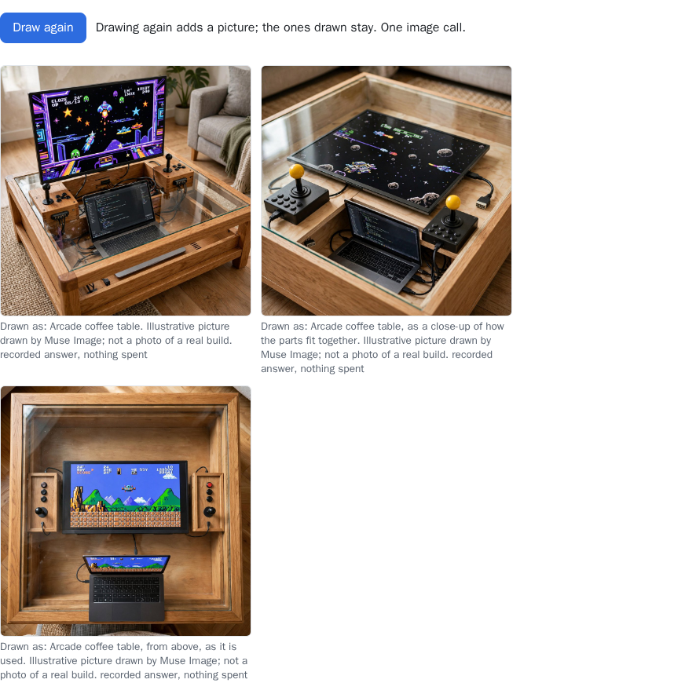
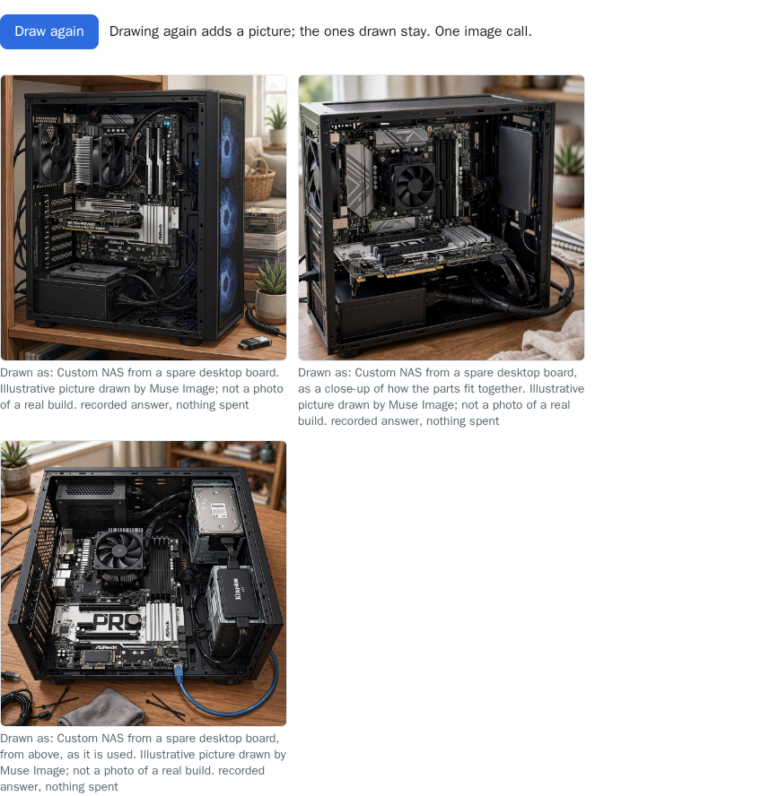
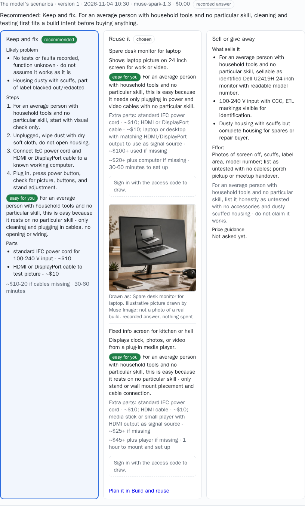
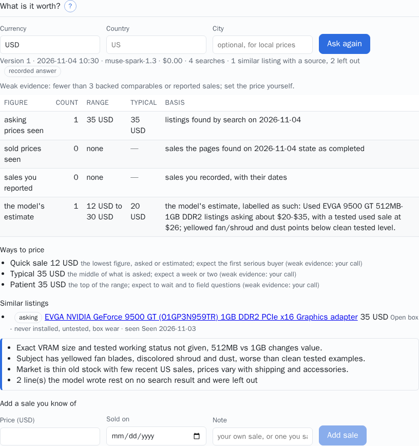

# Orphan Parts Lens for judges

**Start here:** the [demo video](https://www.youtube.com/watch?v=3USMv4zCeD0) (2:52), then
[run it on your own computer](#b-run-it-on-your-own-computer-the-main-path) on the recorded
answers: no key, nothing spent, every page open. The documentation is at
<https://nikolareljin.github.io/orphan-parts/>, with
[Examples: what the models produced](https://nikolareljin.github.io/orphan-parts/start/examples/).

Orphan Parts Lens turns the things in a drawer into a private inventory with evidence: a photo
of a label becomes values you confirm one by one, and from there each item is kept and fixed,
reused in a build, sold or given away, or completed with the part it is missing from Facebook
Marketplace. Meta's models read and write; rules decide what is kept.

**What the models produced**, from the demo set (recorded answers; the hosted demo shows the
same read-only), more on
[Examples](https://nikolareljin.github.io/orphan-parts/start/examples/):

<p>




</p>

## How to review

There is no access code for judges, and none is needed: a stack on your own computer has no
gate, so every page is open, and the demo set's recorded answers are in the repository.

### (a) Watch the video

[Orphan Parts Lens in 2:52](https://www.youtube.com/watch?v=3USMv4zCeD0), also on the docs
site under [Start > Demo video](https://nikolareljin.github.io/orphan-parts/start/video/).

### (b) Run it on your own computer (the main path)

The same app the hosted demo serves, on the demo set's recorded answers: no Model API key,
nothing spent, nothing leaves the computer.

**You need:**

- **Docker with Compose v2**: Docker Desktop on macOS or Windows, Docker Engine with the
  Compose plugin on Linux (`docker compose version` answers).
- **git** and **bash**.
- **On Windows: WSL 2** (Ubuntu from the Microsoft Store) with Docker Desktop's **WSL
  integration** turned on for it; run every command in the Ubuntu terminal and clone into the
  WSL home directory, not under `/mnt/c`.
- About **5 GB of free disk** for the images and the web app's packages, and ports 5173 and
  8000 free (`BACKEND_PORT` and `FRONTEND_PORT` move them).

**Start it:**

```bash
git clone https://github.com/nikolareljin/orphan-parts.git
cd orphan-parts
cp .env.example .env    # leave MODEL_API_KEY empty: the stack runs on recorded answers
./dev up                # builds once, then the web app on http://localhost:5173
./dev demo              # loads the demo set: 49 items with everything the models produced
```

The first `./dev up` builds the backend image and installs the web app's packages: a few
minutes, depending on the connection (about a minute and a quarter on a machine that already
had the base images). `./dev demo` takes about a minute. With an empty key `./dev up` says it is
*starting in fixture mode (recorded answers, no credits)*, and the foot of every page says
*recorded answers only (nothing spent)*; the header says *Open server (no code needed)*.

**A guided tour.** Open <http://localhost:5173>. The **?** beside each section explains what it
does and what the rules decide there; open a few as you go.

1. **My inventory**: the demo set, two drawers of the owner's own parts. **Open** the **Dell
   U2419H monitor, 24 inch**. Each item has tabs: **Facts** (its photos beside every value,
   each with where it came from), **Decide**, **Value**, **Sell or give away**, **Measure and
   fit** and **Picture**.
2. In the monitor, **Decide**: the three cards Muse Spark wrote (*Keep and fix*, *Reuse it*,
   *Sell or give away*), the one it recommends and the plan chosen; each *Reuse it* idea has the
   picture Muse Image drew for it, captioned as drawn. **Picture** shows the drawings kept for
   the item.
3. Open the **EVGA GeForce 9500 GT graphics card**: **Value** keeps the price guidance's four
   figures apart (asking, sold, reported by you, the model's estimate), each comparable with
   its page and date; **Sell or give away** has the whole Marketplace listing (title, price,
   category, condition, description, tags, photo order and the checklist).
4. **Build and reuse**: eleven projects proposed from the demo shelf, each with its drawing,
   its items and why they fit, what is still needed and the unknowns. Three are selected,
   with build packs, three drawings each and a search with Marketplace links for every
   missing part: a family photo NAS on the ASRock board, a gaming coffee table with the
   joystick module, a smart desk calendar on the UNO.
5. **Find a part**: the search for the frappé maker's agitator rod, with its plan (the search
   phrasings, each a Marketplace link, and the match pattern), its four candidates with the
   questions to ask each seller, and the maker's part (OEM 990010200) that **Search the web**
   found, with its link; and the pages found for the NAS's power supply.
6. **Read a label**, the sample gallery with the SAM 3.1 regions. On an open stack this page is
   the upload form; the gallery is what a visitor sees behind the gate. Run `./dev gate on` (it
   prints codes for you and a phone; you do not need them here), reload the page and stay
   signed out. Tick a photo, several, or **Select all photos of this item**, leave *Find the
   label in the photo first* on and press **Read the label**: under *Recorded answer for this
   sample.* each reading shows the SAM 3.1 pass (the regions it found, and a note for each of
   item, label and connector it did not), then every value Muse Spark read with its unit,
   confidence, source and the text as printed. `./dev gate off` opens the server again.
7. **Measure a feature**, in an item's **Measure and fit**: marks a ruler and a feature on one of
   the set's photos and computes the dimension, with its uncertainty, with no model call.

**Recorded and stand-in answers.** Everything the tour shows was saved from real model calls
when the demo set was recorded; each carries a *recorded answer* badge and costs nothing. A
stack without a key never calls a model. What you ask again is answered from the recordings:

- **Plan the search**, **Search the web** and the price guidance come back as recorded.
- A request that has no recording of its own gets a fixed **stand-in** answer, still badged
  *recorded answer* at $0.00, and **not about your item**: **Ask again** under **Decide** adds
  cards about a laptop battery; **Check fit** on a listing reads it as a 65 W laptop charger; a
  photo of your own on **Read a label** reads as the label of an *Orbital Power* 65 W adapter,
  whatever the photo shows. The earlier, recorded results stay listed under the new ones.
- **Draw it** and **Draw again** are off on a local stack (`PICTURE_ENABLED=0`): the page says
  *Drawing pictures is turned off on this server.* or *Pictures are off on this server.*; the
  drawings already made stay shown.
- **Propose** under **Build and reuse** answers *No idea fits what you own.*; the eleven
  recorded projects stay.

`./dev demo` puts the demo set back as loaded, whatever you clicked.

**Stop it:** `./dev down` stops the stack and keeps what you saved; `./dev down -v` also removes
its data volumes. The complete path, with the phone over the Wi-Fi, USB and a
troubleshooting table:
[Run it on your own computer](https://nikolareljin.github.io/orphan-parts/start/local/).

### (c) The hosted demo, read-only, while it is up

<https://orphan-parts.pages.dev>: nothing to install. It may be taken down after judging, and
after today it answers from the recordings only. Without a code it is the visitor view of the
same demo set: **Read a label** is the sample gallery from step 6 of the tour, and **My
inventory**, **Find a part**, **Build and reuse** and **Profile** show everything in steps 1
to 5, read-only. Buttons that would save, ask again, draw, plan or search show the sign-in
line instead (*Sign in with the access code to use this.*); nothing is saved and nothing is
spent. The line at the foot of the page says *Demo: recorded answers only*.

### (d) Optional: live models with your own key

Not needed to review it. To see the models read a photo of your own, get a key at
<https://dev.meta.ai> (**Billing**: a payment method; **API keys**: create one), set
`MODEL_API_KEY=<your key>` and `OPL_FAKE_API=0` in `.env`, set `PICTURE_ENABLED=1` for
drawings, and run `./dev up` again. Each call is charged to your key, at the rates under
[Costs and limits](#costs-and-limits); `SPEND_CAP_USD` in `.env` (25 by default) stops every
model call once that much has been spent through the stack.

### The Android app

The APK is on the [latest release](https://github.com/nikolareljin/orphan-parts/releases/latest):
[install it](#install-the-android-app), then [pair it](#pair-the-phone) with your local stack.

## What to look for

**Meta models, each with one job.**

| Model | Where you see it |
|---|---|
| Muse Spark | reads a label into typed values with a confidence each; finds the private details on each photo kept (product keys, MAC addresses, serials, passwords, QR codes) for the shared copies to black out; writes the decision cards, the ideas for what an item is good for, the Marketplace draft, the search plan and the build proposals; reads a listing brought back; searches the web for price guidance with citations |
| SAM 3.1 | looks for the item, the label and the connector in a photo, so the label crop is what gets read when one is found (the overlay under each reading, with a note when nothing was found) |
| Muse Image | **Draw it**: a picture of what an item could become or of a finished project, on a click only, always captioned as drawn and never used as evidence |
| Muse Voice Transcribe | a voice note from the phone's **Talk** tab or a capture, kept on the item as the owner's words |

Model IDs and request shapes are on [Meta models](https://nikolareljin.github.io/orphan-parts/models/).
Muse Wonder, Muse Glimmer and Muse Spark Open were considered and are not used; their pages say
what for.

**The rules decide, the model proposes.**

- Every value carries its source (*observed on a photo*, a label crop, a measurement, a
  listing, *stated by the owner*) and stays *to confirm* until accepted.
- **Does it fit?** ends in one verdict from a five-step
  [ladder](https://nikolareljin.github.io/orphan-parts/concepts/verdicts/) decided by the
  category's rules, never by the model. An unknown is never a pass; it becomes a question for
  the seller.
- A measurement is geometry from marks on a photo with a ruler, with its uncertainty; a
  blurred, oblique or unreferenced capture is refused with the reason.
- Price guidance keeps four figures apart (asking, sold, reported by you, the model's
  estimate), each comparable with its page and date, and calls weak evidence weak.
- A draft line that rests on nothing confirmed is dropped and listed; faults and what was not
  tested are always disclosed; a serial number, MAC address or IMEI never reaches the model.
- Nothing is posted, searched or fetched on Marketplace for you: no public API posts a personal
  listing or searches Marketplace, so the app prepares the fields and the search links and you
  run them.

## Install the Android app

The app runs on Android 8.0 and newer. It is not on Google Play, so it installs from this
repository's releases as an app from an unknown source.


1. Scan the QR code with the phone's camera, or open
   `https://github.com/nikolareljin/orphan-parts/releases/latest/download/orphan-parts.apk`
   in the phone's browser. The newest release's APK (about 8 MB) downloads. The
   [release page](https://github.com/nikolareljin/orphan-parts/releases/latest) carries the
   same file as `orphan-parts-<version>.apk` under **Assets**.
2. Open the download (the notification, or the browser's Downloads page). The APK is signed
   with the build's development key, not a Google Play key, so Android asks before installing:
   on the prompt tap **Settings**, turn on **Allow from this source** for the browser, and go
   back. On Android 8 and newer that permission is per app, under **Settings**, **Apps**,
   **Special app access**, **Install unknown apps** (menu names vary a little by maker); on
   older phones it is one switch, **Settings**, **Security**, **Unknown sources**.
3. Tap **Install**. If Play Protect says the app is from an unknown developer, tap **More
   details**, then **Install anyway**: every app installed outside Google Play carries a key
   that is not a store's.
4. Tap **Open**. The app opens on its **Backend** tab.
5. Scan it with Play Protect: in the **Google Play Store** app, tap the profile icon at the top
   right, **Play Protect**, **Scan**. The scan covers every installed app, this one included,
   and should report no harm. Then turn the permission from step 2 off again: **Settings**,
   **Apps**, **Special app access**, **Install unknown apps**, the browser, **Allow from this
   source** off.

### From a computer over USB (optional)

Only if you prefer a cable, or the phone's browser refuses the download. On the phone:
**Settings**, **About phone** (on Samsung, **About phone**, **Software information**), tap
**Build number** seven times; then **Developer options** (under **System** on some phones),
**USB debugging** on. On a Samsung phone with One UI 6 or newer, turn **Auto Blocker** off
first (**Settings**, **Security and privacy**, **Auto Blocker**): it blocks commands over USB.
Connect a cable that carries data, choose **File transfer** if asked, and
on **Allow USB debugging?** tick **Always allow from this computer** and tap **Allow**. Then one
command on the computer; it downloads Google's `platform-tools` (about 10 MB) when `adb` is
missing, then the latest release's APK, installs it and opens the app. No Java, Android SDK or
Docker is needed.

- **macOS, Linux, or WSL on Windows:**

  ```bash
  curl -fsSL https://raw.githubusercontent.com/nikolareljin/orphan-parts/main/scripts/phone-install.sh | bash
  ```

  From a clone of the repository: `bash scripts/phone-install.sh`.

- **Windows, in PowerShell**, from a clone or after downloading the script:

  ```powershell
  powershell -ExecutionPolicy Bypass -File scripts\phone-install.ps1
  ```

  If Windows does not see the phone, install the maker's USB driver (Samsung Smart Switch,
  Google USB Driver, and so on) and run it again.

`--version x.y.z` (`-Version x.y.z` on Windows) picks a release other than the latest; `--apk file.apk` (`-Apk`)
installs a file you already have.

## Pair the phone

With your local stack up, the phone reaches it over the Wi-Fi. Open the web app at the
computer's address on the Wi-Fi (for example `http://192.168.1.20:5173`), not at `localhost`
(on the phone, `localhost` is the phone), with the phone on the same Wi-Fi; the details,
firewall included, are in
[Run it on your own computer](https://nikolareljin.github.io/orphan-parts/start/local/#8-pair-the-phone).
Every screen, pictured:
[Pair the phone with the web app](https://nikolareljin.github.io/orphan-parts/start/pairing/).

1. At the foot of the page, open **Pair the phone**. A QR code appears, with the address to
   type under it. On an open stack it carries the server's address and nothing else.
2. In the app, on the **Backend** tab, tap **Scan to pair** and point the camera at the QR code
   on the other screen.
3. Tap **Check**. It says **Backend ok**, with `Model API fixture` on a stack that answers from
   recordings.

**Without Google Play services, or without a second screen:** type the address shown under the
QR code into **Backend URL** on the **Backend** tab exactly as shown, tap **Save**, then
**Check**.

**With the gate on** (`./dev gate on`, as in step 6 of the tour), sign in on the page with the
master code it printed before opening **Pair the phone**: the QR code then also carries a
pairing good for fifteen minutes, with which the app claims a code of its own (thirty days at
most), and never your code. Typing it in by hand, use the phone's code `./dev gate on` printed.
A QR code from a page that is not signed in pairs the phone as the demo (recorded answers,
nothing kept). **Unpair** on the **Backend** tab makes the phone forget the address, its code
and its session; `./dev keys revoke "phone …"` revokes the code on the server. With the
Android tools installed (`./dev setup --android`), `./dev phone` builds the app, installs it
over USB and prints the pairing code in the terminal.

### On the phone

- **Capture** tab: photos of the item and its label (the label filling the frame), a short
  video if it moves or makes a sound, hold to talk and say what you know, a name, **Send**.
- On the site, **Inbox**: the capture is there. **Read it** turns it into an item: the label
  read into values to confirm, your words kept as yours, the photos beside the values.
- **Talk** tab: for an item already in the inventory, hold and say what you know; the
  transcript is kept on the item and read back.
- From a laptop instead, the Inbox's **Send a capture from this computer** takes photos and a
  short MP4 or 3GP video.

## Costs and limits

- **On your own computer without a key, nothing is spent.** The Model API is never called:
  every answer is a recording or a stand-in, and the foot of the page says *recorded answers
  only (nothing spent)*.
- **On the hosted demo, nothing is spent either.** A visitor gets the recordings of the demo
  set's own photos and cannot upload one; each reading or measurement is a try, 20 per address
  and hour, and every request of any kind is held to 120 per address and minute.
- **With your own key**, each call is charged to it, and `SPEND_CAP_USD` (25 USD by default)
  stops every model call once the stack's ledger reaches it. The live calls used today show at
  the foot of every page.
- Rough cost per call at the published rates: a label read $0.003 to $0.008, finding the label
  $0.0025, a draft, the decision cards or a search plan under $0.01, a drawing $0.01, price
  guidance with web search $0.04 to $0.07, a build proposal $0.01 to $0.03.
- Limits on what goes in: four photos per reading, 12 MB per file, a video of 60 MB, a voice
  note of ten minutes.

## Privacy: what a visitor never sees

Items are private by default. The owner can mark an item public; the demo set loads that way.
A visitor to a gated server (the hosted demo, or your stack after `./dev gate on`) who is not
signed in sees a public item's values, photos and drawn pictures, and never:

- where it is kept, the owner's notes, a voice note or a clip;
- the lowest acceptable price, the reason for selling, the pickup area, the note said with a
  decision, or the sales the owner reported (a public item's drafts, price guidance, Decide
  cards, ideas and the plan chosen are shown as saved, masked like the item);
- a search made from values or for a private item, a project with a private item on it, an
  outcome not shared, the notes on a search or a listing, the budget or the radius, or the
  Inbox's private captures. The searches for public items, their candidates and listings, the
  projects built on public items alone and the skills are shown read-only.

Photos are re-encoded on arrival, with EXIF and GPS dropped; the phone re-encodes before
sending. Product keys, MAC addresses, serial numbers, passwords, QR codes and barcodes found on
a photo are blacked out on every copy a visitor or a download gets, and a photo not checked is
not shown to a visitor at all. A serial number, MAC address or IMEI never goes to a model as
text. A session is one cookie that holds no account; issued codes are kept as hashes and logged
by their label only. Nothing is posted or searched anywhere on anyone's behalf. Details:
[Privacy](https://nikolareljin.github.io/orphan-parts/operations/privacy/), and what is
blacked out on a photo, pictured:
[Private details on photos](https://nikolareljin.github.io/orphan-parts/guides/private-details/).

## If something does not work

| What you see | What to do |
|---|---|
| The browser will not open the APK, or "blocked by your admin" | Open it from the browser's Downloads page, or [install over USB](#from-a-computer-over-usb-optional) |
| "App not installed" | An earlier release is on the phone: each release is signed with a fresh development key, and Android refuses an update under another key. Uninstall it (**Settings**, **Apps**, **Orphan Parts Lens**, **Uninstall**), then install again |
| Play Protect: "unsafe app blocked" or "unknown developer" | **More details**, **Install anyway**; then a Play Protect scan (step 5 of the install) checks it |
| `phone-install`: "the phone has not allowed this computer" | Unlock the phone, tick **Always allow**, tap **Allow** on its prompt, run again |
| `phone-install`: "no phone found" | A cable that carries data; **USB debugging** on; **File transfer** chosen; on Windows the maker's USB driver |
| The install over USB fails on a Samsung phone | **Auto Blocker** is on: **Settings**, **Security and privacy**, **Auto Blocker**, off |
| The app: "that code points at localhost" | The site was opened at `localhost`; open it at the computer's network address |
| **Check**: "Not reachable" | The phone is off the server's network, the address has a typo, or (on your own computer) the firewall blocks port 5173; the hosted address is `https://`, a local one `http://…:5173` |
| **Check**: "The code is refused" | The code was mistyped or has expired |
| "This phone's code has ended or was revoked; scan the code on a signed-in page" | The phone's own code, or the code that paired it, has ended or was revoked; the app has cleared it: sign in on the site with a current code (`./dev gate show` prints the master) and scan again |
| After a scan: "no code of its own: the pairing has ended" | The fifteen minutes ran out before the claim: reload the signed-in page and scan its new code |
| After a scan: "no code of its own: the code that paired this phone has ended" | The code the page was signed in with has ended or was revoked: sign in again with a current code and scan the new QR code |
| After a scan: "no code of its own: … does not claim a phone's code" or "… already" | The pairing was spent or did not come from a scan: reload the signed-in page and scan within fifteen minutes |
| After a scan: "no code of its own: a phone's own code does not pair another phone" | The page was signed in with a phone's code: sign in with the master code (`./dev gate show`) and scan again |
| After a scan: "no code of its own: this code has paired 10 phones already" | Have one revoked with `./dev keys revoke "phone …"` on the server, or use another code |
| After a scan: "no code of its own: too many tries" | Wait the seconds it names and scan again |
| "Sign in with the access code to read your own photos." | Uploads are for signed-in sessions; signed out, pick photos from the gallery |
| "this address's hourly allowance of tries is used; wait … s" (or "… has fewer than … left") | Signed out on a gated server, each reading (one photo, or all photos of one item) and each measurement is a try, 20 per address and hour: pick fewer photos, or wait the seconds it names |
| "this visitor's hourly allowance is used; try again in … s" | Wait the seconds it names; the allowance is 20 calls that reach a model per session and hour |
