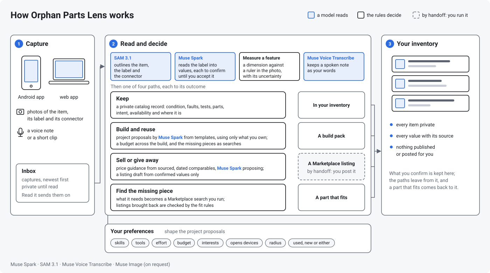

<p align="center"></p>

# Orphan Parts Lens

Scan what you already own. Decide what it can become. Find the missing piece on Marketplace, or
prepare what you no longer need for sale or free pickup. Every answer carries its evidence, on
Meta's Muse models.



**This repository is the entry for the Meta Global AI Developer Hackathon (Oct 27 to Nov 4, 2026).**
Everything in it was built during the hackathon; the dated log is
[docs/project/hackathon.md](docs/project/hackathon.md) (*Project > Built during the hackathon*
on the docs site). One diagram of the whole, every box a link:
[How it fits together](https://nikolareljin.github.io/orphan-parts/project/flow/).
**Judging it?** [JUDGES.md](JUDGES.md) starts with a two-minute fast path on the hosted app,
then the Android app and the access code. **Trying it on a phone?**
[Five steps](#on-a-phone-in-five-steps) below.

Orphan Parts Lens starts from a private inventory of the devices, parts and other things you
own. A photo of a label becomes a record you confirm field by field. A photo next to a ruler
becomes a measurement with its method and uncertainty. From there, a decision written for your
skills and four paths: keep a catalog, build something with what you have, sell, or give away.
Facebook Marketplace is the destination both ways: the part you are missing, and the listing
for what you let go. Nothing is published by a scan, nothing is posted or searched on your
behalf, and a number without a source says so.

## Four paths on one inventory

| Path | What it does | Where it stands |
|---|---|---|
| Catalog | read the label, confirm or reject each value, add what you know, keep condition, faults, tests, parts, plan and availability, measure a feature against a ruler | built |
| Sell and give away | listing details (condition, what is included, faults, handover, area, price; the lowest price and the reason stay private), price guidance from sourced comparables with the four figures kept apart, a Facebook Marketplace (US) draft in its fields with the disclosures the rules require, each field to copy, the photos as a zip in order, the create page by handoff, and what happened after (listed, sold, given) | built |
| Find the one that fits | what an item needs; a search plan of Marketplace search links you run and a match pattern; listings brought back as text or screenshots, ranked by the pattern with no model call; one read into a candidate, assessed by the category's rules and dated, the seller's questions as a message | built |
| Build and reuse | what you want from a build, project proposals grounded in what you own with every allocation checked against the inventory, items committed to one selected build at a time, a budget across the selected set, missing pieces as searches, a versioned build pack that goes stale when an input changes, the outcome in your words | built |

Before a path, **Decide**: three cards for the item and your rated skills (keep and fix with
the steps at your level, reuse it with what else you own, sell or give away), one
recommendation, and the choice kept as the item's plan; **Draw it** shows how a finished
project could look.

Underneath, one engine answers five questions with evidence: Identify, Value, List, Find, Reuse.
A category is a data file, a profile, that names the fields, the features worth measuring with
their tolerances, and the rules that decide a fit. Power adapters, blender and frappé maker
agitators, and vacuum attachments ship as profiles, with a generic one for anything else.

## What makes it trustworthy

- **Evidence per value.** Every field says where it came from: the label, a crop, a measurement,
  a listing, your own word. An observation stays "to confirm" until you accept it.
- **A ruler, not a guess.** A dimension comes from marks on a photo with a scale reference and
  explicit geometry; a blurred, oblique or unreferenced capture is refused with the reason.
- **Rules decide, the model reads.** Does it fit? ends in one verdict from a ladder; an
  unknown is never a pass, and a conflict is never talked away.
- **Four price figures, never merged.** Asking, sold, what you reported, and the model's
  estimate, each with its page and date; weak evidence is called weak.
- **A demo you can leave running.** Without the access code a visitor clicks the demo set's
  own photos and gets the answer recorded for each, at no cost; the code opens uploads and the
  live models behind allowances per visitor and per day, a per-address limit, a spend cap and
  an operator's switch.

Documentation: https://nikolareljin.github.io/orphan-parts/

## On a phone in five steps

1. **Install the app** on an Android 8.0 or newer phone. The QR code, scanned with the phone's
   camera, or `https://github.com/nikolareljin/orphan-parts/releases/latest/download/orphan-parts.apk`
   opened on the phone, downloads the newest release's APK.<br>
   <br>
   Or, on the phone, open the
   [latest release](https://github.com/nikolareljin/orphan-parts/releases/latest) and tap either
   APK. The app is not on Google Play, so allow the browser to install unknown apps when the
   download opens (**Allow from this source**); if Play Protect warns, **More details**,
   **Install anyway**; afterwards a **Play Protect** scan in the Play Store checks it. Or over
   a USB cable, with **USB
   debugging** on in **Developer options**: from a clone, `scripts/phone-install.sh` on the
   computer (on Windows,
   `powershell -ExecutionPolicy Bypass -File scripts\phone-install.ps1`), or the one-line
   download in the long version.
2. **Open the web app**: the hosted site, `https://orphan-parts.pages.dev`; or `./dev up` and
   `http://localhost:5173` on your own computer. To pair a phone with a local server, open the site at the computer's network address, not `localhost`
   (for example `http://192.168.1.20:5173`), with the phone on the same network.
3. **Sign in**: **Sign in with the code** in the header, then the access code you were given
   (**Sign out**, in the same place, ends it).
   A local stack has no door until `./dev gate on`, which prints a code for you and one for
   the phone; reload the page, then sign in with yours. Without it, go on to step 4.
4. **Pair the phone**: at the foot of the page, open **Pair the phone** for the QR code. In the
   app, on the **Backend** tab, tap **Scan to pair** and point the camera at the code on a
   second screen, then **Check**. Signed in, the phone gets an access code of its own on
   that scan; from a page that is not signed in, the phone joins as the demo. Without Google
   Play services or a second screen, type the address shown under the code into **Backend
   URL** and the access code, if the site has one, into the field under it, then tap **Save**
   and **Check**. Pictured:
   [Pair the phone with the web app](https://nikolareljin.github.io/orphan-parts/start/pairing/).
5. **Take a photo** on the app's **Capture** tab and tap **Send**; it shows in the site's
   **Inbox**.

Every step pictured: [Pair the phone with the web app](https://nikolareljin.github.io/orphan-parts/start/pairing/);
what to do when a step fails: [JUDGES.md](JUDGES.md#if-something-does-not-work).

## Quickstart

Docker and bash are the only requirements.

```bash
cp .env.example .env        # add MODEL_API_KEY; without one the stack runs on recorded answers
./dev up
```

- Web app: http://localhost:5173
- API and OpenAPI docs: http://localhost:8000/docs
- Docs site: `./dev docs` then http://localhost:8001

`./dev test` runs the whole check suite inside the same images CI uses. `./dev help` lists every command.
Changes go through pull requests; a release is a pull request from a `release/x.y.z` branch whose merge becomes the tag that publishes images to GHCR.

## Set up

1. **Docker** with Compose v2, and bash. Nothing else is required; the native loop
   (`./dev up --native`) additionally needs Python 3.12 and Node 24 (`.nvmrc`).
2. **A Model API key.** Sign in at https://dev.meta.ai, add a payment method under Billing,
   create a key under API keys, and put it in `.env` as `MODEL_API_KEY`. The key never leaves
   the backend. With `OPL_FAKE_API=1` instead, every call is answered from recorded fixtures,
   which is how the tests and CI run.
3. **Muse Code**, the coding agent used on this repository:

   ```bash
   curl -fsSL https://dev.meta.ai/install.sh -o muse-install.sh   # read it, then run it
   sh muse-install.sh && muse --version
   cd orphan-parts && muse        # sign in with the browser or paste an API key; trust the workspace
   ```

   `./dev test` is the check Muse runs after a change. Details in the docs under
   *Development > Working with Muse Code*.

## Meta models in the app

| Model | Job |
|---|---|
| Muse Spark | reads labels and listings into structured fields; writes the decision cards, listing drafts and search plans; searches the web for prices with citations; proposes projects through tools |
| SAM 3.1 | isolates the item, its label and its connector in photos |
| Muse Voice Transcribe | voice notes kept as the owner's words, from the web and from the phone; spoken questions later |
| Muse Image | a picture of what an item could become or of a finished project, drawn only when you click and the switch is on; illustrative, never evidence |
| Muse Wonder, Muse Glimmer, Muse Spark Open | considered, not used in this version; the docs say what for |

Built with Muse Code.

## Layout

```
backend/    FastAPI service (Python 3.12)
frontend/   React + Vite app (Node 24)
android/    the Android app (Kotlin, Jetpack Compose)
demo/       the demo set: photos, listings, set.yaml
deploy/     the backend on Modal
docs/       MkDocs site, published to GitHub Pages
e2e/        Playwright browser checks
eval/       where ./dev eval writes the demo set's score
livecheck/  one real Model API call per operation (./dev live-check)
scripts/    bash helpers used by ./dev, the release and deploy scripts
docker/     images that are not part of backend/ or frontend/
```

## License

MIT, see `LICENSE`.

Made by Nik Reljin — [about the author](https://nikolareljin.github.io/orphan-parts/about/), [LinkedIn](https://www.linkedin.com/in/nikolareljin). If it is useful, ⭐ star the repository.
