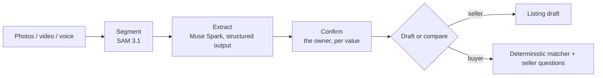

# How identification works

The pipeline is the same for sellers and buyers:

1. **Segment.** SAM 3.1 finds the item, its label and its connector, one concept per call.
   Each match becomes a box, a mask and a crop. Built: `POST /api/segment`, see
   [SAM 3.1](../models/sam-3-1.md). The sharpest label frame from a short video is not wired in
   yet.
2. **Extract.** Muse Spark reads the photos, and the label crops when segmentation ran first,
   into the fields the field set defines, with a confidence and a source per field. Built:
   `POST /api/extract`, see [Muse Spark](../models/muse-spark.md) and the
   [evidence model](evidence.md).
3. **Confirm.** Saved privately, every observed value waits for the owner to accept or reject
   it; the owner's own values sit beside the observations with their provenance. Search
   grounding is used where a page can back a figure: price guidance keeps only the comparables
   a search result backs ([Value an item](../guides/value.md)).
4. **Draft or compare.** Sellers get a listing draft written from confirmed values only. Buyers
   get a verdict per candidate from the rule-driven matcher, with the line that decided it and
   the questions for the seller written by the rules; no model takes part in the verdict.

Each step is one call the owner makes; nothing runs on its own. When the label cannot be found
first, the photos are read whole and the page says so; when a value is unknown, it stays
unknown and becomes a question.
