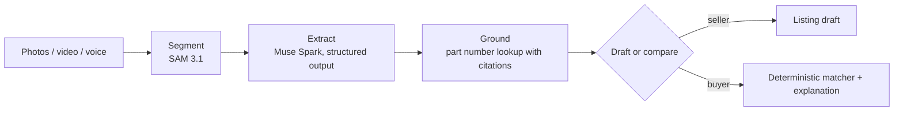

# How identification works

The pipeline is the same for sellers and buyers:

1. **Segment.** SAM 3.1 isolates the part, its label and its connector. Each region becomes a
   crop. For video, the sharpest label frame is picked automatically.
2. **Extract.** Muse Spark reads each crop into the fields the category profile defines, with a
   confidence and a source per field.
3. **Ground.** The part number, when one was read, is looked up with search grounding. Citations
   are kept and shown.
4. **Draft or compare.** Sellers get a listing draft. Buyers get a verdict per candidate from the
   rule-driven matcher, explained by the model but never overridden by it.

The agent that runs these steps decides what to do next: ask for a second photo when the label
was unreadable, skip grounding when there is no part number, run candidate checks in parallel.

!!! note
    Not built yet beyond the service skeleton.
