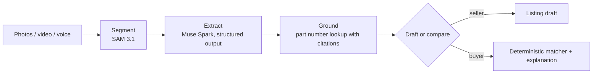

# How identification works

The pipeline is the same for sellers and buyers:

1. **Segment.** SAM 3.1 finds the item, its label and its connector, one concept per call.
   Each match becomes a box, a mask and a crop. Built: `POST /api/segment`, see
   [SAM 3.1](../models/sam-3-1.md). The sharpest label frame from a short video is not wired in
   yet.
2. **Extract.** Muse Spark reads the photos, and the label crops when segmentation ran first,
   into the fields the field set defines, with a confidence and a source per field. Built:
   `POST /api/extract`, see [Muse Spark](../models/muse-spark.md) and the
   [evidence model](evidence.md).
3. **Ground.** The part number, when one was read, is looked up with search grounding. Citations
   are kept and shown.
4. **Draft or compare.** Sellers get a listing draft. Buyers get a verdict per candidate from the
   rule-driven matcher, explained by the model but never overridden by it.

The agent that runs these steps decides what to do next: ask for a second photo when the label
was unreadable, skip grounding when there is no part number, run candidate checks in parallel.

!!! note
    Segment and extract are built. Ground and the agent are next.
