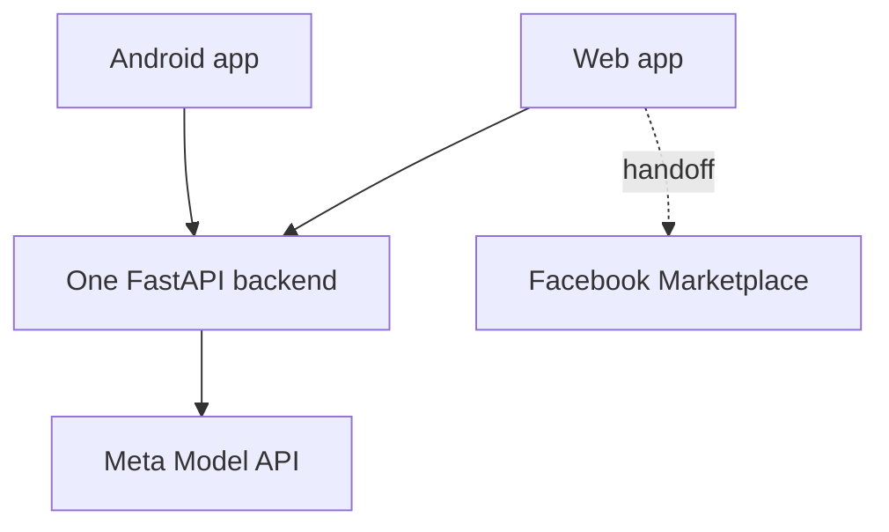
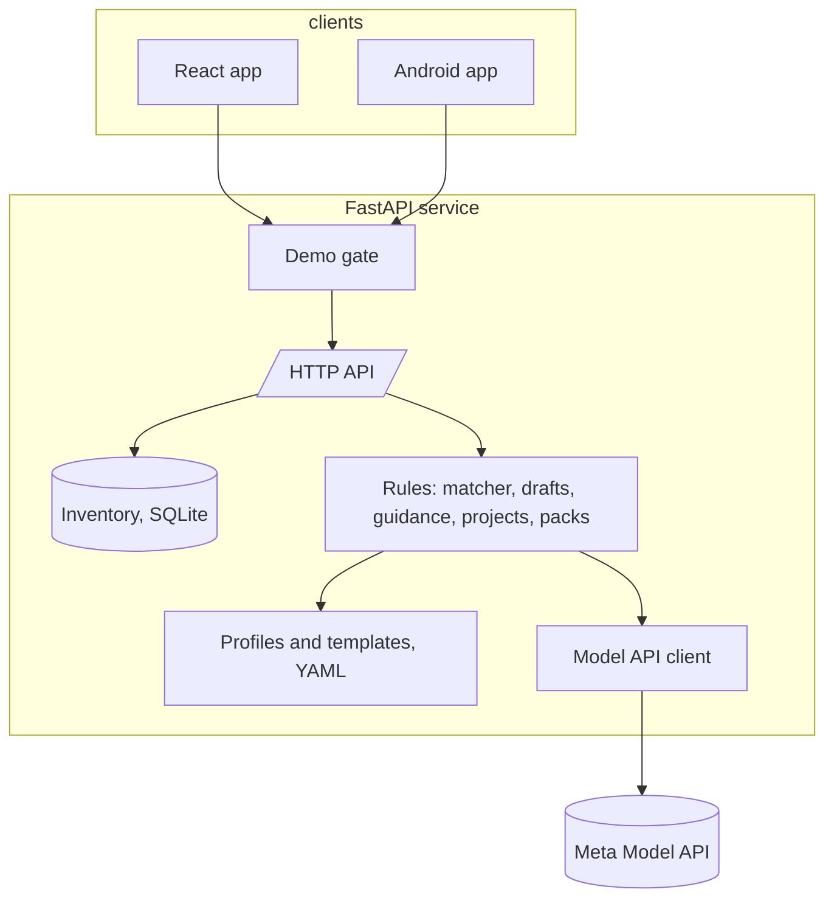

# Architecture

## Surfaces

The web app and the Android app are thin clients of one backend. Marketplace is reached by
handoff: the app copies an approved draft and opens the create-item page, or opens a search for
the owner to run; nothing is posted, fetched or searched on anyone's behalf.

## Inside the backend

- The **backend** owns everything that reasons. The model proposes through the one client
  (structured output, search grounding, a tool loop); the **rules** decide what is kept: a
  verdict from the profile's rules, a draft line that rests on a confirmed field, a comparable
  a page backs, a project allocation the inventory backs. Profiles and project templates are
  data the model never changes.
- The **inventory** is one SQLite file under `DATA_DIR`; every value carries its provenance and
  every change is an event ([Data model](../reference/data-model.md)).
- The **demo gate** sits in front of every call when an access code is set
  ([Demo access](../operations/demo-access.md)).
- The **frontend** and the **phone app** render evidence and let people confirm and edit it.
  Neither has model logic.

Each call does its work within the request; there is no queue and no background job. The
request's id runs through the logs and the spend ledger ([Events and history](../reference/events.md)).
