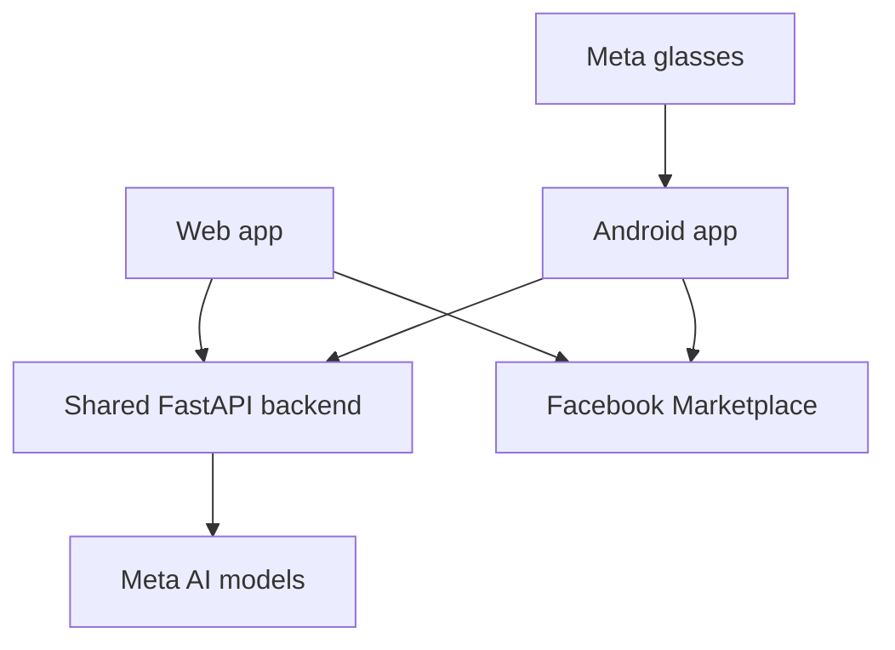
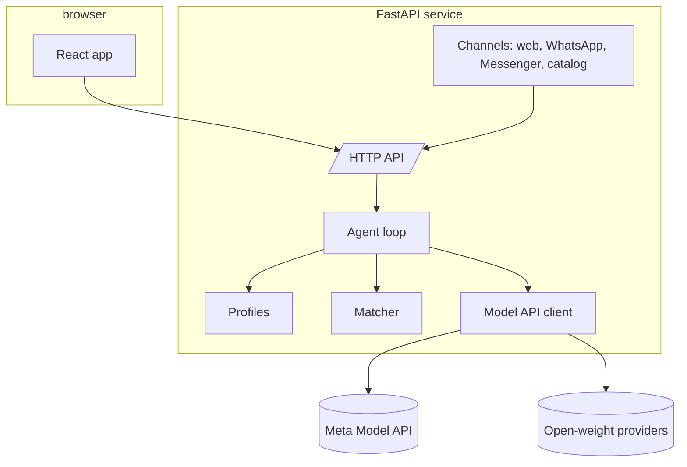

# Architecture

## Surfaces

The web app and the Android app are thin clients of one backend. Marketplace is reached by
handoff: the app copies an approved draft and opens the create-item page; nothing is posted on
anyone's behalf. The glasses reach the backend through the Android app.

## Inside the backend

- The **backend** owns everything that reasons: the agent loop, the profiles, the matcher and
  the single Model API client.
- The **frontend** renders evidence and lets people edit it. It has no model logic.
- **Channels** are thin adapters that turn a WhatsApp message, a Messenger message or a catalog
  export into the same API calls the web app makes.

Request flow and the agent loop get their own diagrams as those parts land.
