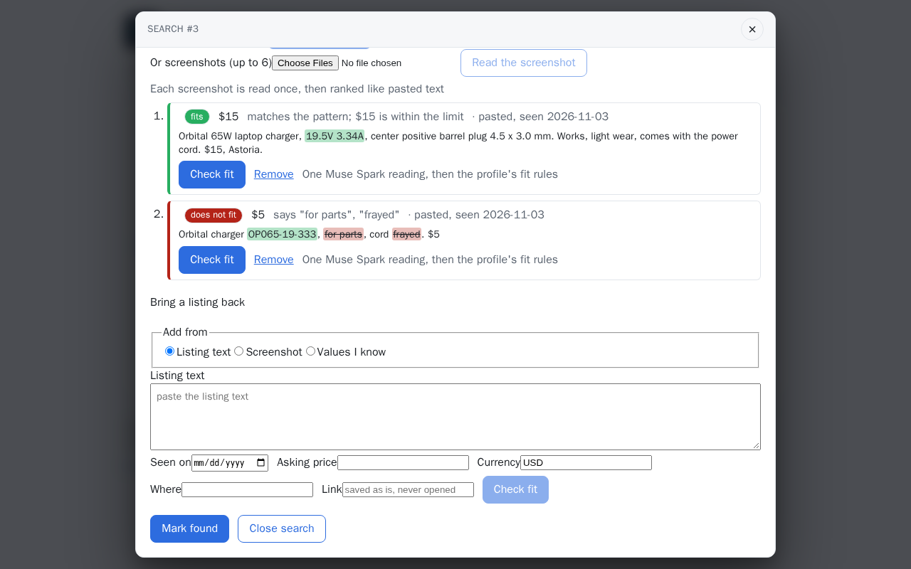
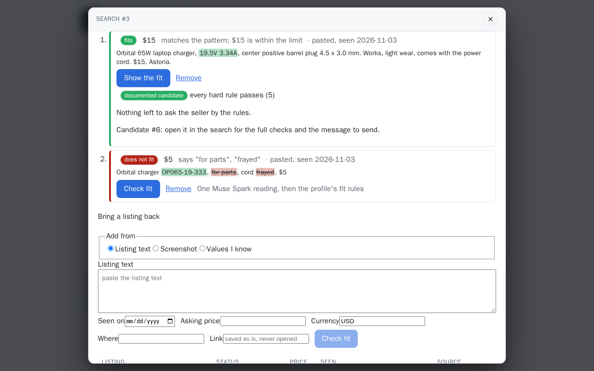
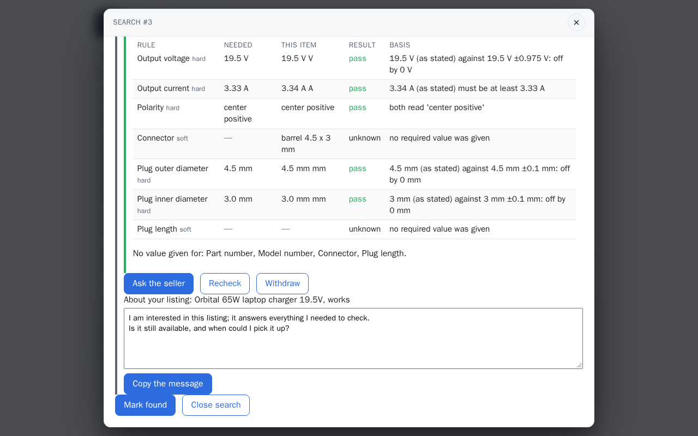

# Buyer flow

Photograph the broken part, bring candidate listings back as screenshots or text, read one
verdict per candidate with the evidence behind it, and send the seller the questions the rules
leave open.

## Built so far

The comparison itself: [Does it fit?](match.md) checks a candidate against what is needed, rule
by rule, and ends in one verdict from the [ladder](../concepts/verdicts.md) with the questions
to ask the seller. Candidate listings from text, screenshots or values you know, each dated and
assessed, with the seller's questions as a message, live under [Find a part](search.md). Before
any is read, the listings brought back are ranked by the search plan's match pattern, its
exclusion words and the price, with no model call ([Plan the search](search.md#plan-the-search));
a table comparing the candidates of one need side by side is under
[Next steps](../project/next.md).

## Step by step

1. On **Find a part**, a search for the part, with listings pasted back and ranked
   ([Find a part, step by step](search.md#step-by-step)).

    

2. **Check fit** on the best one: one Muse Spark reading, then the rules give its verdict.

    

3. **Ask the seller** turns what is still unknown into a message to copy.

    
