# Capture from the phone

The phone is where a thing gets photographed and where a person says what they know about it
while holding it. A capture is what the phone sends in one go: photos, a short clip, a spoken
note and a line of text. The backend keeps it, and reads it into an item when asked.

## Step by step

### On the phone

The phone has to be [paired](../start/pairing.md) first. The phone pictures are frames from a
recording of the app on a phone.

1. **Capture** tab, *Capture an item*: **Take a photo** (or **Photos from the gallery**), as
   many as four; **Record a video** or **A video from the gallery** for a short clip.

    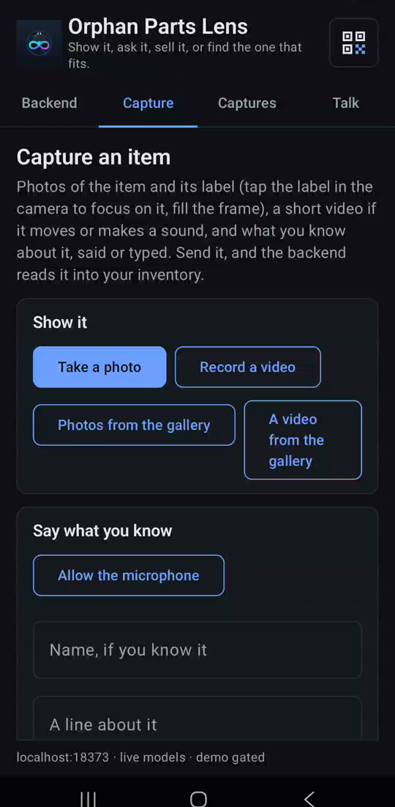{ width=300 }

2. Under **Say what you know**: **Allow the microphone** once, then hold to talk; **Name, if
   you know it** and **A line about it**. **Send**. Nothing is read yet, so nothing is spent.

    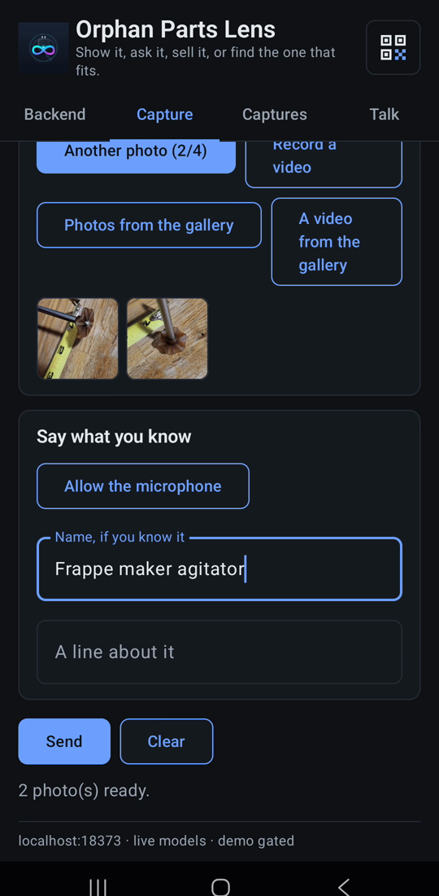{ width=300 }

3. **Captures** tab: the capture, *Received, not read yet*, with **Read it now**.

    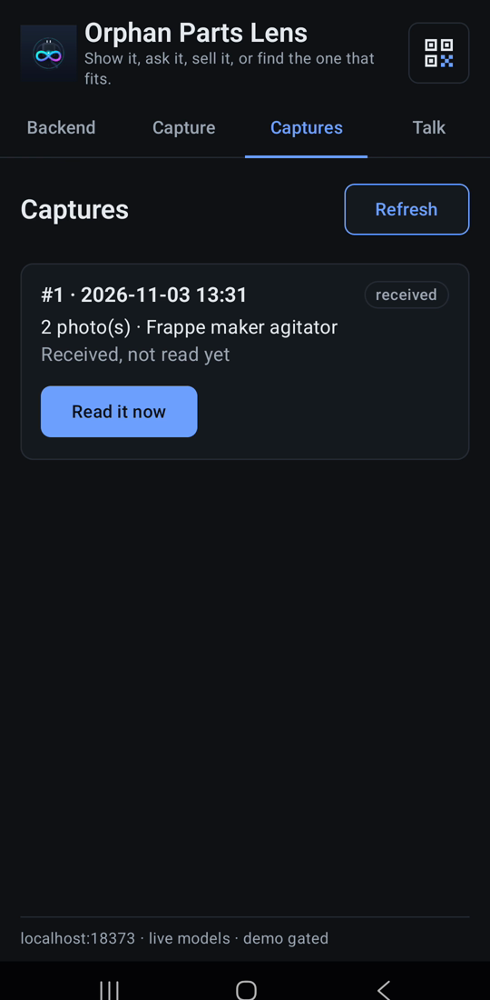{ width=300 }

4. **Read it now** reads it into an item: the label found first by SAM 3.1 and read by Muse
   Spark (under a cent a photo), a voice note transcribed by Muse Voice Transcribe. The capture
   then says which item it became, and **Talk about item #…** opens the **Talk** tab on it.

    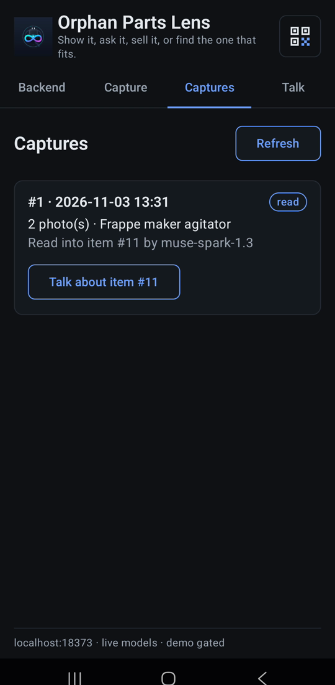{ width=300 }

### On the computer

5. **Read a label** takes up to four photos of a label: **Choose Files**, keep *Find the label
   in the photo first* on, **Read the label**.

    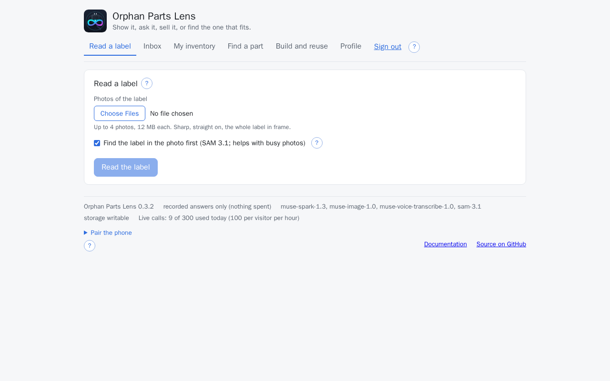

    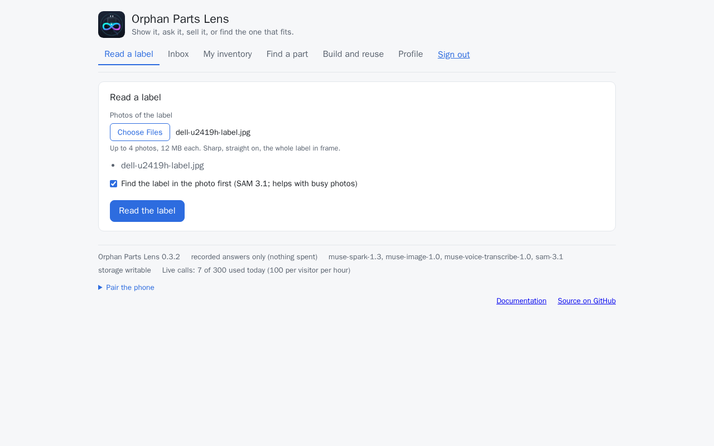

6. SAM 3.1 looks for the item, the label and the connector first (about $0.0025); it says so for
   each it did not find, and the photo is then read whole. Muse Spark reads the values (about
   $0.003 to $0.008): each with its confidence and its source. *Label text* holds the label as
   printed.

    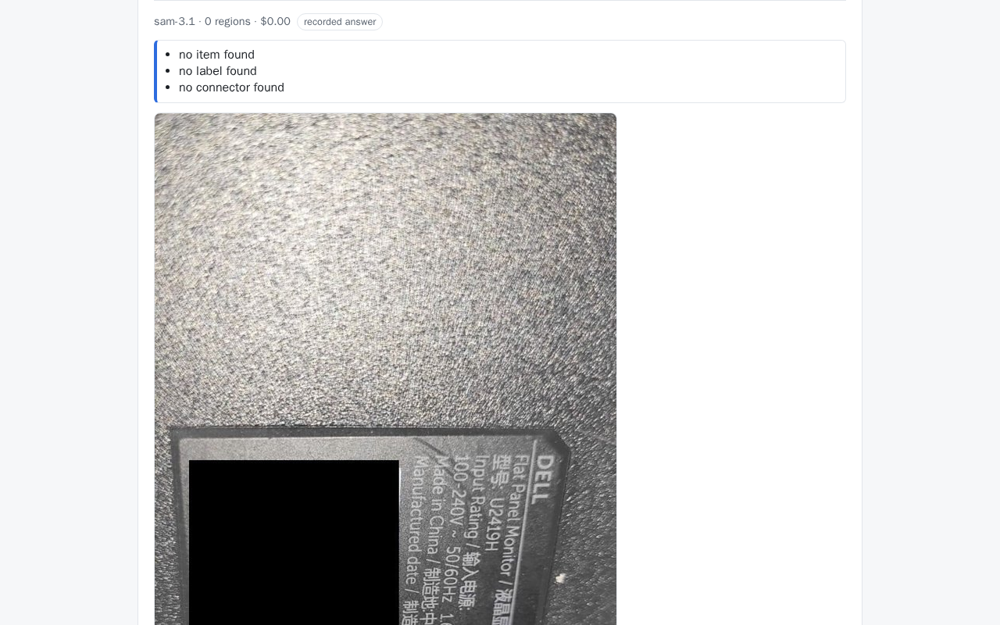

    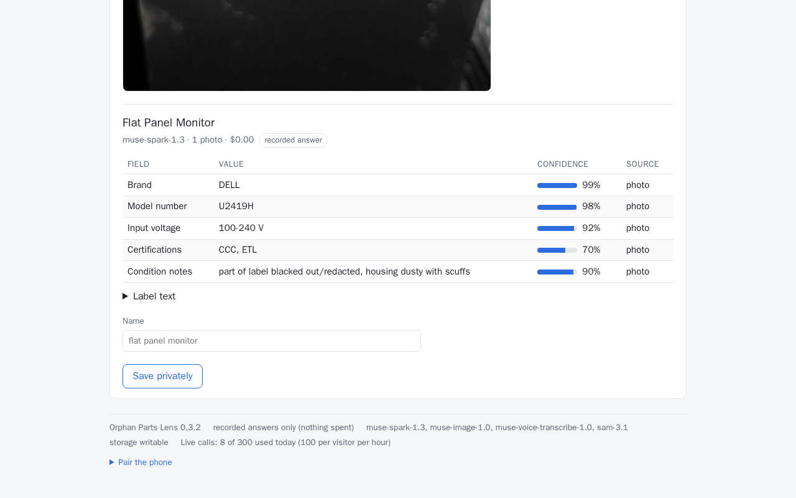

7. **Name** it and **Save privately**. The page moves to **My inventory**, where every value
   waits to be confirmed ([My inventory](inventory.md#step-by-step)).

    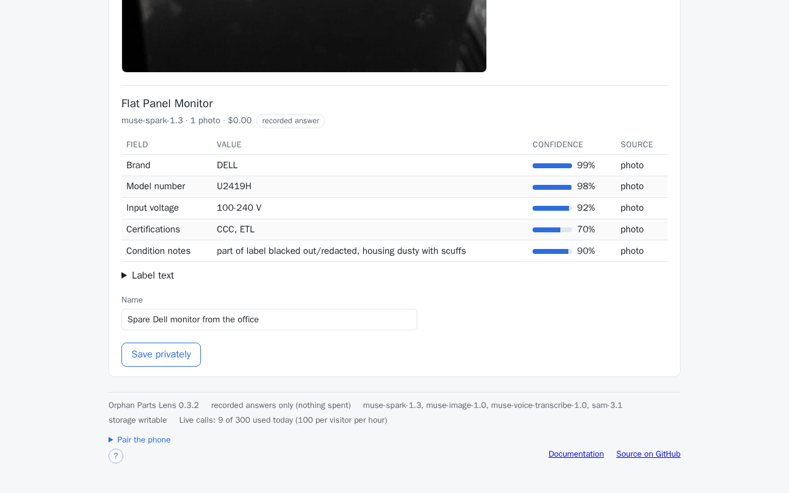

    Each photo kept is checked once for private details, which are then blacked out on every
    copy that leaves your view ([Private details on photos](private-details.md)).

8. **Inbox**, **Send a capture from this computer**: **Photos**, **A short video (optional)**,
   **Name (optional)**, **What you know (optional)**, **Send**. The capture waits in the Inbox
   with **Read it** and **Delete**, as one from the phone does.

    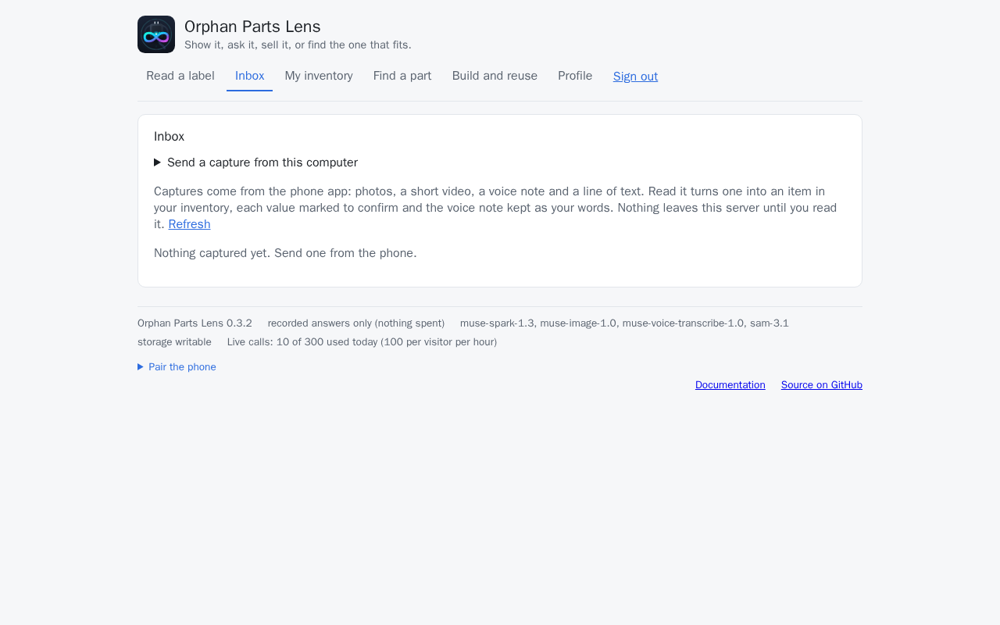

    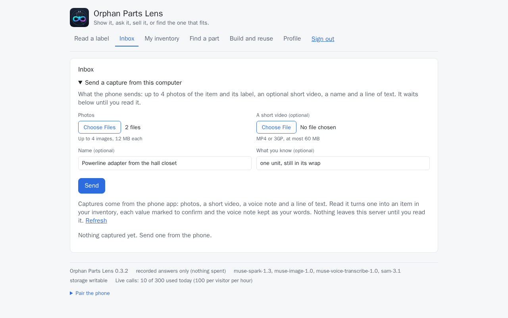

    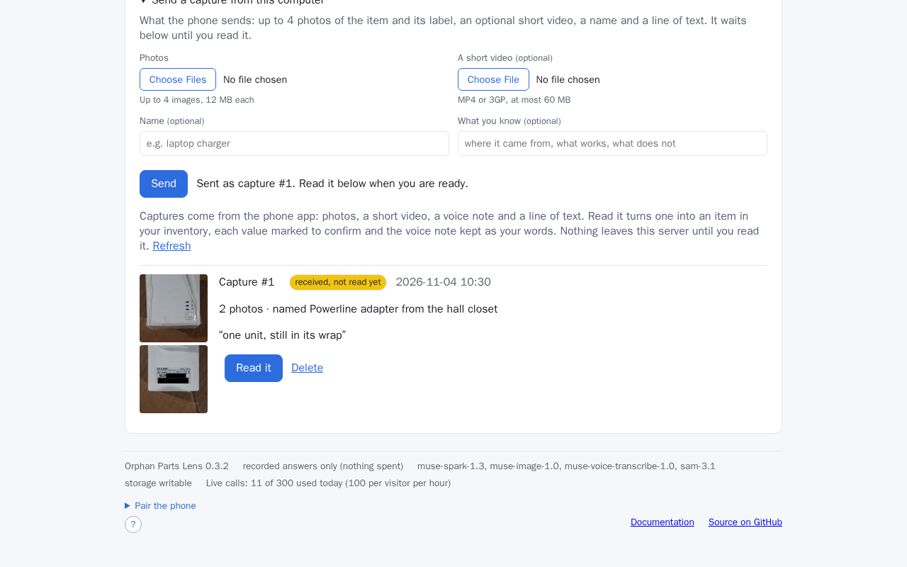

Without the access code there is no upload anywhere: **Read a label** is a gallery of the demo
set's photos, each answered from its recording ([Demo walkthrough](../start/demo.md)), and the
Inbox shows *Sign in with the access code to use this.*

In the web app, look for the **?** next to **Read a label**, next to **Inbox** and beside *Find
the label in the photo first*: each opens a short note on what can be done there, with a link to
this page.

## On the phone

The **Capture** tab is one session: **Take a photo** as many times as needed (four go in one
capture; the next capture takes more), **Record a video** through the phone's camera app (30
seconds at most), **Hold to talk** for what you know (what it is, what is wrong, what you
tested), a name if you know it, a line, then **Send**. Photos are re-encoded on the phone before
they leave it, pixels only; the clip is sent as recorded. **Captures** lists what was
sent and whether the backend has read it: **Read it now** asks for that, and a capture that
could not be read says why and can be tried again. A capture read into a part the backend
cannot tie to its device asks which device it came from, as the web app's item dialog does
(see [Inventory](inventory.md)).

## From a computer

The Inbox's **Send a capture from this computer** form takes the same bundle the phone
sends: up to `MAX_PHOTOS` photos of the item and its label, one short video (an MP4 or 3GP
file, at most `MAX_CLIP_MB`; a recording from a phone's camera or a laptop's webcam saved as
MP4 is what it takes, a MOV or WebM file is refused by its bytes), a name and a line. What
the form can tell before sending (too many photos, a photo or a video over the limit, a
file that is not MP4) it says at once; the backend's own check answers the rest. The
capture waits in the Inbox like one from the phone. The demo visitor sees no form, only
*Sign in with the access code to use this.* On the phone, **Photos from the gallery** and **A video from the gallery** on
the Capture tab take media already on the phone, re-encoded and checked the same way.

## In the Inbox

The web app's **Inbox** shows every capture newest first: the thumbnails, the clip to play,
the note to hear, the line, the status. **Read it** turns a capture into an item: the photos
go through the same reading as the web form (the label found first by SAM 3.1, the fields read
by Muse Spark, every value marked as observed and waiting for you to confirm), the note is
transcribed by Muse Voice Transcribe and kept on the item as your words, the line becomes the
item's notes, and a clip is noted as having come with it. The capture's photos pass to the
item, shown above its values. **Open item** goes to the inventory. **Delete** removes the
capture and its files; an item made from it stays, photos included.

## What is kept

Everything a capture holds stays under `DATA_DIR/captures/<id>/` on the backend, private,
until the capture is deleted: the photos (re-encoded on arrival, no metadata), the clip as
sent (a clip keeps whatever metadata the phone wrote into it), the note. Reading a capture
sends the photos and the note to the Meta Model API; the clip is sent nowhere.

## From the API

```bash
curl -s -X POST localhost:8000/api/captures -F photos=@label.jpg -F audio=@note.wav \
  -F 'request={"note": "the old adapter from the drawer", "find_label": true}'
curl -s -X POST localhost:8000/api/captures/1/process
curl -s localhost:8000/api/captures
```

## After the capture

The item a capture becomes is like any other: its **Decide** section asks what to do with it
(keep and fix, reuse it, sell or give away; see [Decide what it becomes](decide.md)).

## Not yet

A frame picked from the clip for reading is under [Next steps](../project/next.md).
