# My inventory

A private record of what you own: each item with the values read from its label, the condition
and faults you know about, what you mean to do with it, and whether a plan may count on it.
Nothing in it is published. A scan never posts anywhere; a listing draft is a separate step you
approve.

## Step by step

The pictures come from the demo set (`./dev demo`) on a stack answering from recordings.
Without the access code, **My inventory** lists the items marked public, read-only.

1. **The list.** **My inventory** shows every item with its kind, how many values it has, its
   plan, its availability and when it last changed. **Open** an item.

    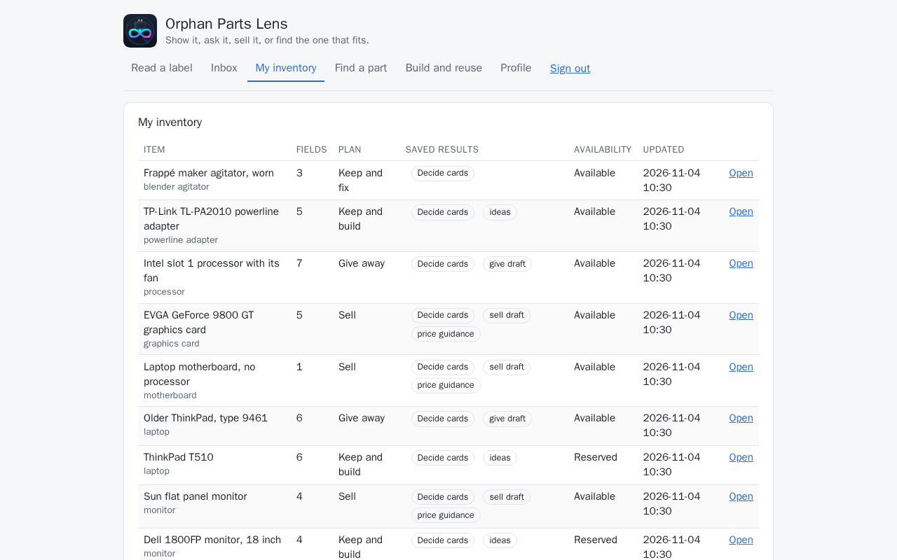

2. **The item.** The dialog has section links at the top (**Facts**, **Decide**, **Value**,
   **Sell or give away**, **Measure and fit**, **Picture**). Under **Facts**: the photos, the
   **Plan**, **Availability** and **Profile**, then **Fields**, every value with where it came
   from (*observed on a photo* with its confidence, *stated by the owner*, a measurement) and
   its review.

    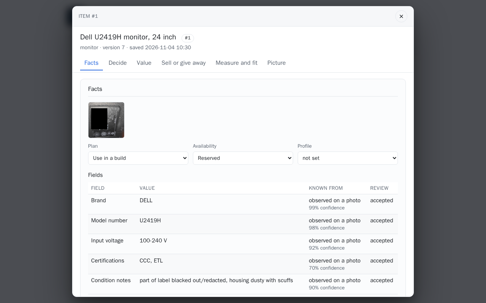

    Under the photos, a line says which private details (a product key, a MAC address, a
    serial number, a password, a QR code) were found and are blacked out on every shared copy:
    [Private details on photos](private-details.md#step-by-step).

    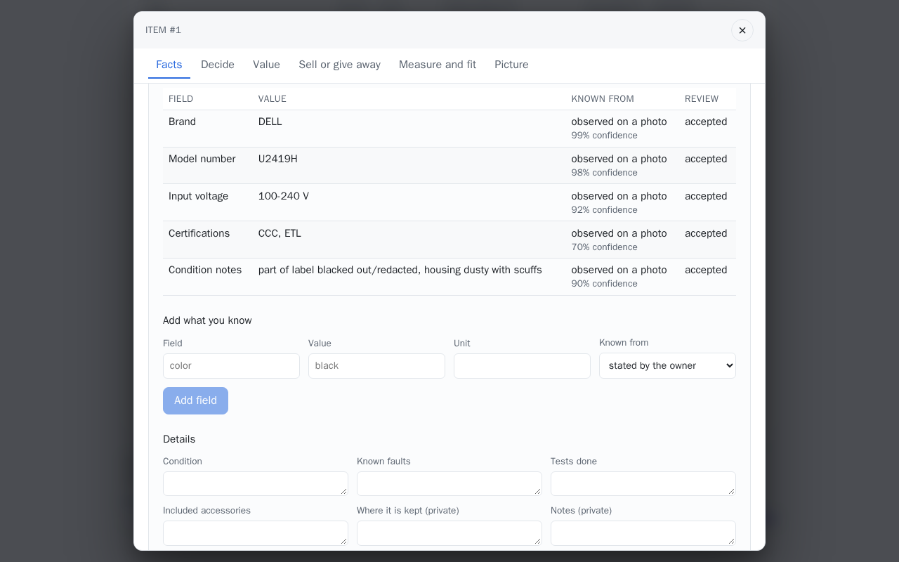

3. **Confirm what was read.** A reading saved from **Read a label** (see
   [Capture](capture.md#step-by-step)) arrives with every value *to confirm*, each with
   **Accept** and **Reject**. No model call.

    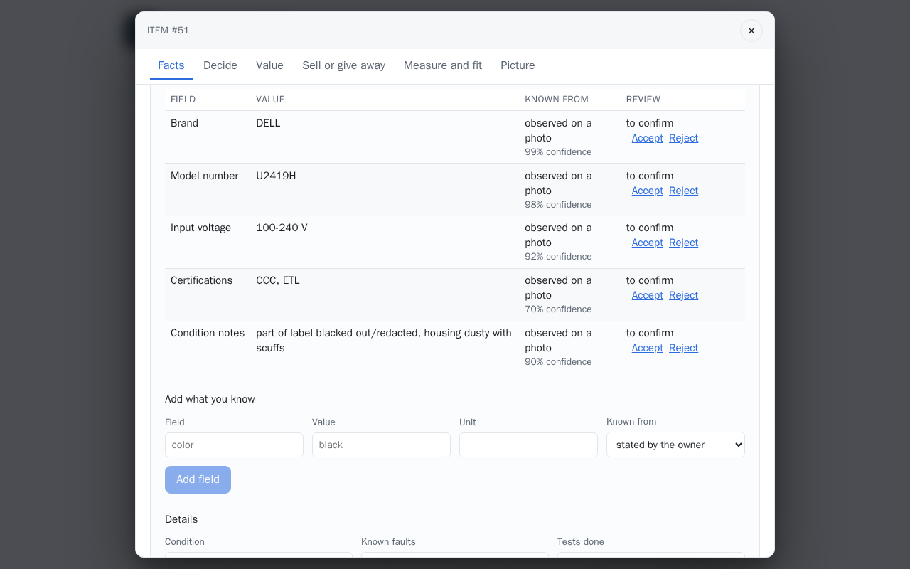

    An accepted value says *accepted*; a rejected one leaves the current values (it stays in
    the record).

    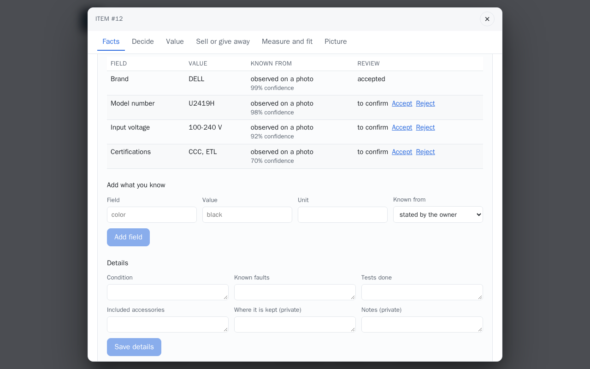

4. **Add what you know.** Under **Add what you know**: a **Field**, a **Value**, a **Unit** and
   **Known from** (*stated by the owner*, *from documentation*, *tested*, *estimated*), then **Add field**. No
   model call.

    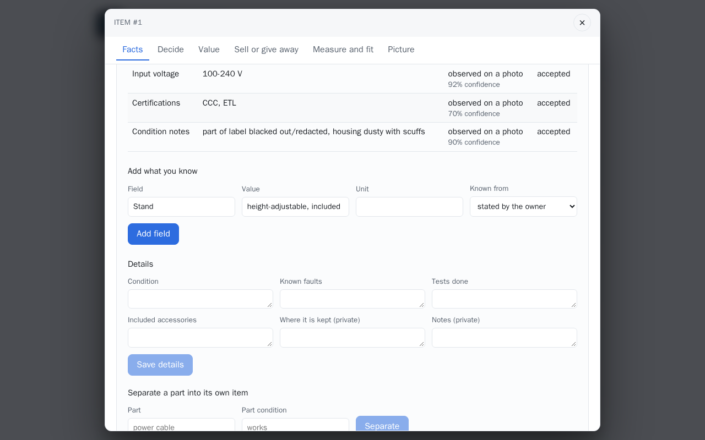

5. **The history.** **History**, at the foot of the dialog, lists every change with its time:
   created from a reading, each value accepted, each project it was proposed for, each value
   you set.

    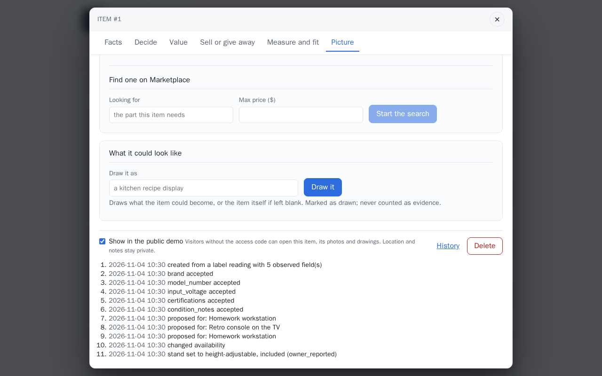

6. **The rest of the dialog.** **Separate a part into its own item** under the details; under
   **Picture**, **Find one on Marketplace** and **What it could look like** (**Draw it as**,
   one Muse Image call when pictures are on); at the foot, **Show in the public demo**,
   **History** and **Delete**.

    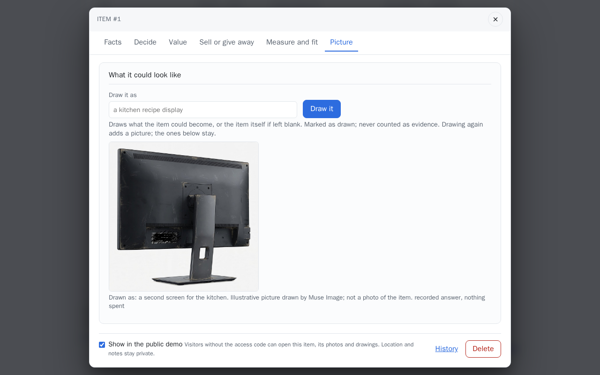

7. **A part that does not say where it came from.** The agitator carries no model number, so
   the dialog asks which device it came from: a line in **Device it came from**, or **Add a photo
   of the device** (one Muse Spark reading of the label).

    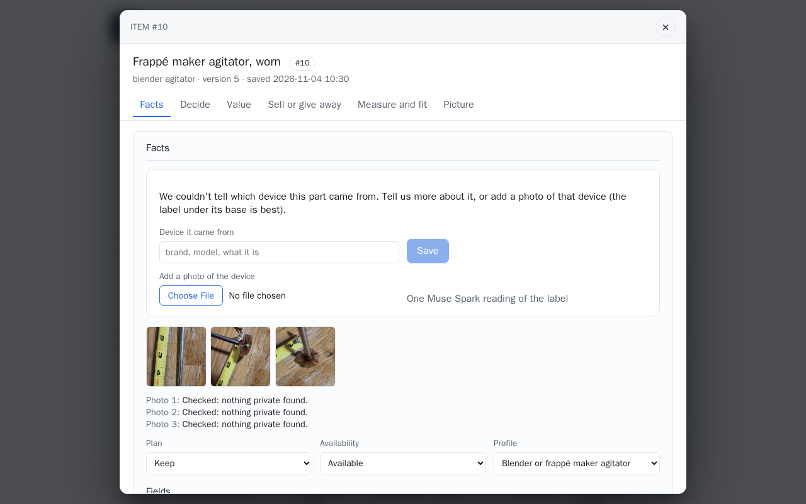

    A photo of the label under the mixer's base answers it: *Came from: Hamilton Beach 729*,
    with *Read from the photo: ... Confirm it in the fields.* and the device's photo above the
    part's own.

    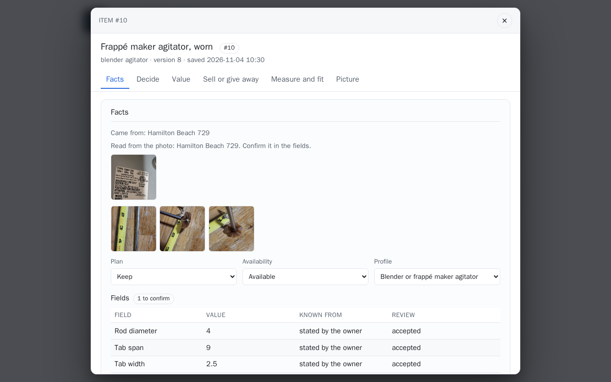

### On the demo set

The demo set's two drawers, and an item of the second as a visitor reads it. More on
[Examples: what the models produced](../start/examples.md).

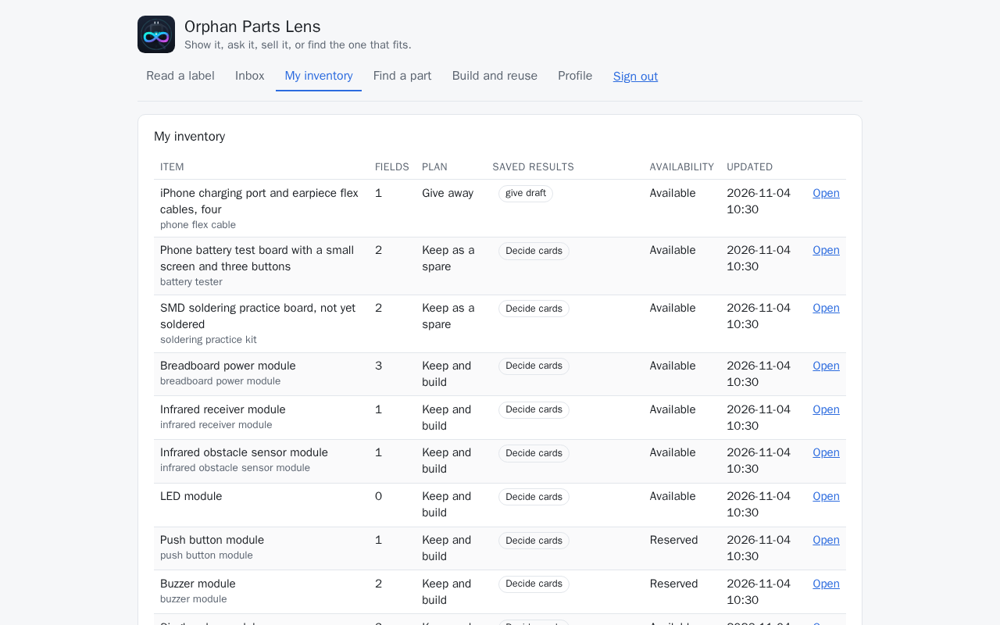

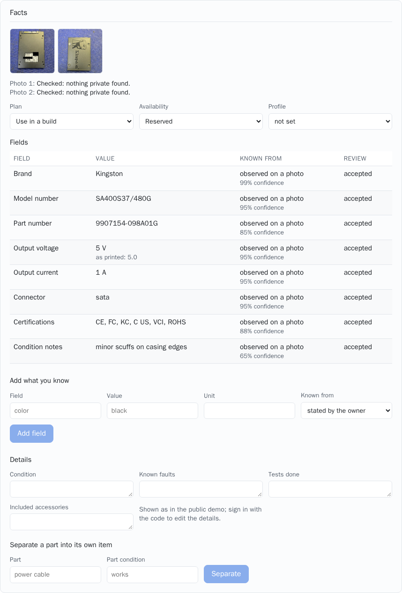

## From a reading to a record

Read a label, then **Save privately**. Every field the model read becomes an **observed** value
on the new item, marked *to confirm*. On the item page you accept or reject each one, with the
photos the reading was made from above the values (they stay in view while the list scrolls;
one click makes a photo large). A rejected observation disappears from the item's current
values but stays in the record.

Anything you know yourself goes in through **Add what you know**: a field, a value, a unit, and
how you know it (stated by you, documented, tested, estimated). Your value is accepted as stated
and shown as the current one, but it never replaces the observation: both stay, each with its
provenance, so a later reader can see what the label said and what you corrected.

## Condition, plan and availability

| Field | Meaning |
|---|---|
| Condition, known faults, tests done, included accessories | free text, yours |
| Plan | keep, use in a build, sell, give away |
| Availability | available, reserved (a plan counts on it), gone |
| Where it is kept, notes | private; shown only on the item page, never in a draft or a shared record |

Every edit bumps the item's version and records an event. The page sends the version it last
saw with each change; if the item changed in between, the write is refused and the page shows
the current state instead of overwriting it.

## Parts of a whole

A removable part can be separated into its own record with **Separate a part into its own item**: a camera module
from a broken phone, the cable from a charger. The part gets the parent's plan and a link
back; the parent's faults note what left, so a later plan does not count on a whole device that
is no longer whole.

## The device a part came from

Some parts carry no model number of their own: a blender's agitator, a vacuum's tool. When an
item has a part profile (`blender_agitator`, `vacuum_attachment`; `part_of_device: true` in the
profile), no model or part number of its own and no device recorded, the item dialog (and the
*Read a label* result once saved) asks instead of guessing:

> We couldn't tell which device this part came from. Tell us more about it, or add a photo of
> that device (the label under its base is best).

- **Device it came from**: a line in your words (brand, model, what it is), saved as the field
  `parent_device` (source `user_edit`). It is yours like the notes: the demo visitor never gets
  it, and it goes into no brief but the searches you run for the part.
- **Add a photo of the device**: one label reading (one Muse Spark call); the brand and model
  number read off it are proposed as `parent_device_model` (source `photo`) for you to accept,
  and the dialog says *Read from the photo: ... Confirm it in the fields.* until you do. The
  photo is kept as a photo of the device, apart from the part's own: it takes none of the
  part's `MAX_PHOTOS`, never goes into a draft or the photo zip, and the demo visitor never
  gets it. The dialog shows it under *Came from*.

Either answer, a model number of the part's own, or a link to the device as its parent item
clears the question; a rejected value does not. Once answered, the dialog says where the part
came from in a line (*Came from: Hamilton Beach 729*). A photo that gives no model is kept all
the same, as a new version of the item. The rule lives in the backend
(`app/inventory/parent.py`) and is served on the item as `needs_parent`, so the web app and the
phone ask the same: the phone's **Captures** tab shows the question under a capture read into
such a part, with the same two answers, and *Came from: ...* once answered. The demo visitor sees the question with no inputs. The device leads the
part's [web search](search.md#search-the-web) and its search plan: the maker's own part for that
device first. In the demo set the frappé maker's agitator is answered this way, by the Hamilton
Beach drink mixer it came off (model 729, type DM01): nothing is typed, the model is read off
its label, its badge, the whole mixer and a side view with the rod fitted, and accepted.

## Measuring

Under **Measure a feature** a dimension is taken from a photo with a scale reference and, when
accepted, proposed on the item as an observed value with source `measurement`. The method, the
checks and the uncertainty are in [Measure a feature](measure.md).

## Deleting

Delete hides the item from the list. The record and its history stay, so an event log is never
missing an item it refers to.

## Storage

One SQLite file, `INVENTORY_DB_FILE` inside `DATA_DIR`, in WAL mode (`SQLITE_JOURNAL_MODE`) with a versioned schema.
Four tables: items, assertions (one row per value with its provenance, confidence, source and
review state), events (one row per change with the version it produced) and measurements (each
capture with its result and the prepared photo it was made on). Postgres and object
storage are the documented path after the hackathon; the service layer is the only place that
knows SQL.

## API

```bash
# save a reading privately
curl -s -X POST localhost:8000/api/items \
  -H 'Content-Type: application/json' \
  -d '{"extraction": <the answer of /api/extract>, "name": "Desk charger"}'

# list, read, edit
curl -s localhost:8000/api/items
curl -s localhost:8000/api/items/1
curl -s -X PATCH localhost:8000/api/items/1 -H 'Content-Type: application/json' \
  -d '{"intent": "sell", "version": 1}'

# your own value, beside the observed one
curl -s -X POST localhost:8000/api/items/1/fields -H 'Content-Type: application/json' \
  -d '{"field": "output_voltage", "value": "19", "unit": "V", "provenance": "tested"}'

# accept or reject an observation, separate a part, read the history
curl -s -X POST localhost:8000/api/items/1/assertions/3/review -H 'Content-Type: application/json' \
  -d '{"review": "accepted"}'
curl -s -X POST localhost:8000/api/items/1/components -H 'Content-Type: application/json' \
  -d '{"name": "power cable", "condition": "frayed"}'
curl -s localhost:8000/api/items/1/events
```

The full shapes are in the [HTTP API](../reference/http-api.md).
