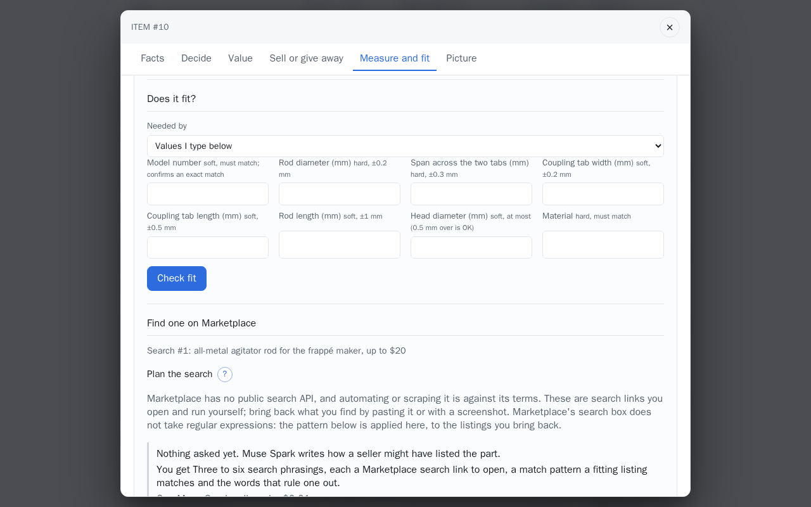
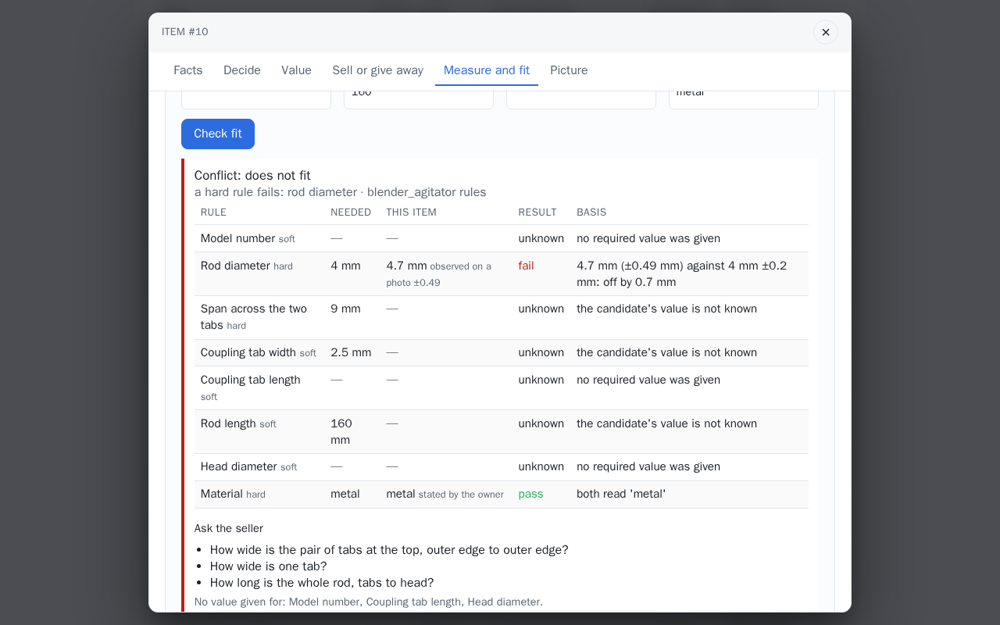
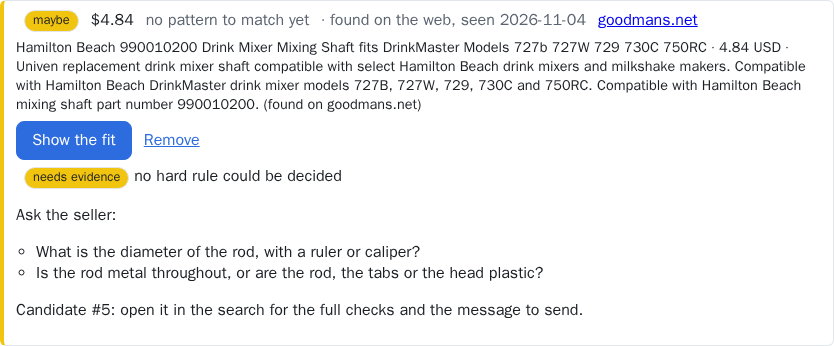

# Does it fit?

A candidate is checked against what is needed, one rule at a time, and gets one verdict from
the [ladder](../concepts/verdicts.md). The rules come from the item's
[category profile](../concepts/profiles.md); the evidence comes from the inventory or from values
written in. No model takes part.

## Step by step

No model takes part. The pictures check the frappé maker's agitator from the demo set against
values typed in, as a seller's listing might give them.

1. In the item, **Measure and fit**, then **Does it fit?**. Under **Needed by**, pick another
   item, or keep **Values I type below** and fill the fields the profile's rules name; each says
   whether it is *hard* or *soft* and its tolerance.

    

2. **Check fit.** The verdict comes first with the line that decided it, then every rule with
   what is needed, what this item has (and how that is known), the result and the basis in words,
   then **Ask the seller** for the unknowns and the rules no value was given for.

    

### On the demo set

Check fit on a page Search the web found for the agitator rod: the page has no rod diameter,
so no hard rule can be decided and the verdict is *needs evidence*. More on
[Examples: what the models produced](../start/examples.md).



## Two sides

- **The need**: what the part must satisfy. Either another inventory item (the laptop that needs
  an adapter, the frappé maker whose agitator wore out, with the required values on it: measured
  with [Measure a feature](measure.md) or recorded under *Add what you know*), or values written
  straight into the form.
- **The candidate**: the item whose page you are on. Its values are the ones it currently shows:
  accepted ones first, else the latest observation still to confirm, each with its provenance.
  A value that came from a [measurement](measure.md) carries its uncertainty into the check.

Needed values are written in the candidate's terms: for a vacuum tool, the needed
`opening_inner_diameter` is the wand's outer diameter; for an agitator, the needed `tab_span`
is the worn rod's own span, the one the drive takes. A side can be an item and values at
once; a written value replaces the item's for that key. Numbers are compared in the rule's
unit: milli and centi units convert (`3300 mA` reads as 3.3 A against a rule in amps), a unit
that does not convert stays unknown and asks for the right one.

## Rules

Each rule names a key, whether it is **hard** (decides the verdict) or **soft** (reported), and
how it compares:

| Kind | Passes when |
|---|---|
| `equal` | both sides read the same after the label normaliser (polarity, connector, part number); a `material` key reads as `metal` or `plastic` however it is spelled, and a mix (including wood or ceramic), a negation, an uncertain claim, a component or a surface finish stays as written |
| `within` | the candidate is within the tolerance of the needed value: an absolute amount, a percentage, or the larger of the two |
| `at_least` | the candidate is at least the needed value, less any slack |
| `at_most` | the candidate is at most the needed value, plus any slack |

A numeric check takes the candidate's uncertainty into account. A measured 4.55 mm ± 0.3 mm
against 4.5 mm ± 0.1 mm is neither a pass nor a fail: the check stays **unknown** and asks for a
caliper reading. A rule marked `identity` (part or model number) is soft, and a pass on it makes
the match `EXACT_MATCH`.

## What comes back

The verdict with the one line that decided it, every check with the needed value, the
candidate's value and its backing (provenance, whether it is still to confirm, its uncertainty),
the result and the basis in words; the **questions** to ask the seller for every unknown on the
candidate's side; the rules the need gives no value for; and the checks that rest on
observations not yet accepted.

## In the web app

On an item's page, **Does it fit?** lists the other items under *Needed by*; pick one, or leave
*Values I type below* and fill the rules' fields, then **Check fit**. The verdict, the checks and
the questions appear under the form. The item is the candidate, so the panel is behind the
access code; the demo visitor's tries go through `POST /api/assess` with values on both
sides.

## From the API

```bash
curl -s localhost:8000/api/assess -H 'content-type: application/json' -d '{
  "need": {"profile": "power_adapter", "values": {"output_voltage": "19.5 V", "polarity": "center positive"}},
  "candidate": {"item_id": 3}
}'
curl -s localhost:8000/api/profiles/power_adapter/rules
```

See [HTTP API](../reference/http-api.md) and the [profile schema](../reference/profile-schema.md).
