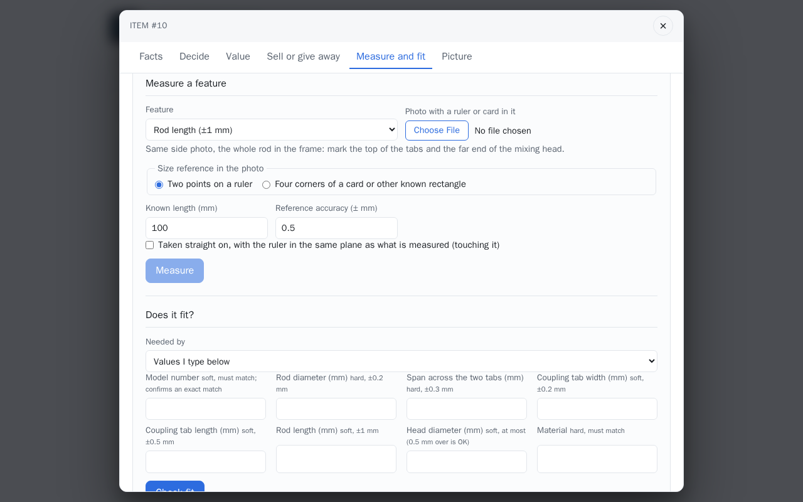
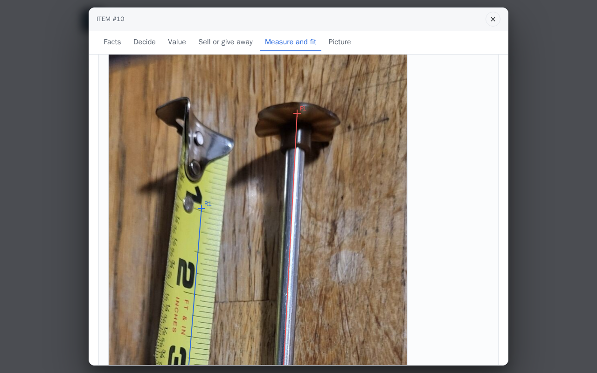
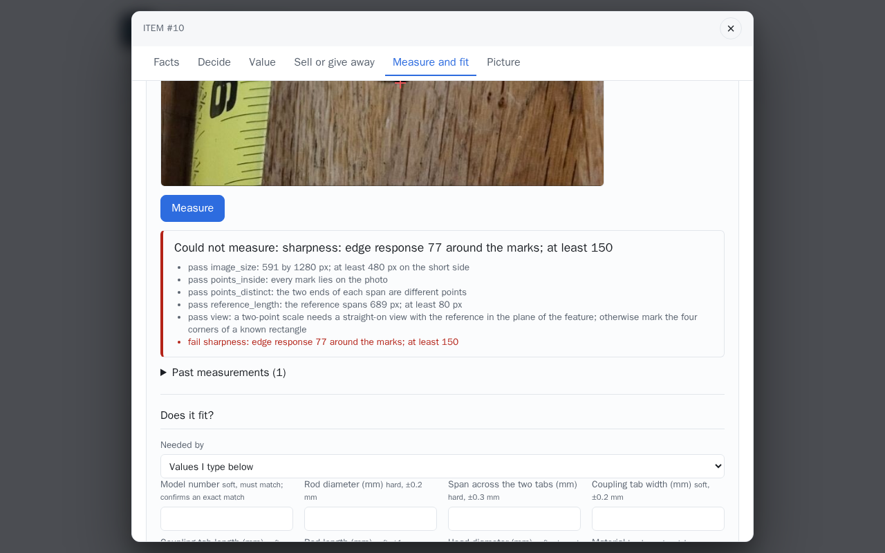
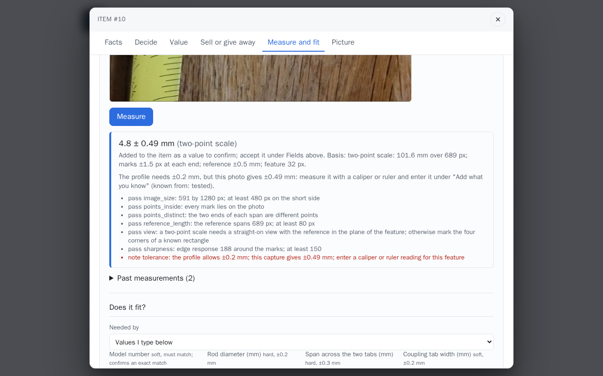

# Measure a feature

A dimension from a photo, computed by geometry from marks you place, with the uncertainty that
follows from how it was captured. No model produces the number. Without a scale reference there
is no number at all.

## Step by step

No step here calls a model: the number is geometry from your marks. The pictures use the
agitator's photo from the demo set, with a tape measure beside the rod; the inch marks 1 and 5
are the known length, 101.6 mm.

1. **Open the section.** In the item, **Measure and fit**, then under **Measure a feature** pick
   the **Feature**; the line under it says how to photograph it. Choose the **Photo with a ruler
   or card in it**, keep **Two points on a ruler**, enter the **Known length (mm)** and the
   **Reference accuracy (± mm)**, and tick **Taken straight on** when it was.

    

2. **Mark the photo.** Click the two ends of the known length on the ruler, then the two ends of
   the feature. The line above the photo says which mark comes next, and *All marks placed* at
   the end; **Clear marks** starts again.

    

3. **Measure.** A capture that cannot carry a number is refused with every check and the one
   that failed: here the edge of the rod's disc is too soft to mark
   (*sharpness: edge response … around the marks; at least 150*).

    

    Marked on sharp edges, the rod's diameter comes back with its uncertainty and the basis it
    rests on, and is proposed on the item as a value *to confirm*. When the profile's tolerance
    is tighter than the capture can give, the result says so and asks for a caliper or ruler
    reading.

    

Without the access code, the photo is one of the demo set's, picked in a gallery, and nothing
is stored.

## What to photograph

The item's profile names the features that decide fit and how to capture each one: for a
blender or frappé maker agitator the rod's diameter and length, the width, length and span of
the two coupling tabs and the head's diameter; for a power adapter the plug's two diameters and
its length. Put a ruler, or any object of known length, **in the same
plane as the feature** and photograph it straight on. For an oblique view on a flat surface,
use a known rectangle instead, a card for instance, and mark its four corners.

## Marking

On the item page, under **Measure a feature**: pick the feature, choose the photo (signed out,
one of the demo set's photos is picked instead and nothing is stored), then click
the marks in order on the photo: the two ends of the known length on the reference (or the four
corners of the rectangle, top-left first, clockwise), then the two ends of the feature. Enter
the reference's length (or width and height) in millimetres and its tolerance. For a two-point
reference, confirm the photo was taken straight on; that statement is yours, and a two-point
scale is only valid when it is true.

## What comes back

- **Accepted**: the value with its uncertainty, the method, and the basis the uncertainty was
  derived from: the marking precision at each end of the feature, the marking precision at each
  end of the reference, and the reference's own tolerance. The value is proposed on the item as
  an observed value (source `measurement`) and waits for you to accept it in the fields table.
- **Refused**: no number, and the checks that failed with what to redo. A capture is refused
  for a short reference (too few pixels per millimetre), marks off the photo or on top of each
  other, a photo whose short side is under the minimum, blur or a featureless patch around any
  mark, a two-point capture not declared straight on, a rectangle seen at too steep an angle, or
  four corners that lie on one line.
- **Tolerance**: when the profile's tolerance for the feature is tighter than the capture's
  uncertainty, the result says so and asks for a caliper or ruler reading. Enter it under
  **Add what you know** with *tested* as how you know it. Direct entry is always available.

Every capture is kept on the item, accepted or refused, with the prepared photo and the marks in
its pixels, so a result can always be traced back and the share of unusable captures is on
record.

## The methods

**Two-point scale.** Pixels per millimetre from the reference's two marks and its known length;
the feature's pixel length divided by that scale. Valid when the reference lies in the plane of
the feature and the view is straight on.

**Homography.** The four corners of a known rectangle give the projective transform from the
photo to that plane in millimetres; both feature marks are mapped through it and the distance is
taken there. Valid for a feature on the same flat surface, from any angle up to the steepness
limit. One plane's calibration is never applied to a feature at another depth.

**Uncertainty.** With a marking precision of `m` pixels at each end (`MEASURE_MARK_PX`), a
reference of `R` pixels and `L` millimetres with tolerance `t`, and a feature of `F` pixels at
`s` pixels per millimetre:

```
value       = F / s
uncertainty = 2m / s  +  value * (2m / R + t / L)
```

No default accuracy is assumed and nothing is rounded away: a short reference or a loose
tolerance shows up directly in the number.

## What a dimension does not prove

A matching dimension filters candidates. It never establishes electrical, structural, firmware,
sealing, retention or safety fit on its own; those need their own evidence.

## API

```bash
# try a capture without storing it
curl -s -X POST localhost:8000/api/measure \
  -F photo=@agitator-ruler.jpg \
  -F 'request={"feature":"rod_diameter","profile":"blender_agitator",
      "image":{"width":640,"height":480},
      "reference":{"kind":"two_point","points":[{"x":100,"y":400},{"x":500,"y":400}],"length_mm":100},
      "points":[{"x":200,"y":200},{"x":340,"y":200}],"straight_on":true}'

# the same on an item: stored, and proposed as an observed value when accepted
curl -s -X POST localhost:8000/api/items/1/measurements -F photo=@agitator-ruler.jpg -F 'request={...}'
curl -s localhost:8000/api/items/1/measurements
curl -s localhost:8000/api/items/1/measurements/1/photo -o capture.jpg

# the features a profile names
curl -s localhost:8000/api/profiles
curl -s localhost:8000/api/profiles/blender_agitator/features
```

Full shapes in the [HTTP API](../reference/http-api.md); thresholds in
[Configuration](../reference/configuration.md).
