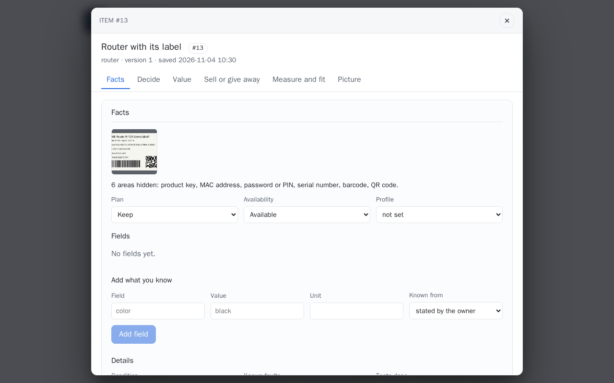
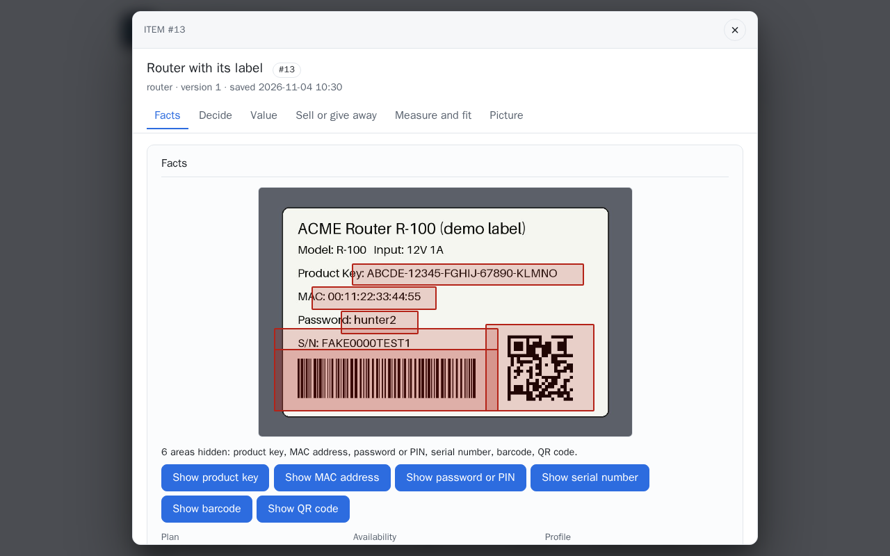
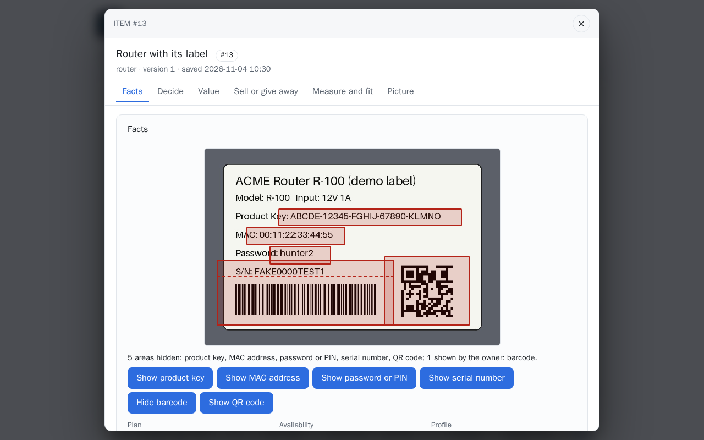
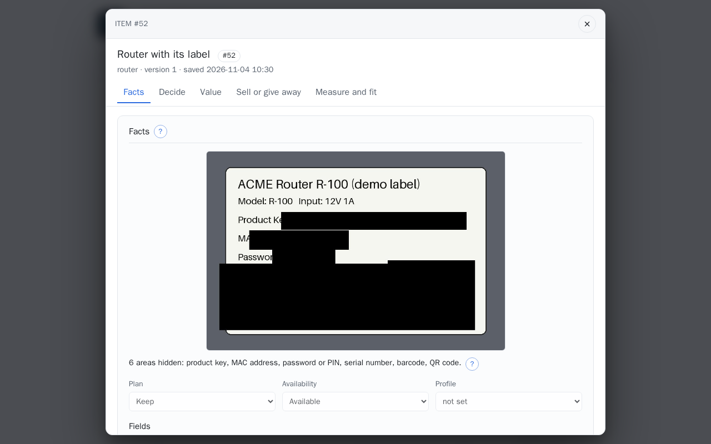

# Private details on photos

Labels carry more than a model number. A laptop's underside has its Windows product key, two
MAC addresses and a serial number; a powerline adapter prints its Wi-Fi password; a monitor
has a service tag and QR codes that encode it. The app finds these on every photo you add and
blacks them out on every copy that leaves your view. You keep the original.

## Step by step

The pictures use a made-up label (every value on it is fake), the one the browser checks use,
whose photo check is recorded; nothing is spent.

1. **Add the photo** to an item: from **Read a label** with **Save privately**, from a capture,
   or on the item. The check runs once, when the photo is kept: one Muse Spark call. Under the
   item's photos a line says what was hidden.

    

2. **Open the photo** (click it). Each hidden area is outlined on your original, and each has a
   button: **Show product key**, **Show MAC address**, and so on. No model call.

    

3. **Show** an area that is nothing private after all; the line under the photo counts it as
   shown by the owner, and its button reads **Hide** to put it back. The choice applies to
   every copy shared from then on.

    

4. **What others get.** Every copy that leaves your view is the shared copy: each hidden area a
   solid black box. Here, the same item as the demo visitor sees it once it is public.

    

**Review the outlined areas before you share a photo**: the boxes are approximate (see
[Limits](#limits)).

## What is found

| Kind | On a photo | In text |
|---|---|---|
| Product key | five groups of five letters and digits (Windows, Office) | the same pattern |
| MAC address | any MAC printed on a label | six hex pairs with `:` or `-`, three groups of four with dots, or twelve hex digits after a MAC label |
| Serial number | a serial number, service tag or express service code with its value | the value after `S/N`, `SN:`, `Serial`, `Serial No.`, `Service Tag`, `SVC Tag` |
| IMEI | an IMEI | fifteen digits that pass the Luhn check |
| Password or PIN | a password, PIN, Wi-Fi key or network key, printed or handwritten | the value after `Password:`, `PIN:`, `WPA key=`, `Wi-Fi password:`, `Network key:` and the like |
| QR code, barcode | every QR code, and every barcode but a retail UPC or EAN on packaging | (not text) |
| Other | an account number, an email address, a network name printed beside its key | (not text) |

Model numbers, part numbers, ratings, FCC IDs, dates and regulatory marks are not private and
stay.

## When a photo is checked

Each photo is checked once, when it is kept: a photo saved with an item from **Read a label**,
added on the item, read in from a phone capture, or loaded with the demo set. The check is one
Muse Spark call per photo ([operation `find-sensitive`](../models/muse-spark.md#private-details-on-photos)).
What it found is kept beside the photo, so showing or sharing it later costs nothing and gives
the same result every time.

Under the item's photos a line says what was hidden:

> 2 areas hidden: product key, MAC address.

Open a photo (click it) and the areas are outlined on your original. Each area has a button:
**Show** it when it is nothing private after all (a model number the check took for a serial),
**Hide** it again. The choice applies to every copy shared from then on.

## What is shared, and what is not

Every copy that leaves your view is the **shared copy**: the photo with each hidden area a solid
black box, re-encoded, no metadata.

- The photo zip of a Marketplace draft (**Download photos**), and the draft's photo list.
- Everything the demo visitor sees: a public item's photos, a public capture's photos, the
  demo set's photos in the sample gallery.

A photo whose check did not finish, or that was never checked, is not shared at all: the
visitor gets nothing for it, and **Download photos** names it and stops. The line under the
photo says why (no recording of it in fixture mode, the operator's pause, an allowance used
up); **Check for private details** runs the check again. For a download you can
choose **Download anyway**, which puts that photo in as it is.

Text that leaves your view is masked by the same rules, without a model: a listing draft's
title, description, facts and tags (with a warning naming what was masked), the build pack and the
share text, and what the demo visitor reads of an item (its name, condition, faults, tests,
accessories and every value) and of a label reading. A serial number keeps its last four
characters (`•••• 7QX9`); a password keeps nothing (`••••`).

## Limits

- **The boxes are approximate.** They come from a model reading the photo with a numbered grid
  drawn on its copy, and are padded; on real labels a box can still miss the first character
  of a value, or the second line of a value that wraps. **Review the outlined areas on the
  opened photo before you share it**, and photograph a label so the private part is not the
  only thing in focus at the edge.
- A value the check does not report is not blacked out. The check is a model's answer, not a
  guarantee; the text rules cover what is typed, not what is printed.
- What is sent to the models is unchanged: a draft's photos still go to Muse Spark as kept, as
  they always did ([what leaves the machine](../operations/privacy.md#what-leaves-the-machine)).
- The demo set's photos were masked by hand before they were committed; the check's areas go
  on top of that. The segmentation overlay and label crops a sample reading shows are drawn from
  those masked files.
