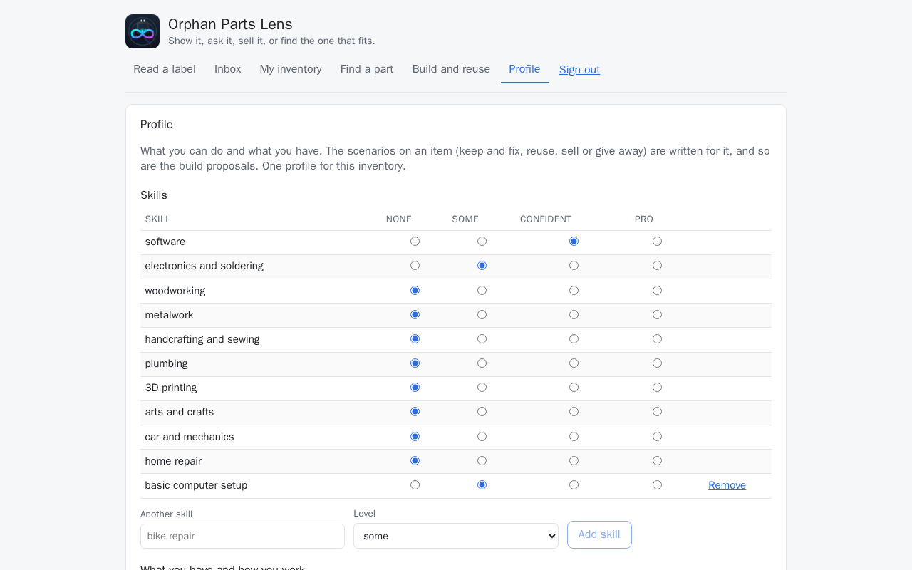
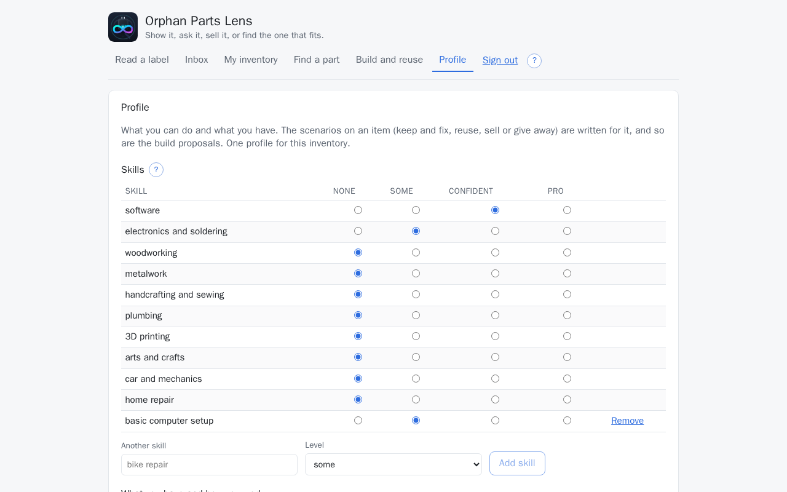
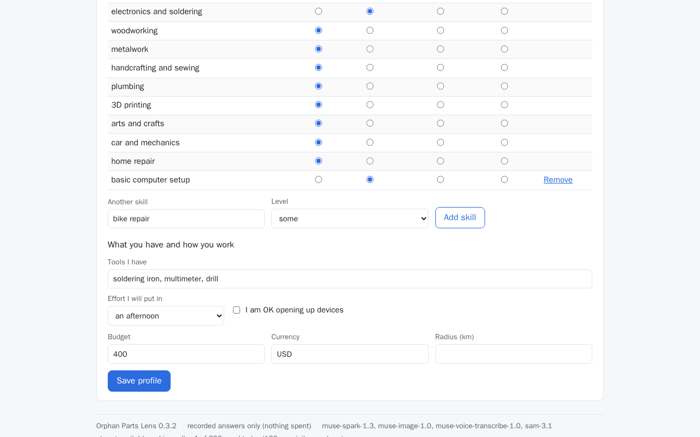
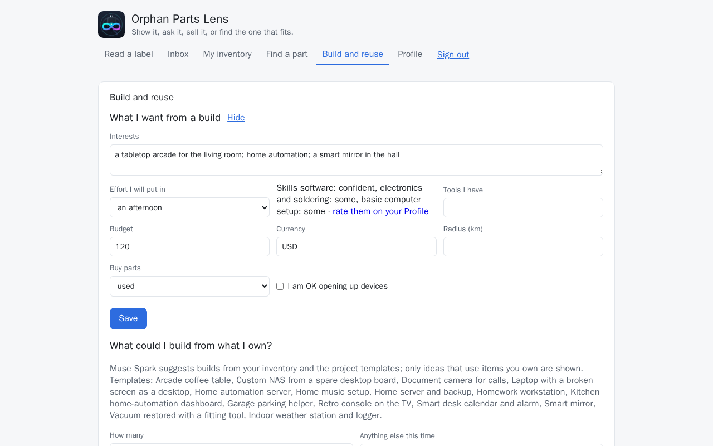
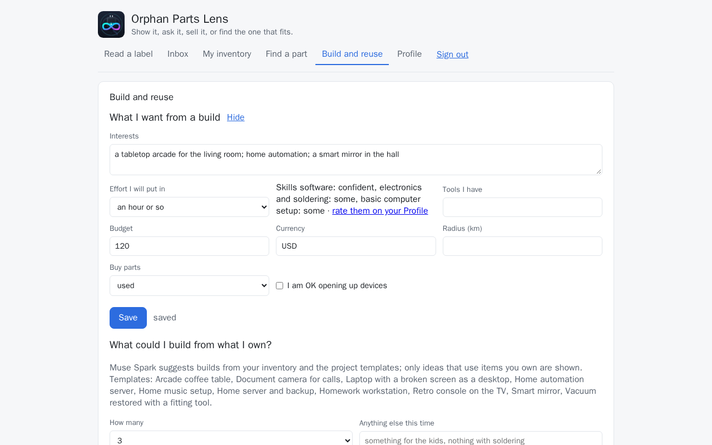
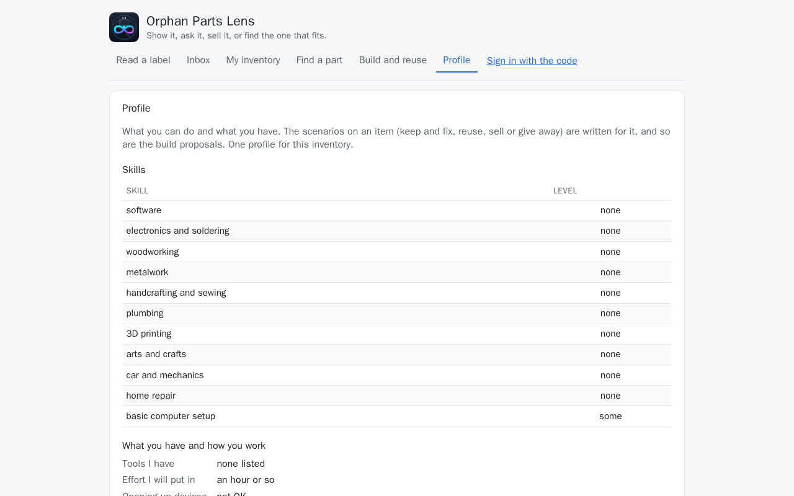

# Profile

What you can do and what you have, kept once for the inventory. The scenarios on an item
([Decide what it becomes](decide.md)) are written for it, and so are the build proposals
([Build and reuse](reuse.md)).

## Step by step

No step on this page calls a model: the profile is a form, read later by the calls that write
the scenarios and the proposals. Saving it needs the access code; the demo visitor sees it
read-only (below).

1. Open **Profile** in the header. **Skills** lists ten skills, each with four levels:
   *none*, *some*, *confident*, *pro*. A skill added on top of them has **Remove** beside it
   (in the pictures, *basic computer setup*, which the demo set adds).

    

2. Rate each skill by its level: here **software** at *confident* and **electronics and
   soldering** at *some*; woodworking, metalwork and the rest stay at *none* until you say
   otherwise.

    

3. A skill that is not listed: type it into **Another skill**, pick its **Level**, then **Add
   skill**. Under **What you have and how you work**, **Tools I have** takes your tools in a
   line; then **Effort I will put in**, **I am OK opening up devices**, **Budget**,
   **Currency** and **Radius (km)**.

    

4. **Save profile**. The form says *saved*.
5. On **Build and reuse**, **What I want from a build** is the same record: **Edit** opens
   **Interests**, **Effort I will put in**, the rated skills in a line with a link back here
   (*rate them on your Profile*), **Tools I have**, **Budget**, **Currency**, **Radius (km)**,
   **Buy parts** (used, new or either) and **I am OK opening up devices**. **Save** keeps it.

    

    

What the profile changes is on [Decide what it becomes](decide.md) (the cards say how hard a
step is for you) and [Build and reuse](reuse.md) (the proposals).

## Built so far

**Profile**, in the header, is one form:

- **Skills**, each rated *none*, *some*, *confident* or *pro*. Ten are always listed: software,
  electronics and soldering, woodworking, metalwork, handcrafting and sewing, plumbing, 3D
  printing, arts and crafts, car and mechanics, home repair. **Another skill** and **Add skill**
  add one of your own with its level; a skill of your own can be removed, the listed ones stay at *none*.
- **Tools I have**, in a line.
- **Effort I will put in**: an hour or so, an afternoon, or a weekend or more.
- **I am OK opening up devices**.
- **Budget**, **Currency** and **Radius (km)**.

**Save profile** keeps it. The record is the one behind `GET /api/preferences` and
`PUT /api/preferences`; the Build page's form edits its interests and the way you buy (used,
new or either) and shows the rated skills in a line with a link here.

**Ratings and older records.** The skills are a list of `{skill, level}`. A record saved before
the ratings held plain names; it is read as it is stored, and each plain name reads as *some*.
The record is written in the rated shape the next time it is saved. `PUT /api/preferences`
takes either shape: a plain name in a request is a skill at *some*. A blank name is dropped and
a name given twice keeps its first rating.

**How the scenarios use it.** The brief names every rated skill with its level, the tools, the
effort in words, whether you open devices up and the budget. Each card says how hard the work
is for you and names the skill that makes it so; a repair that needs plumbing is *hard* when
plumbing is *none*. Without a saved profile the cards are written for an average person with
household tools and the panel says so. The answers the demo loader writes (`./dev demo`) do not
count as a saved profile until you save the form yourself.

Without the access code the profile is read-only: the skills with their levels, the tools, the
effort and whether devices are opened up, never the budget or the radius, and no **Save
profile**.

