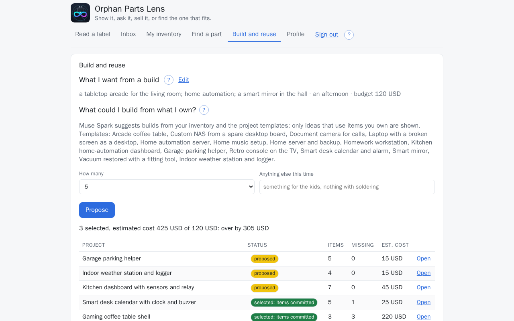
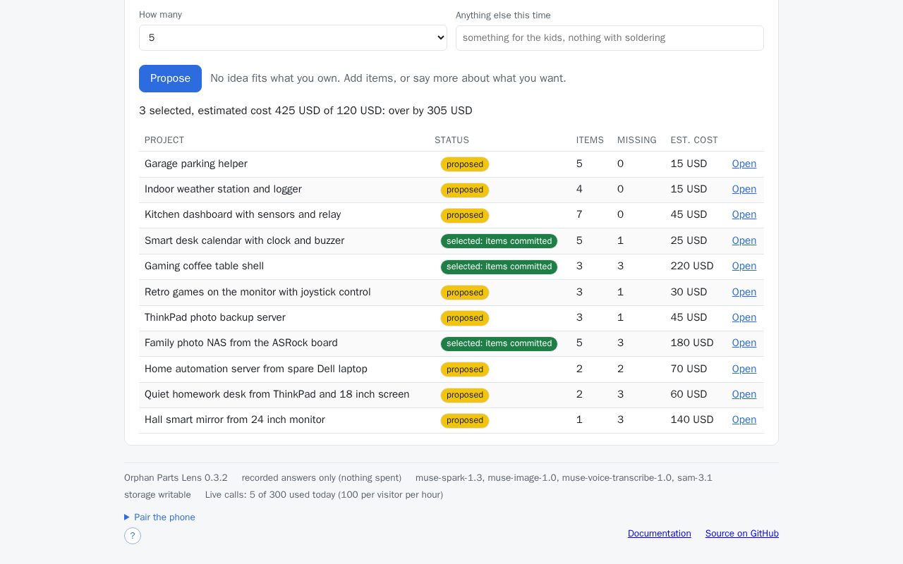
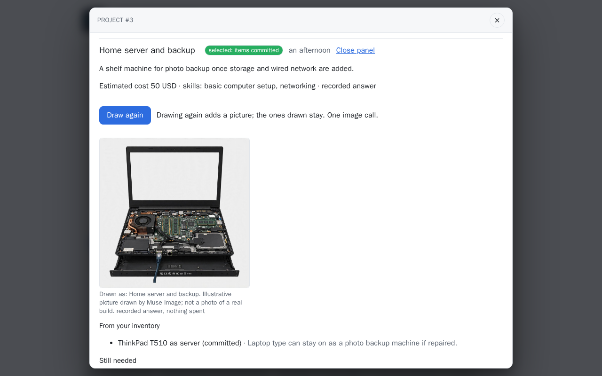
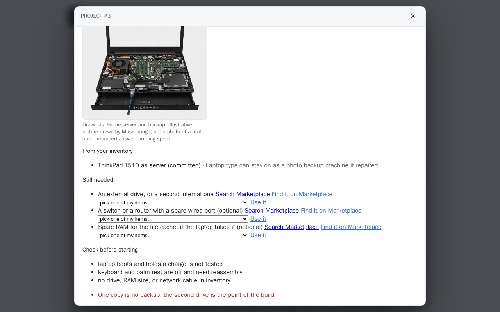
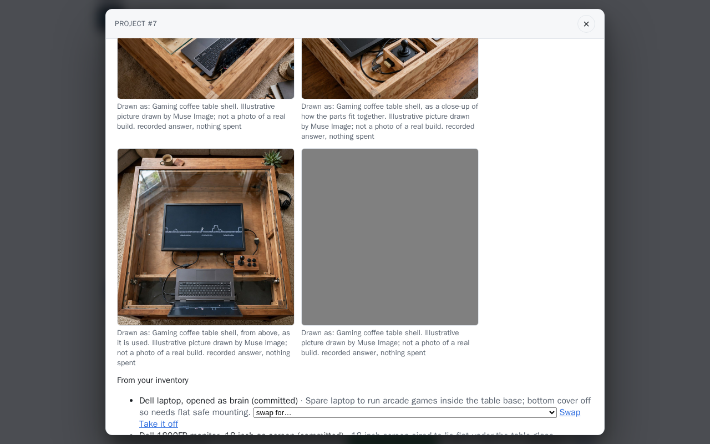
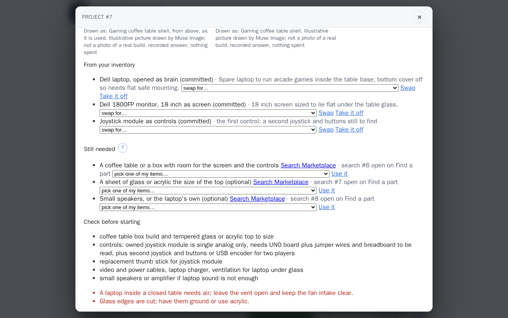
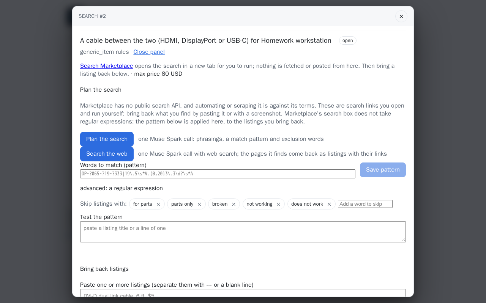
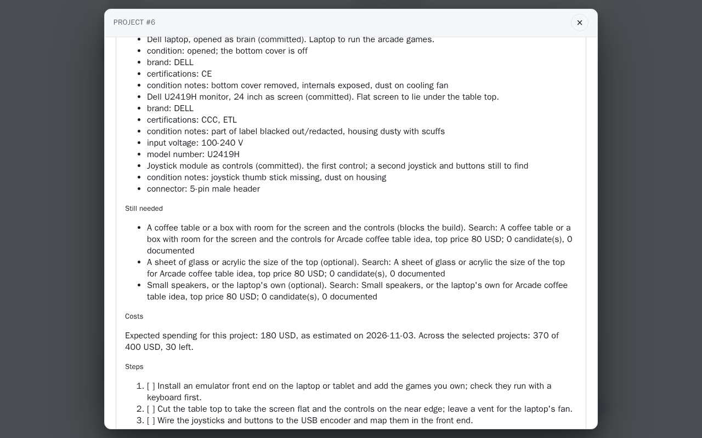
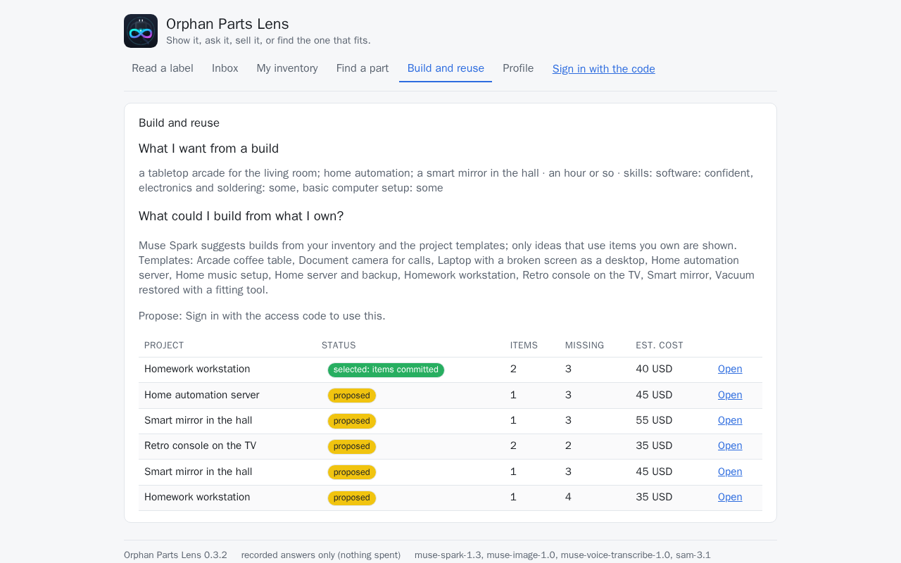
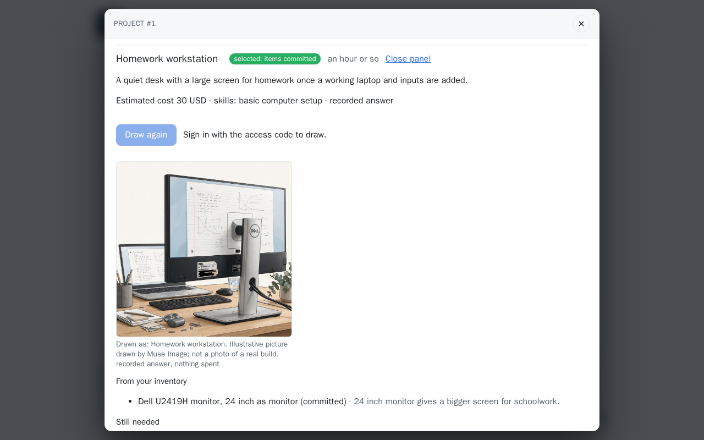

# Build and reuse

What could you build from what you already own? Say what you want from a build, ask for
proposals, and pick the ones you will do. Every proposal rests on items in your inventory;
what is missing becomes a search you run on Marketplace.

## Step by step

The pictures come from the demo set (`./dev demo`) on a stack answering from recordings. Each
step says whether it calls a model. Without the access code the page is read-only (see the end of this section): proposing,
selecting, drawing and writing a pack are refused with the demo line.

1. **Say what you want.** On **Build and reuse**, **What I want from a build**, **Edit**: your
   interests, effort, budget and how you buy parts, then **Save**. The skills come from your
   [Profile](profile.md#step-by-step). No model call.
2. **Ask for proposals.** Under **What could I build from what I own?**, pick **How many** (up
   to five), add a line under **Anything else this time** if you like, and press **Propose**.
   One Muse Spark call that reads the inventory through tools (about $0.01 to $0.03).

    

3. **Read the table.** Each kept proposal is a row: the project, its status (*proposed*), how
   many of your items it uses, how many requirements are still missing and the estimated cost.
   The line above it is the budget across the selected projects. **Open** one.

    

4. **Look at a project.** The panel says what it is for, the estimated cost and the skills it
   asks for; **From your inventory**, the items it would use and why; **Still needed**, each
   missing requirement with **Find it on Marketplace** and, to fill it with something you
   own, *pick one of my items* and **Use it**; **Check before starting**, the unknowns; and
   **Steps**. At the foot: **Shortlist**, **Select and commit the items**, **Abandon**.

    

5. **Select it.** **Select and commit the items** reserves the items for this build: the status
   reads *selected: items committed* and each item says *(committed)*. An item another build
   holds is named, with **Move it here**. The steps become a checklist. No model call.

    

6. **Draw it** (when pictures are on): one Muse Image call (about $0.01) draws how the finished
   build could look, captioned as drawn, *not a photo of a real build*.

    

7. **Turn a missing piece into a search.** **Find it on Marketplace** beside a requirement
   opens a search for it on **Find a part**, with the budget left as its top price; the line
   then reads *search #… open on Find a part*. No model call.

    

    On **Find a part**, the new search has **Search Marketplace** and the planning tools of
    [Find a part](search.md#step-by-step).

    

8. **Write the build pack.** Under **Build pack**, **Write the build pack**: one Markdown
   document written by the rules, no model call, read in place under the button. **Download**
   keeps it; a change to an item, the project or the budget marks it *out of date*, and
   **Write it again** adds a version, each listed with **Show**.

    

9. **Build and record it.** Once every blocking requirement is filled, **Start building**; tick
   the steps as you go; **Record the outcome** with what was set up, how it was tested and
   its limits. No model call.

### Without the access code

The demo visitor sees **Build and reuse** read-only: what the owner wants from a build, and the
projects built on public items alone, each with its items, what is still needed, what to check
the steps open, and every picture drawn of it side by side (the demo set draws each project
once); what is still needed carries a **Search Marketplace** link for each part; and a selected
project shows its build pack read in place, with the Markdown file to download (the demo set
selects its projects and writes their packs, by the rules, no model). **Propose**, the project's
buttons and **Draw again** give way to the sign-in line; nothing is spent and nothing is kept.





## Built so far

**What I want from a build.** A few answers kept once and read by every proposal: your
interests, the effort you will put in, your skills, the tools you have, whether you open
devices up, a budget with its currency, a radius, and whether you buy used, new or either. It
is the same record as your [profile](profile.md); the skills are rated there, and the form
here shows them in a line.

**Proposals.** Muse Spark reads your inventory and the project templates through tools (the
items a build may count on, one item in full, the catalog of templates) and proposes up to five
projects, each with the item it would use for every requirement and a line of why, what is
missing, the effort, the extra spending it expects and the unknowns to check before starting.
The rules keep a proposal only where the inventory backs it: an allocation must name an item
you have, usable (not gone, not meant for sale or giving away) and of a kind the requirement
takes; anything else is dropped and said. Nothing is invented: a template the data does not
hold is not proposed, and a toaster called "old laptop" does not become a laptop.

**Templates are data.** A project is a YAML file under `backend/app/projects/data/`: what it is
for, the practical result, the effort and skills, a typical cost, the requirements (each with
the kinds of item that fill it, whether it blocks the build, and the profile a search for it
runs under), the steps, the safety lines and the guidance by name. Fifteen ship: a homework
workstation, a home server and backup, a home automation server, a smart mirror, a document
camera for calls, a home music setup, a retro console on the TV, an arcade coffee table, a
laptop with a broken screen used as a desktop, a vacuum restored with a fitting tool, a custom
NAS from a spare desktop board, a smart desk calendar and alarm, a kitchen home-automation
dashboard, an indoor weather station and a garage parking helper (the last four from an
Arduino-type board and sensor modules). A kind sold on a small board counts as the kind: a
*relay module* fills a requirement for a relay. The model never changes them.

**Projects.** A proposal becomes a project in the **proposed** state with exploratory
allocations. **Shortlist** it, or **Select** it: selection commits its items, and a committed
item is reserved in the inventory, for as long as a selected, building or done project counts
on it. One item is committed to one such build at a time: a
second project that wants it is answered with the conflict, and moves the item only when you
say so, which opens the requirement again on the project that lost it. **Abandon** releases
what nobody else holds. A selected project moves to **building** once every blocking
requirement is filled, then to **done**.

**The budget.** What the selected set (selected, being built or done) expects to spend, against
the budget you set, is one line above the projects. **Find it on Marketplace** turns a missing requirement into a
[search request](search.md) under the requirement's profile, with the budget left as its top
price. **Use it** fills a requirement with an item of yours the proposal overlooked or you
bought since, saved in the inventory first; it must be of a kind the requirement takes, and a
search open for it is marked found.

**The build pack.** For a selected project, one Markdown document written by the rules from
what stands on the day: the goal, the items with their accepted values (never a serial number,
a location or a note), what is still needed with the search opened for it and its documented
candidates, the costs with their dates, the tools you said you have, the steps with your
progress, the safety lines, the unknowns to check, the guidance by name, the limits that always
apply, and the outcome once recorded. Nothing is asked of a model. Each pack carries a version,
the day it was written and a digest of its inputs; a change to an item on it, to the project
or to the budget marks it **out of date**, and the next writing is the next version. **Download**
keeps it as a file.

**Progress and the outcome.** While a project is selected or being built, its steps are a
checklist. When it is being built, record the outcome in your words: what was set up, how it
was tested, the day, whether it works, and its limits. A working result marks the project
**done** and keeps its items reserved; a failed test keeps it being built, with the record
kept. Proposed, being built and working stay distinct. The outcome is yours; **Share the
outcome** turns it into a text for other people that names the kinds of items, the result, the
set-up, the test and the limits, and nothing else: no item names, ids, values, places or
prices. It is off until you switch it on.

**Draw it.** A project's panel has **Draw it**: Muse Image draws how the finished project
could look, from its title, what it results in and the kinds of the items on it with up to
three accepted values each (never one that identifies an item, a name, the location, the notes
or a price). One image call per click; opening the panel or proposing draws nothing. The
pictures are kept with the project and shown when the panel opens again, captioned as drawn,
*not a photo of a real build*. While pictures are off on the server the panel says so instead
of showing the button; the demo visitor sees it disabled with *Sign in with the access code to
draw.* See [Muse Image](../models/muse-image.md).

## From the API

```bash
curl -s -X PUT localhost:8000/api/preferences -H 'content-type: application/json' \
  -d '{"interests": "a quiet desk for homework", "effort": "low", "budget": 50}'
curl -s -X POST localhost:8000/api/projects/propose -H 'content-type: application/json' -d '{"count": 3}'
curl -s -X POST localhost:8000/api/projects/1/select -H 'content-type: application/json' -d '{}'
curl -s -X POST localhost:8000/api/projects/1/requirements/video_cable/search
curl -s -X POST localhost:8000/api/projects/1/pack | jq -r .markdown
curl -s -X POST localhost:8000/api/projects/1/picture   # one image call; needs PICTURE_ENABLED
curl -s -X POST localhost:8000/api/projects/1/outcome -H 'content-type: application/json' \
  -d '{"configuration": "laptop on the monitor over HDMI", "test": "a full homework session", "tested_on": "2026-10-29", "working": true}'
```

## Not yet

The pack as a PDF, and a pack that cites the candidate listings' pages, are under
[Next steps](../project/next.md).
