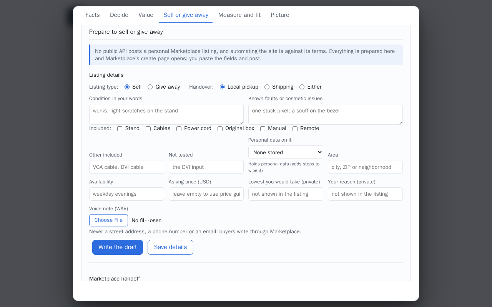
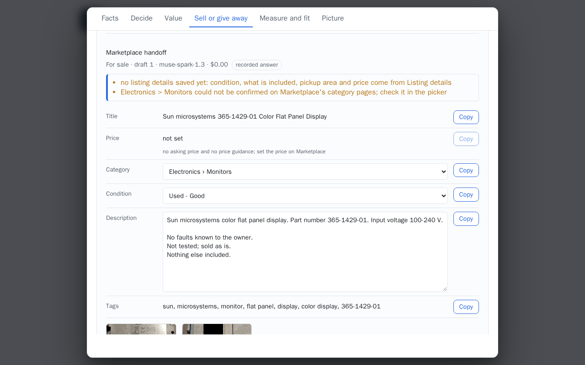
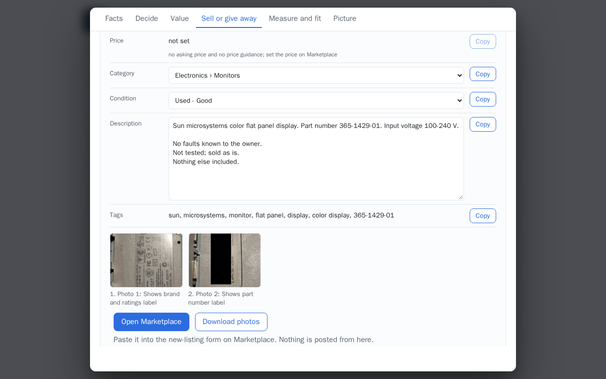
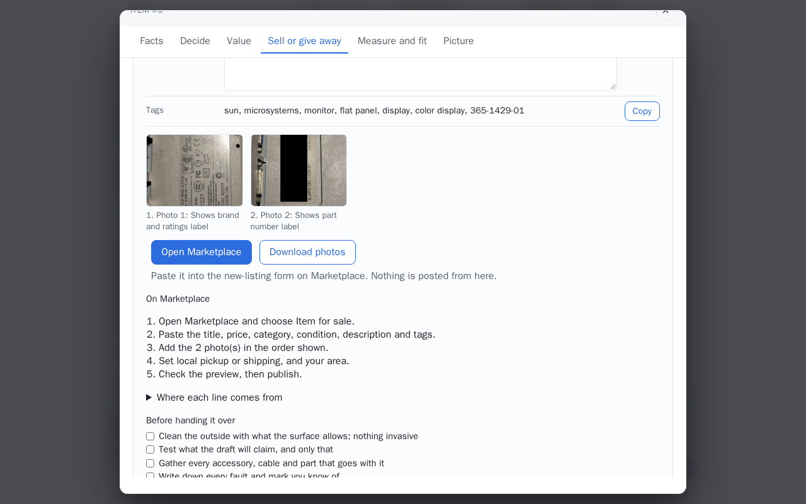
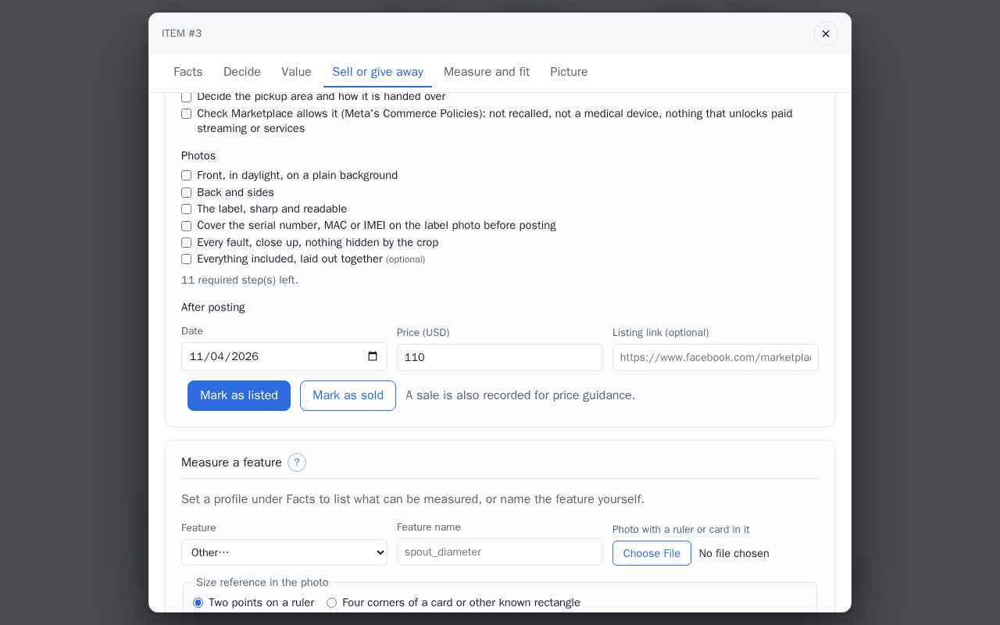
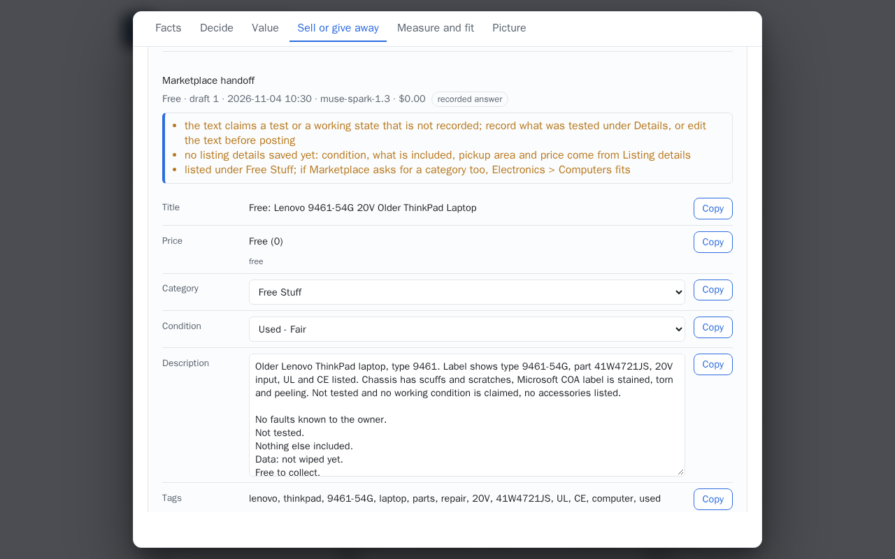
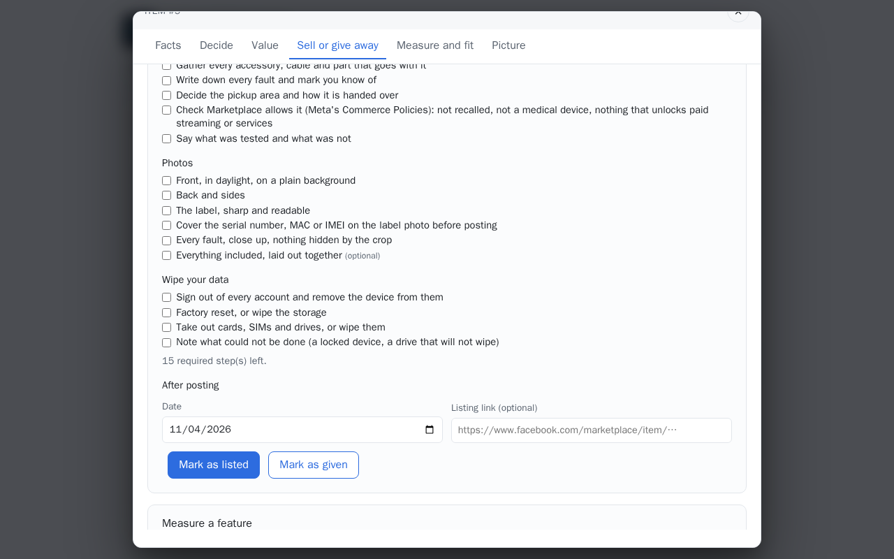

# Seller flow

Photos in, a Facebook Marketplace (US) listing out: the label read and confirmed, the listing
details you give, a draft in Marketplace's fields with the disclosures the rules require, and
the handoff to the create page. Posting is yours.

## Step by step

The pictures show the Sun monitor and the older ThinkPad from the demo set, with the drafts the
demo set wrote for them. Without the access code none of this is shown, not even on a public
item.

1. **Listing details.** In the item, **Sell or give away**. Under **Prepare to sell or give
   away**: **Listing type** (**Sell** or **Give away**), **Handover**, **Condition in your
   words**, **Known faults or cosmetic issues**, what is **Included**, **Other included**, **Not
   tested**, **Personal data on it**, **Area**, **Availability**, **Asking price (USD)**, and the
   two that never reach the listing: **Lowest you would take (private)** and **Your reason
   (private)**. A **Voice note (WAV)** is transcribed and kept as your words. **Save details**
   keeps them without a draft.

    

2. **Write the draft.** One Muse Spark call (under $0.01) writes the listing from the confirmed
   values, your details and the photos. The **Marketplace handoff** opens with what the rules
   want you to know first (here: no listing details saved yet, and a category to check in
   Marketplace's picker).

    

3. **Copy the fields.** **Title**, **Price**, **Category**, **Condition**, **Description** and
   **Tags**, each with **Copy**; the category and the condition can be changed in their lists
   first. With no asking price and no guidance, the price is left for you (*not set*).

    

4. **Photos and Marketplace.** The photos in the draft's order, each with why it is there;
   **Download photos** gets them as a zip in that order, each with its private details blacked
   out ([Private details on photos](private-details.md)); **Open Marketplace** opens
   Marketplace's create page in a new tab. **On Marketplace** lists the steps there, and
   **Before handing it over** is a checklist kept with the draft.

    

5. **After posting.** Under **After posting**: the **Date**, the **Price (USD)** and the
   **Listing link (optional)**, then **Mark as listed**, and later **Mark as sold**, which also
   records the sale for price guidance. No model call.

    

6. **Give it away.** With **Give away** as the listing type the draft is *Free*: the title starts
   with *Free:*, the price is 0, the category is **Free Stuff** (with the category it would
   otherwise take named), and the description ends with *Free to collect.*

    

    An item that holds personal data gets **Wipe your data** in the checklist; **Mark as
    given** records the gift.

    

Posting is yours: nothing here fills, reads or submits a Facebook page.

## The hard limit

No public API posts a personal Facebook Marketplace listing, and automating the site is against
its terms. The app prepares every field, zips the photos in order and opens Marketplace's create
page in a new tab; you paste the fields, add the photos and post. Nothing here fills, reads or
submits a Facebook page, and the service sends nothing to facebook.com.

## Before the draft

**Read a label** takes up to four photos. With *Find the label in the photo first* on, SAM 3.1
looks for the item, the label and the connector in the first photo; the overlay shows the
regions it found, with a note for each it did not, and when a label is found its crop goes to
Muse Spark with the photos, so every value is sourced `label_crop`. When the label
cannot be found first, the photos are read whole and the page says why. The evidence table
shows every field read with its value, unit, confidence, source and the text as printed, the
warnings, the label transcription, the model and the cost of the calls. **Save privately** turns
the reading into an item in [My inventory](inventory.md), where each observed value is confirmed
or corrected before anything is drafted.

## The flow

**Prepare to sell or give away** is a section of the item's dialog; **Sell** or **Give away**
in [Decide](decide.md) scroll to it with the listing type set. It is behind the access code:
the demo visitor sees neither the details nor a draft, not even on a public item.

1. **Listing details.** The listing type (sell or give away) and what a buyer asks about:

    | Field | In the listing? |
    |---|---|
    | Condition in your words | yes, as your words |
    | Included: stand, cables, power cord, original box, manual, remote, and other | yes |
    | Known faults or cosmetic issues | yes, always disclosed |
    | Not tested | yes, always disclosed |
    | Personal data on it: none stored, signed out and wiped, not wiped yet | yes, when it stores any |
    | Handover: local pickup, shipping or either (a give-away is pickup) | yes |
    | Area: a city, ZIP or neighborhood | yes |
    | Asking price (USD, above 0) | in the price field, in whole dollars |
    | Availability | yes |
    | Lowest you would take | **never**: kept for you |
    | Your reason for parting with it | **never**: kept for you |

    The details are saved on the item, a new version each time (`PUT /api/items/{id}/sell-details`).
    An area that reads as a street address is refused, and so is a phone number, an email address
    or a street address in any free-text field: buyers write through Marketplace. A voice note is
    kept as your words (`condition_notes`) and the draft reads it from there. Switching the listing
    type to give away keeps the saved prices and handover; a give-away is priced 0 and picked up.

2. **Write the draft.** The details are saved, then one Muse Spark call (effort low) gets the
    item's accepted values, your public details and the item's photos (the first four, sent at
    768 px, even when `MAX_PHOTOS` allows more), and writes the listing in Marketplace's shape. The
    lowest price, the reason and the asking price are not in what the model reads, and neither is
    a value that identifies the item (a serial number, MAC address or IMEI): one the model reads
    off a photo is taken out of the title, the description and the tags, with a warning. The rules then check what came back:

    - **Title:** at most 100 characters, brand, model and key spec first; a give-away starts
      with *Free:*.
    - **Price:** whole dollars, as Marketplace takes them: your asking price (cents rounded,
      and said); with none, the typical figure of the latest
      [price guidance](value.md), named as such ("suggested: the typical figure of price
      guidance v2, $32; set your own"); `0` for a give-away. A sale is never priced 0, which
      Marketplace shows as free: with no figure of a dollar or more the price is left for you.
    - **Category:** one path from the data file below; a name not in it falls back to its top
      category, or is left for you to pick, with a warning. A give-away is listed under
      *Free Stuff*, and the category the draft picked is named in case Marketplace asks for one.
    - **Condition:** one of the four below. *New* only when you said new and named no fault;
      otherwise it becomes *Used - Like New*, with a warning.
    - **Description:** the model's few sentences, then the lines the rules add whatever was
      written: known faults, what was tested or that it was not, what was not tested, what is
      included, the data line when the item stores any, the pickup or shipping line, and
      availability. A phone number, an email or a street address in the text is taken out and
      said.
    - **Tags:** up to 20, at most 30 characters each, no repeats.
    - **Photo order:** the item's photos, best first, each with a reason; a photo the draft left
      out goes after the others.

    Lines that rest on nothing confirmed are dropped and listed under *Before posting*; a draft
    says when the item or the details changed since it was written.

3. **Marketplace handoff.** Each field has a **Copy** button: title, price, category,
    condition, description, tags. The category and the condition are lists from the data file
    and can be changed before copying. **Download photos** gets a zip of the photos in the
    draft's order (`01-photo-2.jpg`, `02-photo-1.jpg`, ...), as stored: re-encoded when they came
    in, with no camera metadata. **Open Marketplace** opens `MARKETPLACE_CREATE_URL` in a new
    tab. The checklist under it: choose *Item for sale*, paste the fields, add the photos in
    order, set pickup or shipping and the area, check the preview, publish. The preparation
    steps (clean, test, photos with the serial number, MAC or IMEI covered on the label, your
    data) are ticked and kept per draft, and so is checking that
    Marketplace allows the item at all: its Commerce Policies refuse, among others, recalled
    products, medical devices and anything that unlocks paid streaming or services.

4. **After posting.** **Mark as listed** keeps the date, the price and the listing link when you
    paste it; while it is listed, **Listed again at $…** records a new price. Each button waits for
    its write, and a sale is listed at a price above 0. Later, **Mark as sold** keeps the final price, records
    it as a sale for price guidance (`note: Facebook Marketplace`) and marks the item gone, in one
    write; **Mark as given** marks it gone. Nothing follows a sale or a gift (409), so a sale is
    never counted twice. Each is an event in the item's history.

## US categories and conditions

The categories live in `backend/app/listing/marketplace_us.yaml`, read from the public category
index at `facebook.com/marketplace/categories/` and the category pages under it in October 2026.
A name found there is marked `seen: true`; a name in common use that could not be confirmed there
is `seen: false`, and a draft that picks one says to check it in Marketplace's picker.

| Category | Subcategories |
|---|---|
| Electronics | Computers; Cell Phones; Cameras; Video Games & Consoles; Printers, Scanners & Fax Machines; Monitors\*; Audio\*; TV & Video\* |
| Home Goods | Kitchen & Dining\*; Furniture |
| Home Improvement Supplies | Tools\*; Electrical\* |
| Garden & Outdoor, Toys & Games, Musical Instruments, Office Supplies, Pet Supplies, Hobbies | |
| Sporting Goods\*, Auto Parts\*, Baby & Kids\*, Arts & Crafts\* | |
| Free Stuff | (where a give-away is browsed) |

\* not confirmed on the category pages.

Conditions, best first: **New**, **Used - Like New**, **Used - Good**, **Used - Fair**.

Marketplace changes its picker without notice; the draft's choice is a starting point, and the
create page is where it is settled. See also [Marketplace handoff](marketplace.md).
