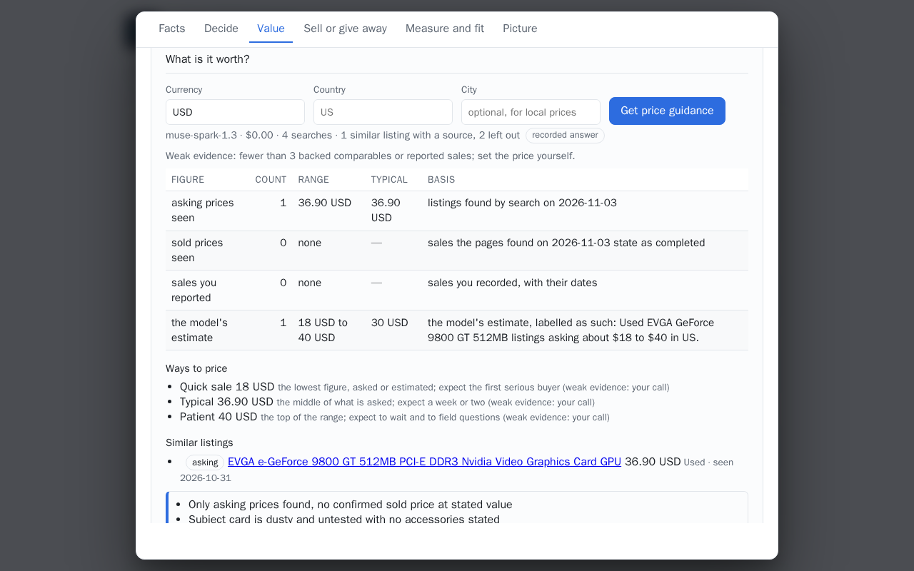
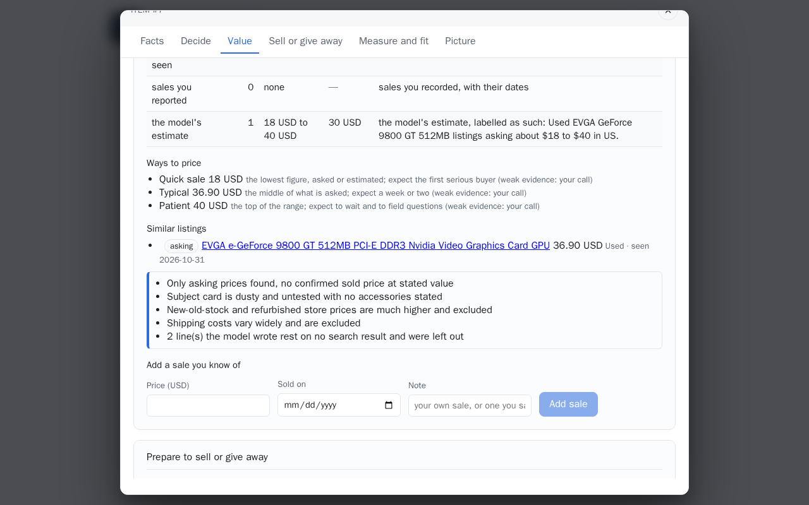
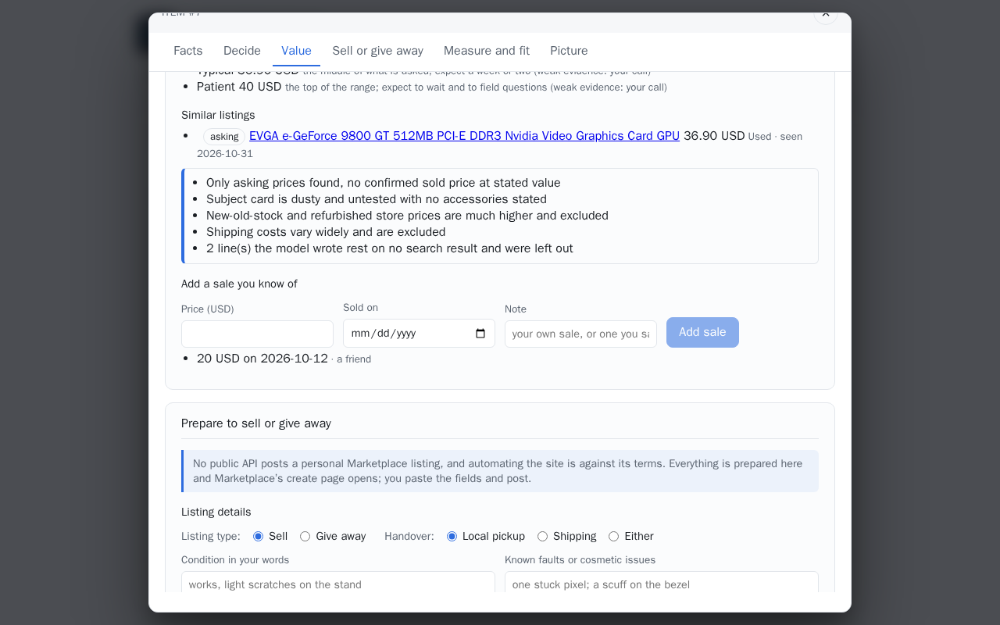

# Value an item

Photograph the item, or start from an identified spec, and ask what it is worth and whether it is
worth selling. The answer is an estimate from cited comparables with their dates, a range rather
than one number, the condition factors that move it, and a plain yes or no on whether listing it
is worth the effort. Every estimate is labelled as an estimate.

## Step by step

The pictures show the graphics card from the demo set, whose price guidance the demo set keeps.
Without the access code price guidance is not shown.

1. In the item, **Value**. Under **What is it worth?**: **Currency**, **Country**, **City**
   (optional, for local prices), then **Get price guidance**: one Muse Spark call with web
   search, about $0.04 to $0.07. The line under the button names the model, the cost, the
   searches made, how many listings a source backs and how many were left out; *Weak evidence*
   when fewer than three back it. The table keeps the four figures apart.

    

2. Below the table: **Ways to price** (quick sale, typical, patient), **Similar listings**, each
   linked to its page with the day it was seen, and the caveats.

    

3. **Add a sale you know of**: **Price (USD)**, **Sold on**, **Note**, then **Add sale**. It is
   listed under the form and counts as *sales you reported* in the next guidance. No model call.

    

## Built so far

**What is it worth?**, on the item's page. Pick the currency, and the country and city for local
results, then **Get price guidance**. Muse Spark searches the web for listings and sales of
the same model and condition (see [search grounding](../models/muse-spark.md#search-grounding))
and proposes comparables (shown as *Similar listings*); the rules keep only those a search result or a citation backs, in the
requested currency, and say how many lines were left out. Nothing is converted between
currencies and nothing is invented.

Four figures, never merged, each with its count, range, typical value, source and date:

| Figure | What it is |
|---|---|
| asking prices seen | listings found by the search, on the day they were seen |
| sold prices seen | sales the found pages state as completed; an asking price is never labelled sold |
| sales you reported | what you recorded under *Add a sale you know of*, with its date |
| the model's estimate | the model's low, typical and high, labelled as an estimate with its basis |

Three ways to price follow, each from a figure that exists: quick sale (under the lowest asking
price seen), typical (the middle of what is asked) and patient (the top of the range). With fewer
than three backed comparables and reported sales the guidance says **weak evidence** and the
strategies say so too; you set the price either way. Every comparable links to its page with the
date it was seen. Caveats come from the model and from the rules.

**Whole or parts.** When the item has parts recorded as their own items, the guidance compares the
whole against the sum of the parts' own latest guidance, with the number of listings that means;
a part without guidance of its own is never priced by guess.

A guidance is written from one item version and says **item changed since** when the item was
edited after it. Asking what it is worth changes nothing about the item, and neither does a
decision on it (keep, sell, give away): the guidance stays current through those.

## From the API

```bash
curl -s -X POST localhost:8000/api/items/3/price -H 'content-type: application/json' -d '{"currency": "USD", "country": "US"}'
curl -s -X POST localhost:8000/api/items/3/price/reports -H 'content-type: application/json' -d '{"price": 16, "sold_on": "2026-09-30", "note": "a friend"}'
curl -s localhost:8000/api/items/3/price
```

See [HTTP API](../reference/http-api.md).
