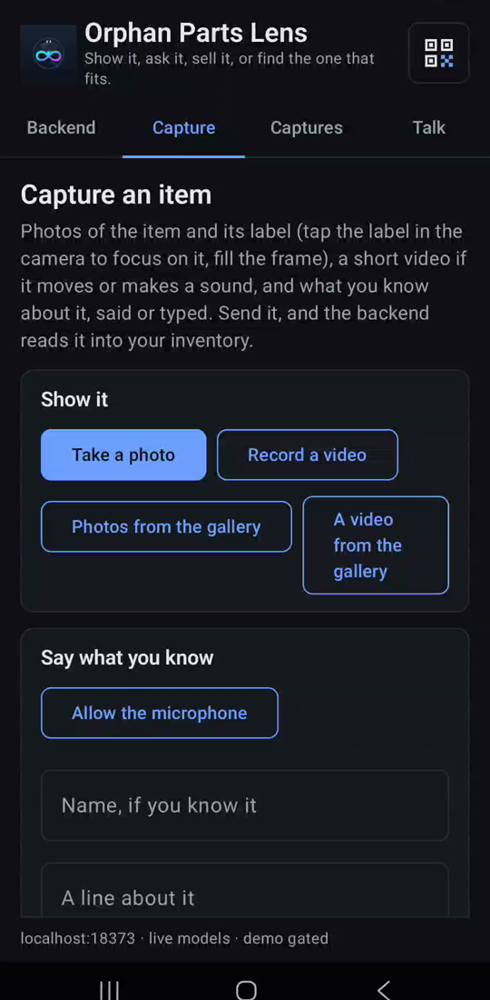
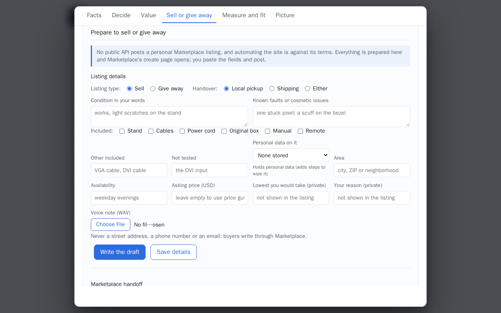
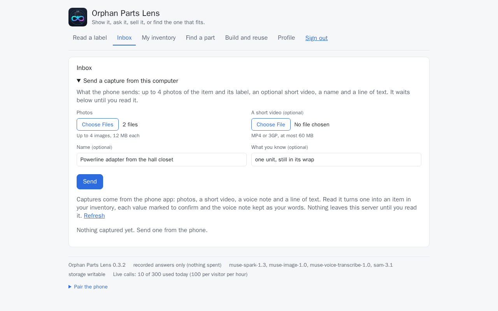

# Voice notes and video capture

Say what you know about a part and keep it as your words with Muse Voice Transcribe; send a
short video with a capture. Picking the sharpest label frame out of that video is not built.

## Built so far

**Voice note.** On an item's page, under *Prepare to sell or give away*, signed in, pick a WAV recording
(ten minutes at most, within the upload bound of `MAX_UPLOAD_MB`: about six minutes of 16 kHz
16-bit mono, twice that at 8 kHz). Muse Voice Transcribe turns it into text, kept on the item as the field
`condition_notes` with the source `voice_note`, accepted as your own words; the draft reads it
from there. A transcript longer than the field holds (4000 characters) is cut at a word and the
answer says so; say the rest in another note. `POST /api/items/{id}/voice`. The phone's
**Talk** tab and a capture's spoken note are kept the same way
([Android app](android.md), [Capture from the phone](capture.md)).

**Video.** A capture from the phone, or from the Inbox's form, carries one short MP4 or 3GP
video, kept and played back in the Inbox; no frame is read from it yet, so what the label says
has to be in a photo ([Next steps](../project/next.md)).

## Step by step

1. **On the phone:** on the **Capture** tab, **Allow the microphone** once, then hold to talk
   under **Say what you know**; **Record a video** adds a clip. The note is transcribed when
   the capture is read (one Muse Voice Transcribe call); the clip is kept, not read.

    { width=300 }

2. **On the computer:** in the item, **Sell or give away**, **Voice note (WAV)** under the
   listing details takes a recording; the transcript is saved as your condition notes.

    

3. **A video from the computer:** the Inbox's **Send a capture from this computer** has
   **A short video (optional)**, an MP4 or 3GP file.

    
