# How the drawings were improved

The demo set's 32 drawings (13 of items and reuse cards, 19 of projects and their views) were
checked on November 3, 2026 with `./dev picture-review --decide`, each against the facts it had
to show ([Review and redraw the drawings](../guides/picture-review.md)). Five were drawn again
with a corrected brief and checked again.
Later the same day the requests themselves were changed: the drawing parameters were tuned
from these reviews, twice, and every drawing of the set was drawn again
([Tuning the parameters, version 1 to 3](#tuning-the-parameters-version-1-to-3)). The drawings
shown in the first sections are the ones version 1 drew.
On November 4 the review's facts were fixed, every drawing that still missed was drawn several
times and the best kept ([Best-of-N](#best-of-n): 17 matches before, 29 of 32 on a fresh review
after), and the Decide cards were tuned the same way ([Text tuning](#text-tuning): flagged
cards 16 to 10 of 44).

## The review

| Verdict | Drawings |
|---|---|
| matches | 8 (7 item pictures, 1 project view) |
| partly | 22 (17 project drawings, 4 reuse cards, 1 item) |
| wrong | 2 |

Issues found, by category: legible text or logos 24, implausible 7, scale 4, missing part 3,
invented part 2, wrong setting 1. Most *partly* verdicts rest on text alone: the drawings
carry brand names (*DELL* on a bezel, *Kingston* on a drive) although every request asks for
none. They mislead nobody about the build and were left as they are.

The two **wrong**:

- **Hall smart mirror from 18 inch monitor** (`project:2#1`). Drawn as a widescreen television
  of 50 inches or more filling the wall above a bench, with *DELL 1800FP* written on the
  screen. The request named the monitor by *brand DELL, input voltage 100-240 V, model number
  1800FP*: a part carries at most three accepted values into the prompt, in alphabetical order,
  and the screen size was not among them.
- **The powerline adapter as a home automation link** (`item:powerline#1`). Drawn still in its
  plastic wrap, hanging off its cable. The item's own picture carries its condition (*still in
  its plastic wrap*), which the request said before the use (*unwrapped and plugged into the
  wall socket*).

Three more were redrawn as clearly off, though *partly*: the home server with a memory stick
drawn inside the laptop's lid (`project:5#1`), the NAS from above with a second drive and a
2.5 inch SSD drawn at 3.5 inch size (`project:4#3`), and the arcade coffee table from above with
its 24 inch monitor no wider than the laptop (`project:7#3`).

## Before and after

| Drawing | Before | After |
|---|---|---|
| Hall smart mirror (`project:2#1`) | 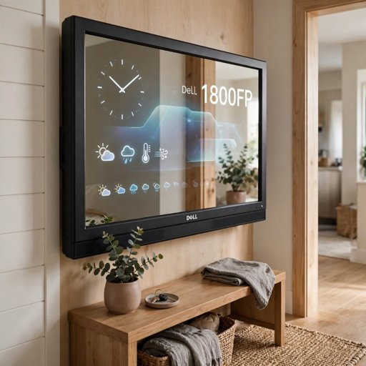{ width="240" } wrong | 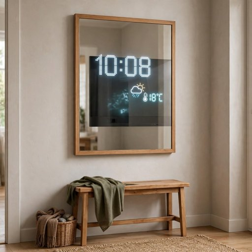{ width="240" } matches |
| Powerline adapter (`item:powerline#1`) | 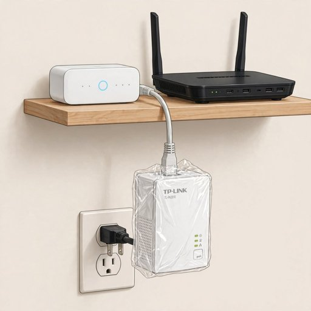{ width="240" } wrong | 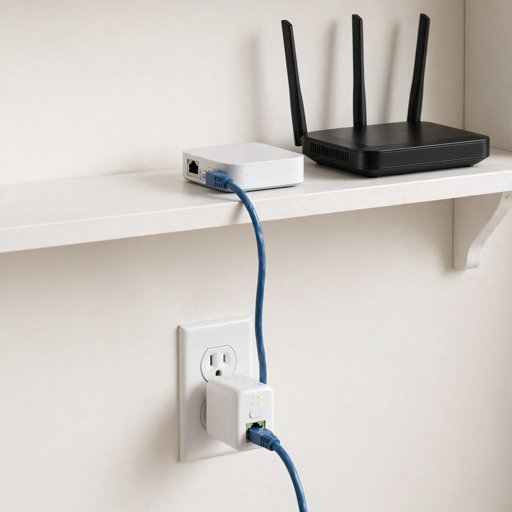{ width="240" } matches (second brief) |
| Arcade coffee table, from above (`project:7#3`) | 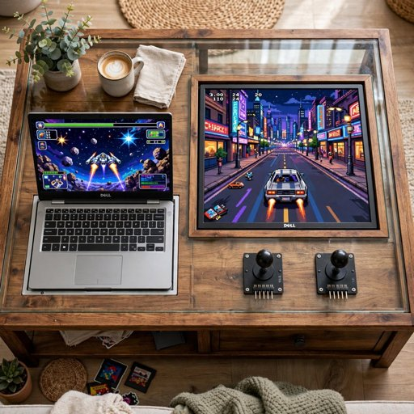{ width="240" } partly | 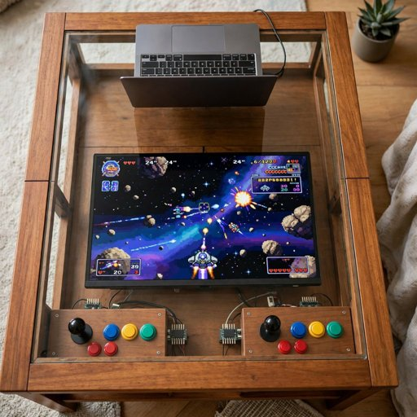{ width="240" } matches |
| Home server and backup (`project:5#1`) | 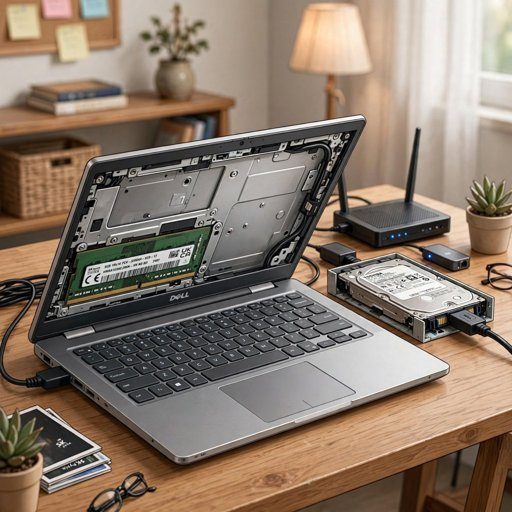{ width="240" } partly | 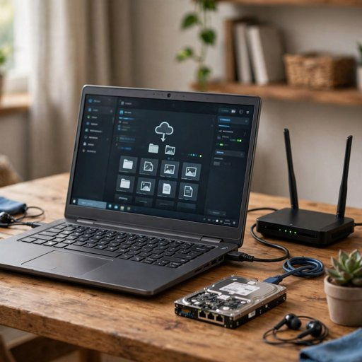{ width="240" } partly (second brief) |
| Custom NAS, from above (`project:4#3`) | 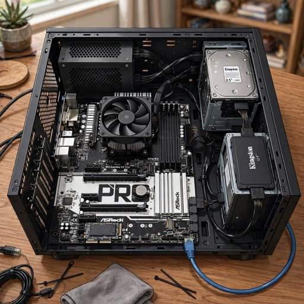{ width="240" } partly | 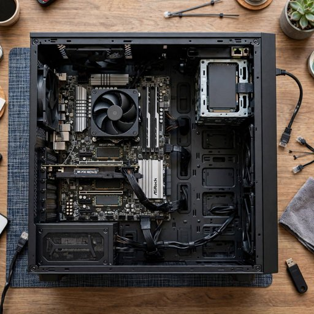{ width="240" } partly (second brief) |

The briefs, as `demo/set.yaml` keeps them (`propose.corrections` and the adapter's
`picture_brief`):

- **smart_mirror**: *an 18 inch 5:4 computer monitor, about 46 cm across the diagonal, hidden
  behind a two-way mirror in a slim wooden frame about 45 x 40 cm, hung at eye level on a hall
  wall above a small bench; only a clock and weather icons glow through the glass; a small
  mirror, not a TV; no words or logos*
- **the adapter**: *exactly one small white powerline adapter, the size of a deck of cards, out
  of its wrap and plugged straight into the wall socket under the shelf, an Ethernet cable from
  it up to a small hub beside the router; the plastic wrap named above is how it lies in the
  drawer today, do not draw it; no second adapter, no words or logos*. The first brief, without
  the line on the wrap, came back *wrong* again: two adapters, one still wrapped.
- **arcade_table / from above**: *seen from above: a wooden coffee table with a glass top; under
  the glass a 24 inch widescreen monitor lies flat, about 53 x 30 cm, much wider than the opened
  laptop that runs it at one end; two joysticks and buttons along the edge; no words or logos*
- **home_server**: *an opened laptop about 35 cm wide on a wooden desk, wired to a router with
  antennas and to one bare 2.5 inch hard drive by a single cable; the memory is inside the
  laptop and not shown; no second drive, no extra box, no words or logos, not a desktop tower*.
  After: the memory is gone from the lid; the drive is drawn with network ports it does not
  have.
- **custom_nas / from above**: *seen from above: an open ATX mid-tower case on a desk, the
  desktop motherboard with a cooler and one full-length memory stick in the slot beside it, one
  2.5 inch SSD in a drive bay, a short PCIe card holding two M.2 drives in a slot, an ATX power
  supply and a network cable; no second drive, no words, logos or model numbers*. After: one
  drive, the adapter card in place; lettering on the board remains.

Each brief is its own request with its own recording; every other drawing sends what it sent
before, so its recording is unchanged. The set loads in fixture mode with 0 not recorded and 0
stand-in answers.

## The recommendations

The same run checked the 44 sets of Decide cards and the 11 projects' allocations against the
items' facts (55 text calls). 27 came back with flags, 36 of them major. They are reported,
not changed:

- **DDR4 memory on a DDR3 laptop.** The home automation server allocates the SK hynix 8 GB
  DDR4 laptop stick to the ThinkPad T510, which takes DDR3: the stick does not fit
  (`project:3`). The SK hynix card's own reuse line says the same of both ThinkPads.
- **No processor for any desktop board.** The cards for the three desktop boards, the desktop
  memory, the drives and the SSD suggest desktop builds *with the processor you own*; the only
  processor is a Slot 1 part of the Pentium II and III years, which fits none of the boards (LGA1155, AM4).
- **The M.2 USB enclosure as a project box.** Five cards for the UNO board and its modules
  build into *the enclosure*; the only one is an M.2 SSD enclosure, too small for an UNO board.
- **Adapters with nothing to adapt.** The M.2 adapters' cards plan for M.2 and U.2 drives the
  inventory does not have; every drive is SATA.
- **The weather station's logger** (`project:10`) logs over time with no storage allocated, and
  its breadboard power module has no breadboard.

These come from the model's reading of the cards; each is for the owner to confirm. The
allocations are kept by the rules on item kinds, not on memory generation or socket, which is
where the DDR4 stick on the T510 slipped through.

## Cost

| Step | Calls | USD |
|---|---|---|
| Review of 32 drawings and 55 recommendation checks | 87 Muse Spark | 0.69 |
| Redraw, first round: 5 drawings, 5 reviews | 5 Muse Image, 5 Muse Spark | 0.09 |
| Redraw, second round: 3 drawings, 3 reviews | 3 Muse Image, 3 Muse Spark | 0.05 |

An earlier run of the same review was stopped part way to make the calls concurrent, about
0.07 USD of reviews. In all, under 1 USD.

## The drawing parameters, version by version

Each version of the drawing parameters (`backend/app/picture/params.yaml`) scored on the whole
demo set: every drawing drawn with that version and reviewed
([Tuning the drawing parameters](../guides/picture-review.md#tuning-the-drawing-parameters)).

<!-- params-history:start -->

*Written by `./dev picture-review --evaluate` from `eval/pictures/`.*

| | params v1 | params v2 | params v3 | params v3 asbuilt | params v3 best3 | params v3 recheck | params v3 propose | params v4 |
|---|---|---|---|---|---|---|---|---|
| drawings | 32 | 32 | 32 | 32 | 32 | 32 | 30 | 30 |
| matches | 11 | 21 | 21 | 19 | 31 | 29 | 28 | 26 |
| partly | 20 | 5 | 6 | 8 | 1 | 2 | 2 | 1 |
| wrong | 1 | 6 | 5 | 5 | 0 | 1 | 0 | 3 |
| issues: text | 19 | 2 | 2 | 1 | 0 | 0 | 0 | 0 |
| issues: scale | 2 | 1 | 2 | 1 | 0 | 0 | 0 | 1 |
| issues: wrong_device | 0 | 2 | 3 | 3 | 0 | 1 | 0 | 4 |
| issues: missing_part | 2 | 4 | 2 | 4 | 1 | 1 | 0 | 0 |
| issues: invented_part | 1 | 5 | 4 | 8 | 0 | 1 | 0 | 0 |
| issues: wrong_setting | 0 | 1 | 2 | 1 | 0 | 0 | 0 | 0 |
| issues: implausible | 2 | 2 | 4 | 4 | 0 | 1 | 2 | 1 |
| spent on the run, USD | 0.21 | 0.51 | 0.52 | 0.73 | 1.23 | 0.15 | 0.17 | 0.17 |

Moved from params v3 propose to params v4:

- `item:laptop_t510#1`: partly to matches
- `item:powerline#1`: partly to matches
- `project:4#3`: matches to partly
- `item:uno_r3#1`: matches to wrong
- `project:2#1`: matches to wrong
- `project:9#1`: matches to wrong

<!-- params-history:end -->

## Tuning the parameters, version 1 to 3

On November 3, 2026, after the redraws above, the Muse Code skill `/picture-tune` ran its loop
on the demo set: the 32 drawings reviewed as they were (version 1), the parameters tuned from
the review, the whole set drawn again and reviewed, twice.

**Version 2** (23 edits: 11 by the rules, 11 phrased by one Muse Spark call, 1 promoted from the
set; all approved):

- *Facts first*: the sizes in an item's name said (*screen size 18 inch, about 46 cm across
  the diagonal*), size facts before the rest, six values a part instead of three.
- *Nothing to letter*: brand, model and part numbers, certifications and voltages left out of
  every request (30 of 32 requests named a brand or a model), and a negative said before the
  closing words.
- *No condition*: an item drawn as a use no longer carries its condition notes (7 requests did).
- *In a home*: an item drawn as a use and a reuse card are drawn finished in their place, no
  longer on a plain background.
- *Corrections* for the home automation server, the home server and the kitchen dashboard
  (phrased from their issues and briefs), the smart mirror's approved brief promoted to every
  smart mirror, and how eight kinds of part look at their real size (*a tiny credit-card-sized
  bare board*).

At the approval step the first phrasing gave the monitor *a wide 16:9 monitor about 55 cm
wide*, true of the 24 inch one and wrong for the 18 inch 5:4 one behind the mirror; the
phrasing instructions now keep a kind's line free of sizes, and the proposal was made again.

**Version 3** (one more round on version 2's review): the sizes said for scale had come back
written on two drawings (*40 cm* beside the mirror), so a negative against dimension labels;
presets for the close-up and the view from above; corrections for the arcade table, the NAS,
the retro console and the weather station; the laptop's and the monitor's looks. One edit was
dropped at approval: a home server correction that would have drawn the laptop disassembled
(the review had judged the item's picture against the item as it lies in the drawer).

| Drawing | Version 1 | Version 3 |
|---|---|---|
| A second screen for the kitchen (`item:monitor_u2419h#1`) | 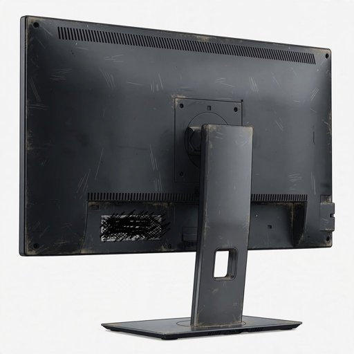{ width="200" } wrong: no kitchen | 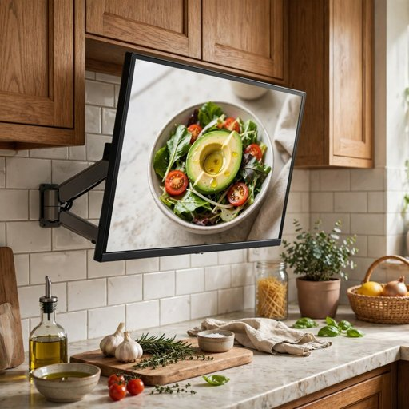{ width="200" } matches |
| Second screen for a computer (`card:monitor_u2419h#1`) | 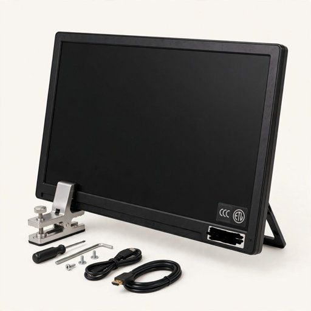{ width="200" } partly: a clamp, tools, lettering | 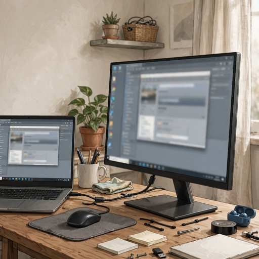{ width="200" } matches |
| Home automation server (`project:3#1`) | 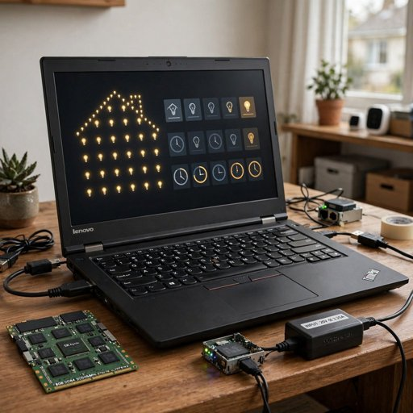{ width="200" } partly: the memory stick twice its size, lettering | 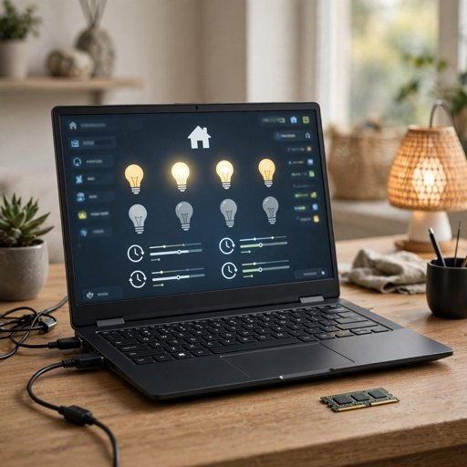{ width="200" } matches |
| Smart desk calendar (`project:8#1`) | 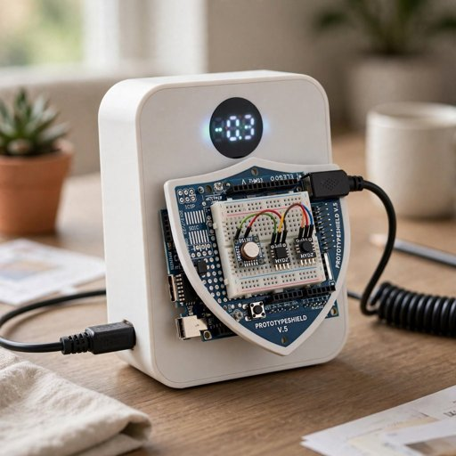{ width="200" } partly: lettering | 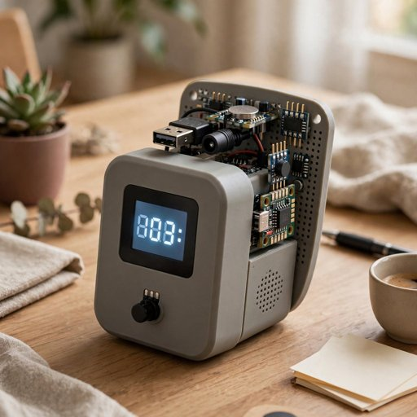{ width="200" } matches |
| Arcade coffee table (`project:7#1`) | 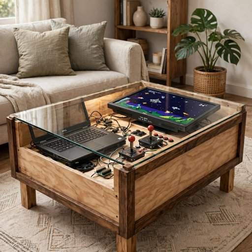{ width="200" } partly: lettering | 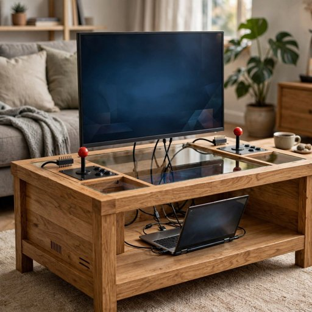{ width="200" } wrong: the monitor upright on the glass |

What the numbers say:

- **Lettering is solved by not saying it.** Text issues went from 19 to 2: a request that
  names no brand and no model number gets none drawn; the two left are sizes written on the
  picture.
- **Matches went from 11 to 21**, and the partly verdicts from 20 to 6.
- **Wrong went from 1 to 5.** Without the lettering, the review looks at the build: an
  invented second monitor on the 18 inch monitor's reuse card, the arcade table's monitor
  standing on the glass, a calendar drawn with a joystick. Two of the five are partly the
  review's own: the facts of an item drawn as a use still list its condition (*disassembled*)
  and the item alone as its parts, so the router of a home server is called invented. Verdicts
  also move from run to run on the same request; every request changed between versions, so
  one drawing's move is not a measure, the set's counts are.

| Step | Calls | USD |
|---|---|---|
| Version 1 reviewed | 32 Muse Spark | 0.21 |
| Version 2 proposed (twice) | 2 Muse Spark | 0.03 |
| Version 2 drawn and reviewed | 32 Muse Image, 32 Muse Spark | 0.51 |
| Version 3 proposed | 1 Muse Spark | 0.01 |
| Version 3 drawn and reviewed | 32 Muse Image, 32 Muse Spark | 0.52 |
| In all | | 1.28 |

The recordings of versions 1 and 2 that version 3 no longer uses were removed
(`--evaluate --prune`); every other recording is unchanged, and the set loads with 0 not
recorded and 0 stand-in answers.

## What it says about the prompt

- **Facts first.** The size of the main part is what a drawing gets wrong most visibly, and the
  prompt leaves it out whenever three other values sort before it. The name the owner gave the
  item (*Dell 1800FP monitor, 18 inch*) says it and is never sent, by design.
- **The item as it is today is not the item as used.** An item drawn *as* a use still carries
  its present condition; the project prompt already leaves the condition out.
- **No logos is asked and not kept.** A third of the issues are lettering; a brief that says
  *no words, logos or model numbers* removed most of it, the general request did not.

Each of these is now a parameter (version 2 and 3 above). The review's facts for an item drawn
as a use are now the item as built ([The reviewer, as built](#the-reviewer-as-built)).

The next steps are in
[Getting better drawings over time](../guides/picture-review.md#getting-better-drawings-over-time).

## The reviewer, as built

On November 4, 2026, before the last round, the review itself was fixed. An item drawn as a use
(*the ThinkPad as a home server*) was checked against the item as it lies in the drawer: its
condition (*disassembled with internal components exposed*) was in the facts though the request
leaves it out, and the item was the only part listed, so the router and the drive any home
server has counted as invented. Now the facts are the item as built, and for an item or a reuse
card drawn as a kind of project, the rest of that build (the template's requirements the item
does not fill, *A switch or a router with a spare wired port*) is listed as what may appear;
what the use itself names or plainly needs is no invented part, and a second copy of a listed
part is. The demo set was scored again with it, nothing redrawn: 19 matches, 8 partly, 5 wrong
(*params v3 asbuilt* above). The set's numbering had changed since version 3 was first scored
(the compatibility rules recorded the proposals again), so this is the baseline for what
follows, not the 21 of version 3.

## Best-of-N

Version 3's requests were kept and each drawing that still missed was drawn again, several
times, the best kept ([Best of N](../guides/picture-review.md#best-of-n)). After the Decide
cards were recorded again ([Text tuning](#text-tuning)) the five reuse-card drawings made from
them were new, so the set was reviewed once more first: 17 matches, 7 partly, 8 wrong.

| Run | Drawings | Candidates | Replaced | USD |
|---|---|---|---|---|
| Best of 3: every drawing not matching, and the four selected builds' three views each, matching or not | 20 | 51 (the cap cut the last nine) | 16 | 0.78 |
| Best of 5 on the three still *partly* | 3 | 15 | 3 | 0.25 |

| | Before (17, 7, 8) | Best kept | A fresh review of the final set |
|---|---|---|---|
| matches | 17 | 31 | 29 |
| partly | 7 | 1 | 2 |
| wrong | 8 | 0 | 1 |

*Best kept* scores each drawing by the review that chose it; *a fresh review* checked the 32
final drawings again in one run (*params v3 recheck* above). The two differ by the review's own
spread: the UNO board drawn for the smart desk calendar was *matches* (0.90) when it was chosen
and *wrong* on the fresh pass, the powerline adapter *matches* then *partly*. The NAS from above
stayed *partly* through seven candidates: the desktop memory stick is never visible in its
slot from that height. Of the 20 drawings tried, the drawing as it stood was kept for four
(three already matching and the NAS's front view in the first round); every other was
replaced by a candidate that the review scored better.

| Drawing | Before | After |
|---|---|---|
| Hall smart mirror (`project:1#1`) | 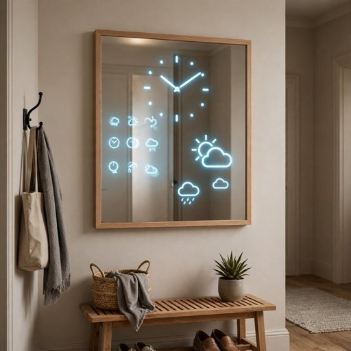{ width="240" } wrong: the 18 inch monitor drawn as a display filling the whole mirror | 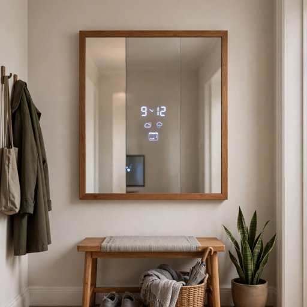{ width="240" } matches |
| Arcade coffee table (`project:7#1`) | 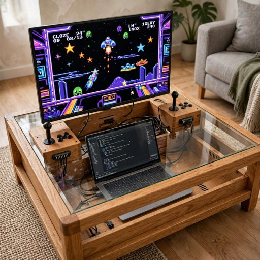{ width="240" } wrong: the monitor upright on the table's back edge, two joystick boxes | 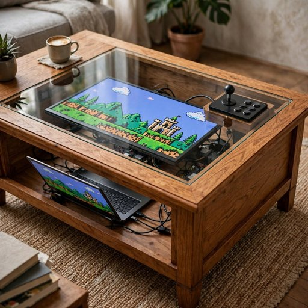{ width="240" } matches |
| The joystick as an arcade table (`item:joystick#1`) | 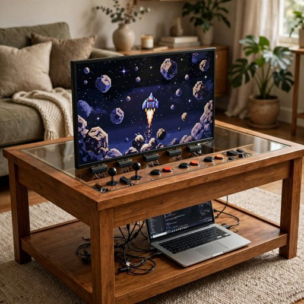{ width="240" } wrong: the screen upright like a TV | 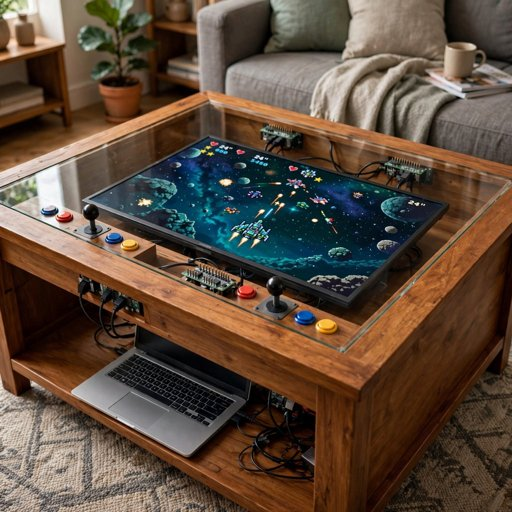{ width="240" } matches |
| Weather station (`project:10#1`) | 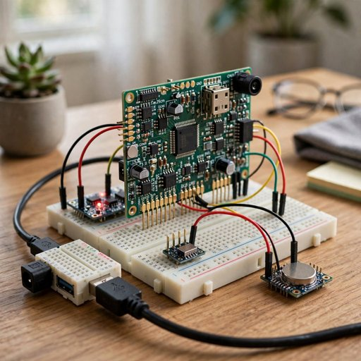{ width="240" } wrong: the board drawn as a large upright PCB | 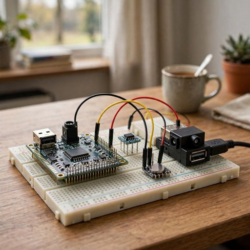{ width="240" } matches |
| Garage parking helper (`project:11#1`) | 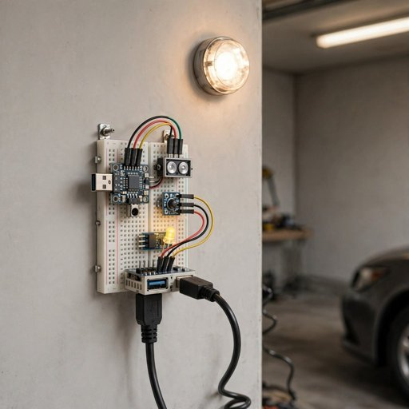{ width="240" } wrong: a mains dome lamp above the circuit | 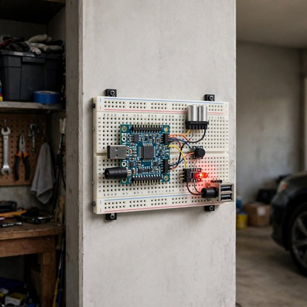{ width="240" } matches |

Each winner's brief is in `demo/set.yaml` and its recording under
`backend/tests/fixtures/api/images-generations/`; the 19 drawings it replaced were removed
(`--evaluate --stage best3 --prune`), and the candidates that lost were kept out of the
repository. The set loads with 0 not recorded and 0 stand-in answers. No version 4 of the
parameters was made: the fresh review left three drawings off, each for a different reason, so
no issue recurred for a rule to fix.

## Computers built in (version 4)

The project drawings that use a laptop still showed it open on the desk or beside the build
(the coffee table, the smart mirror, the home servers, the homework desk, the kitchen
dashboard, the retro console). In version 4 any computer may be taken apart and its parts
built in where needed: `kinds` gained `built`, said of a part only in a finished project's
drawing (a laptop: its bare screen panel as the display, its board hidden inside, never an
open laptop, case, lid or keyboard; a monitor: its bare panel without stand or case; a
desktop board: mounted in the build's case), and `projects` gained `built`, the correction a
project of that template carries instead (flat under the glass in the coffee table, behind
the two-way mirror, framed on the wall). An item's own drawing, its use and a reuse card are
asked exactly as before, so their recordings still replay. The reviewer reads the same
`built` line beside each part.

The 12 project drawings whose request changed were drawn again, then the best of 3 kept
(two rounds), and the set reviewed again: 26 matches, 1 partly, 3 wrong of 30. No drawing
shows a laptop. The homework desk and the kitchen dashboard are *wrong* because the reviewer
wants a bare panel and sees a cased screen; the third is the UNO item drawing, unchanged.
About 1.15 USD.

| Drawing | v3 | v4 |
|---|---|---|
| Gaming coffee table, its three views (`project:7`) | matches (laptop open beside the screen) | matches |
| Hall smart mirror (`project:1#1`) | matches | matches |
| Home automation server (`project:3#1`), photo backup server (`project:5#1`), retro games (`project:6#1`) | matches (open laptop) | matches |
| Homework desk (`project:2#1`), kitchen dashboard (`project:9#1`) | matches (open laptop) | wrong (cased screen) |
| NAS (`project:4`) | matches | matches, matches, partly |

The v3 verdicts were given by a reviewer that still expected an open laptop.

## Text tuning

The same review checks the recommendations (`./dev decide-review`, [Tuning the text
parameters](../guides/picture-review.md#tuning-the-text-parameters)): 44 sets of Decide cards,
the ideas of 4 items and the allocations of 11 projects, 59 checks. Version 1 of the text
parameters adds nothing to any request, so it is the demo set as recorded: 23 of 59 flagged,
16 of them Decide cards, most for desktop builds *with the processor you own* when the only
processor is a Slot 1 part no board takes.

- **Version 2** (from the check of version 1): the Decide cards' brief opens with the item's
  compatibility facts and the rules' pairings come before the profile; two constraints (a card
  rests only on owned items that fit, else lists the part to buy; read the condition first:
  missing, bare or unpopulated is not working as it is); four corrections phrased by Muse Spark
  from the flags (assembly state and every needed power supply and cable; memory generation,
  slot count and a processor present; a controller's connectors; a missing processor said for
  a desktop use); two banned phrases, *with the processor you own* and *your own processor*.
  Proposed and dropped: *works as it is* as a banned phrase (true of an item with nothing
  wrong), *no extra parts needed*, and every edit to the proposals (each would record all 11
  projects and their 19 drawings again). Cards flagged: 16 to 10; claims of a processor the
  owner has: 7 to 2.
- **Version 3** (from the check of version 2): three more corrections (an enclosure's form
  factor before a pairing, header pins and wire packs counted, no test pass that is not
  recorded) and one banned phrase; a per-slot memory limit taken from one laptop was dropped.
  Cards flagged 10 to 11, the new flags for memory and parts the cards now said were missing
  though the owner has them. Not better: version 2 was kept (`./dev decide-review --keep 2`),
  and version 3's recordings removed.

The proposals' requests are the same in all three versions; their flags (7, 4, 6 of 11) show
how far the check itself moves between runs. The ideas had none. Version 2 changed every
Decide card request and the five reuse-card drawings made from them; every other request
replays as it was.

### The proposals (version 4)

Later on November 4 the proposals got their own section, `propose`, from the project flags of
three checks of version 2 (5, 5 and 6 of the 11 projects flagged): the compatibility facts
first, the condition rule, and four constraints written from the flags, not phrased by a call:

- a build that shows or works out anything needs what drives it: a display build allocates a
  computer or a microcontroller board behind the screen, or leaves that requirement missing;
- a memory pick matches the host's generation and form in the compatibility facts (a DDR3
  laptop takes a DDR3 or DDR3L SO-DIMM), and a capacity the facts do not confirm for that host
  goes in the unknowns;
- a joystick module is an analog part on a pin header, not a USB game controller: it plays
  games only through a microcontroller board that reads it;
- jumper wires, a breadboard, cables and a power adapter are still needed unless an owned item
  is allocated for them, and a build is never called complete without them.

The number is 4, not 3: version 3 was tried and not kept, and keeps its number and its score.
With these lines the second proposal call (the desktop boards and the games) checked its picks
more often than the tool loop allowed, so the loop now takes up to four check steps after the
picks (`CHECK_STEPS`, was two). The three proposal calls, the search plans of the selected
builds and every project drawing were recorded again; the Decide cards and every other request
replay as they were.

| Project checks (of 11) | run 1 | run 2 | run 3 |
|---|---|---|---|
| version 2 | 5 | 5 | 6 |
| version 4 | 3 | 3 | 3 |

Version 4 was kept. The three still flagged: the homework desk's cable (the check reads the
T510 as having no HDMI, so an HDMI, DisplayPort or USB-C cable is a claim too wide), the NAS
asking for a case although its ASRock board is recorded in one, and the 8 GB DDR3L stick in the
T510 (the check holds the laptop to 4 GB a slot; the proposal now lists the capacity as an
unknown to check). The Decide cards' 10 to 7 in the table below is the check's own spread:
their requests did not change.

What the demo shows changed with it. The eleven projects are the same kinds; the NAS is now
built on the ASRock board in its case and the smart mirror on the 24 inch monitor. Three of
the four builds are
selected (the NAS, the coffee table, the smart desk calendar): the home automation server is
proposed on the spare Dell laptop, which the coffee table holds, so it was taken out of the
set's `select` and stays proposed.

The 17 project drawings were drawn again with the new requests (params v3) and reviewed: 20
of the 30 drawings matched, 2 partly, 8 wrong, all the misses project drawings. Each project
drawing was then drawn three more times and the best kept (14 replaced), the one still *partly*
five more times. A fresh review of the final set: 28 matches, 2 partly (the powerline adapter
and the ThinkPad as a home server, item drawings), 0 wrong; every project drawing matches
(*params v3 propose* above). The smart mirror's correction in the set still said an 18 inch
monitor, from when it was built on the 1800FP; it was drawn once more with a 24 inch brief
(`--redraw`), matching. About 3.1 USD for the round.

<!-- text-history:start -->

*Written by `./dev decide-review --evaluate` from `eval/decide/`.*

| | text v1 | text v2 | text v3 | text v4 |
|---|---|---|---|---|
| checked | 59 | 59 | 59 | 59 |
| with flags | 23 | 14 | 17 | 10 |
| flags | 33 | 20 | 23 | 17 |
| major | 31 | 17 | 15 | 16 |
| cards with flags | 16/44 | 10/44 | 11/44 | 7/44 |
| ideas with flags | 0/4 | 0/4 | 0/4 | 0/4 |
| projects with flags | 7/11 | 4/11 | 6/11 | 3/11 |
| spent on the run, USD | 0.51 | 0.64 | 1.07 | 0.51 |

<!-- text-history:end -->
