# Demo walkthrough

Sixty seconds through what is built, in the order a person meets it, on a stack started with
`./dev up` in fixture mode (no key: every model answer is a recorded one and nothing is spent).
With a key, the same steps run live. The demo set is a drawer of idle things, photographed by
the owner: three monitors, two ThinkPads and a spare laptop board, an old graphics card, a slot 1
processor, a powerline adapter still in its wrap, and the worn agitator of a frappé maker.

## The set, loaded

`demo/set.yaml` names the things in the walkthrough: each one's photos, what the owner knows
about it, whether a draft or price guidance is written for it, the searches with the listings
brought back (written examples labelled as such), and the proposal brief. Three commands:

```bash
./dev demo-scrub ~/raw-photos   # re-encoded copies into demo/photos/, WAV notes into demo/notes/
./dev record-fixtures           # with a key: the inventory reset, one run, every answer kept,
                                # then every reading a sample click can ask for (each photo
                                # alone, each item's photos together, with the label found first
                                # and without); a run that stopped half-way picks up where it was
                                # (what is recorded is replayed, not bought again) and fails when
                                # a part of the set was skipped; delete a fixture file to record
                                # it afresh
./dev demo                      # the inventory reset and the set loaded, in fixture mode
```

`./dev demo` leaves the stack with the whole set in the inventory, every observed value
accepted, drafts, guidance, searches with their candidates and the proposals in place, so
every take and every visitor starts from the same screen. Once the fixtures for the set are
recorded, the demo spends nothing: the service line at the foot of every page says *recorded answers only (nothing spent)*.
The fixtures are keyed on what is sent, so a change to `EXTRACT_ENHANCE` or `IMAGE_MAX_PX` means
recording again. On a gated host the public demo is the set, not an open reader: a visitor
without the code picks the set's photos in a gallery instead of uploading (see
[Demo access](../operations/demo-access.md)), and each answer is the recording of that exact
photo; a selection with none says so. `docker compose run --rm backend python -m app.demo
samples --set /demo/set.yaml` checks in fixture mode that every sample has its recordings. The
set loads with whatever files are present; a photo named but missing is skipped with a note.

What the owner asked for each item is kept by the load as well, so the demo shows the answers
and nothing is asked again when a section opens: `decide: true` writes the **Decide** cards
(from the items loaded before it; the set's profile is the loader's, so they are written for an
average person), `ideas: true` asks what it is good
for, `reuse_picture: true` draws the first reuse card with **Draw it**, `decision:` records the
plan chosen (`keep_fix`, `keep_spare`, `keep_build`, `sell`, `give`, `not_worth`; with
`decision_note:`, never shown to a visitor) once everything else is asked; a search's `plan:
true` writes its plan after its listings and web finds, and `propose: pictures: true` draws each
kept project. Each of these is answered in fixture mode only by the recording of that very
request, and listed as *not recorded yet* without one; for a new item, `./dev record-fixtures`
replays what is recorded and buys only what is missing. Every item of the set has a saved
outcome: the monitors, the T510 and the powerline adapter their cards, ideas, a reuse picture
and *Keep and build*; the Sun monitor, the laptop board and the graphics card their price
guidance, sell draft and *Sell*; the 9461 and the slot 1 processor their give draft and *Give
away*; the agitator its cards and *Keep and fix*.

An item may name a `picture:` (a template id such as `smart_mirror`, or a few words), drawn by
Muse Image after its drafts; four items of the set do. A drawing is a paid call, so a live load
draws it only with `PICTURE_ENABLED=1` (`./dev record-fixtures` sets it for its run unless the shell sets `PICTURE_ENABLED=0`). Fixture
mode shows a drawing only once a record run has kept it, and until then the load says *not
recorded yet* for it and shows none, never the stub image as a drawing.

## Without the code

On a gated server (the hosted demo, or a local stack after `./dev gate on`), a visitor without
the code is in the demo. The header ends with **Sign in with the code**; **Read a label** is a
gallery of the set's photos instead of an upload.

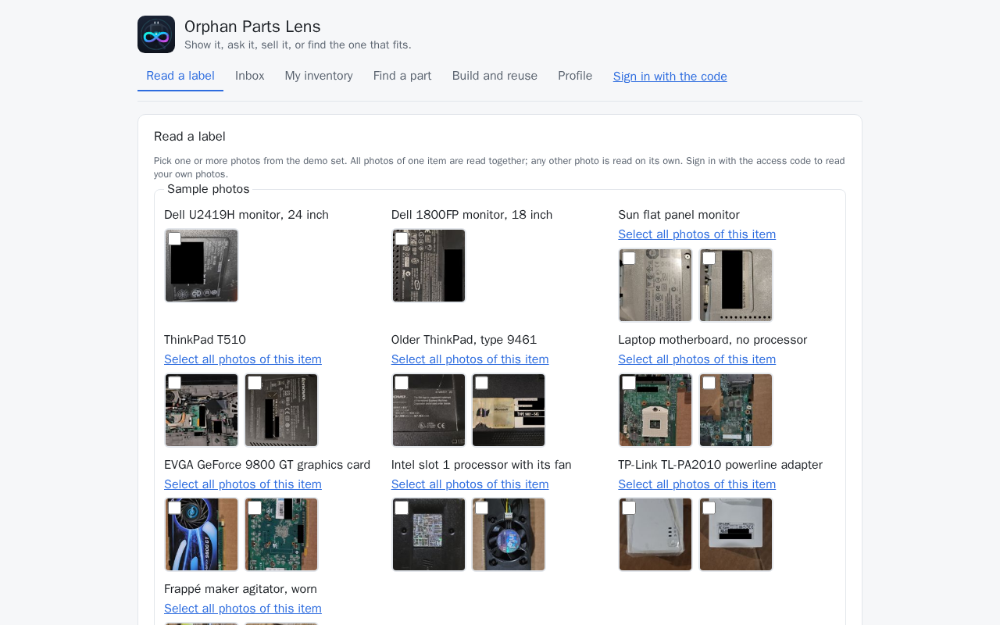

Tick one photo, several, or **Select all photos of this item**, then **Read the label**. Each
reading is the one recorded for that photo, under *Recorded answer for this sample.*; nothing is
spent and nothing is kept.

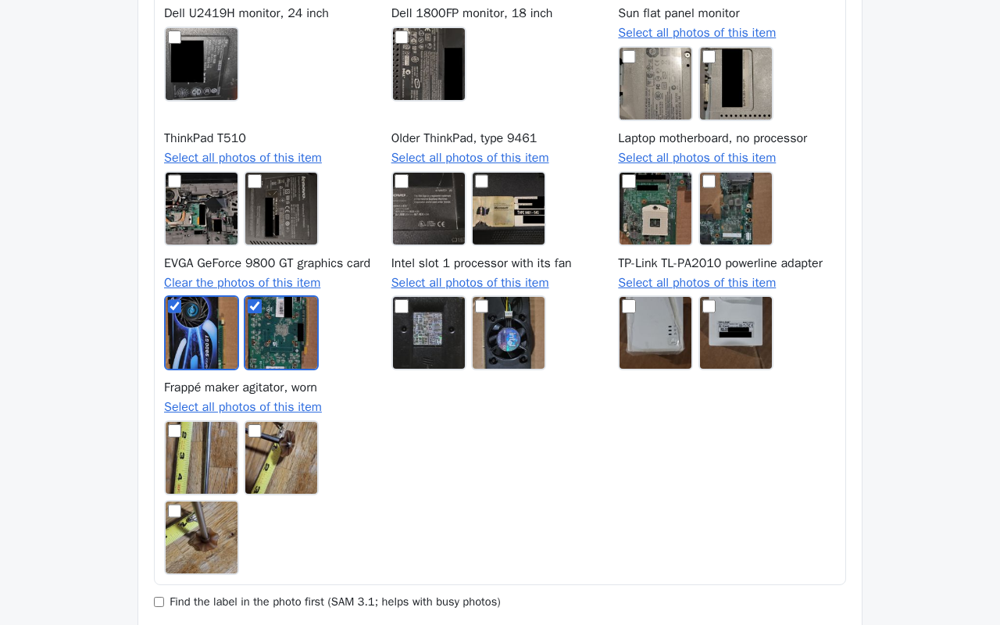

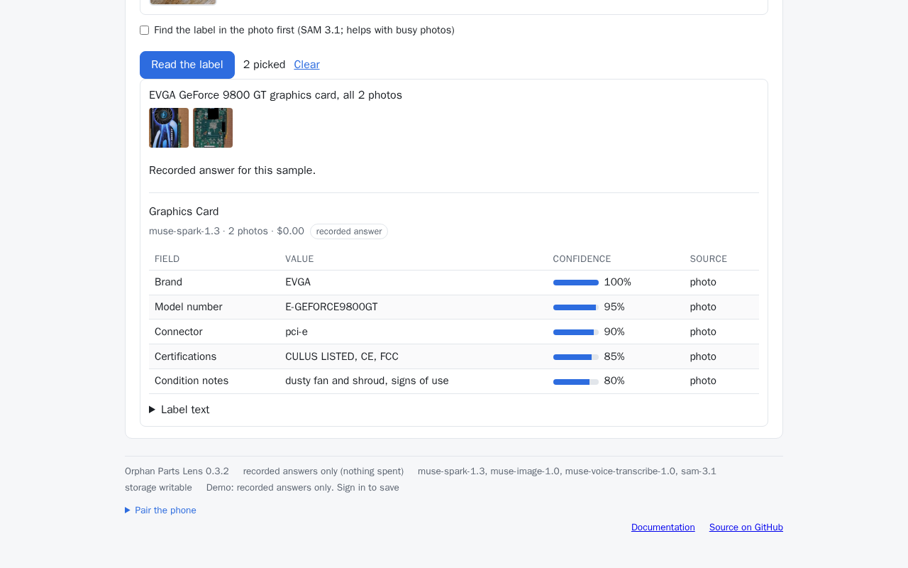

**My inventory** lists the set's items, marked public, read-only: their photos, values and
drawn pictures, and what was asked for each, as it was saved (the list marks it under *Saved
results*), never a note, a location or the lowest price.

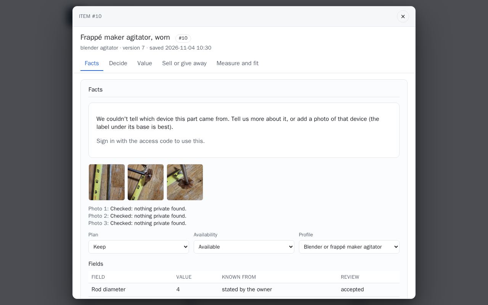

Opening a section asks no model. **Decide** shows the cards (keep and fix, reuse it with the
picture drawn of the first idea, sell or give away), the recommendation and the plan chosen;
**Value** the price guidance; **Sell or give away** the whole listing in Marketplace's fields
for a sale, and the free listing with how to post it for a give-away.

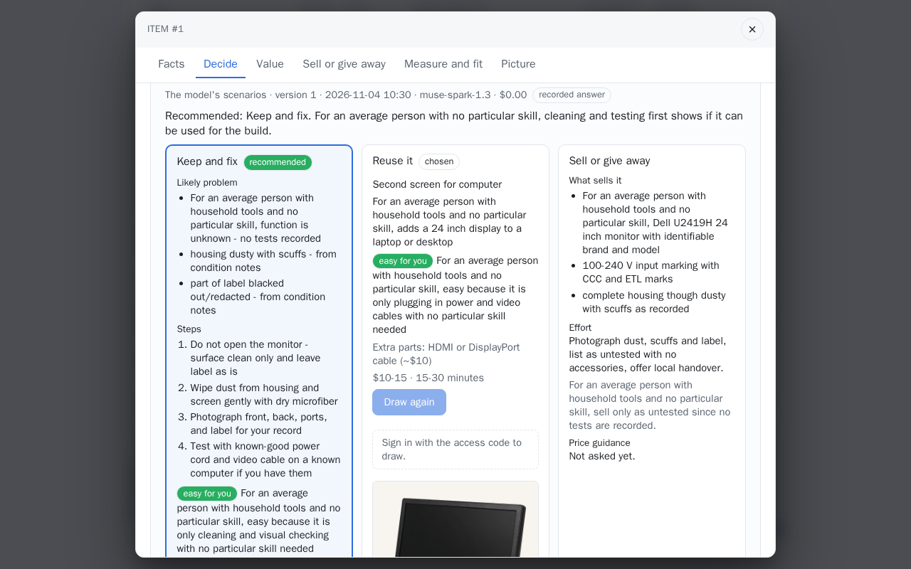

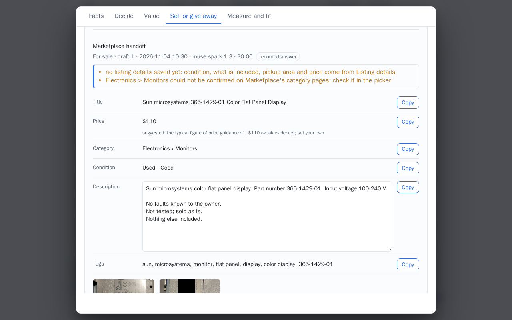

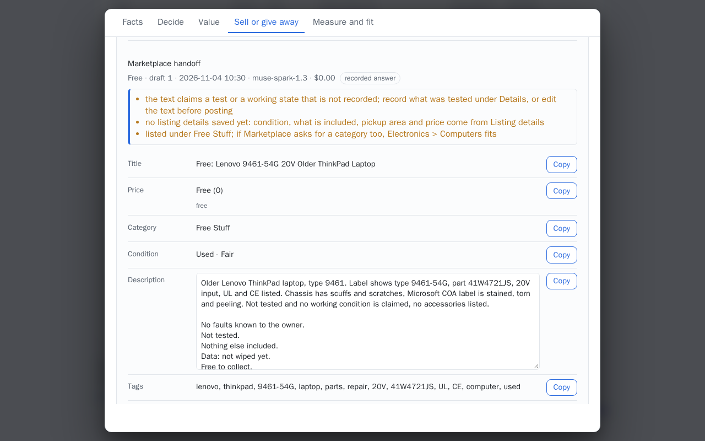

**Find a part**, **Build and reuse** and **Profile** are read-only too: the agitator's search
with its plan (the phrasings, each a Marketplace link), its candidates and what **Search the
web** found, the projects proposed from the demo shelf with their drawn pictures, the skills and their levels. Wherever the owner would save, plan, search or propose,
the page says *Sign in with the access code to use this.*

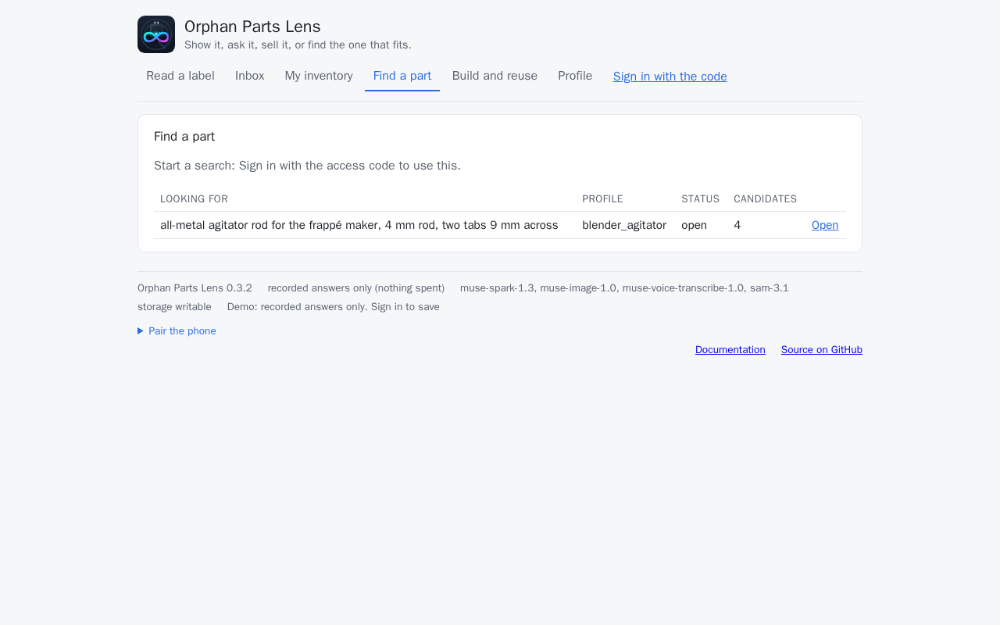

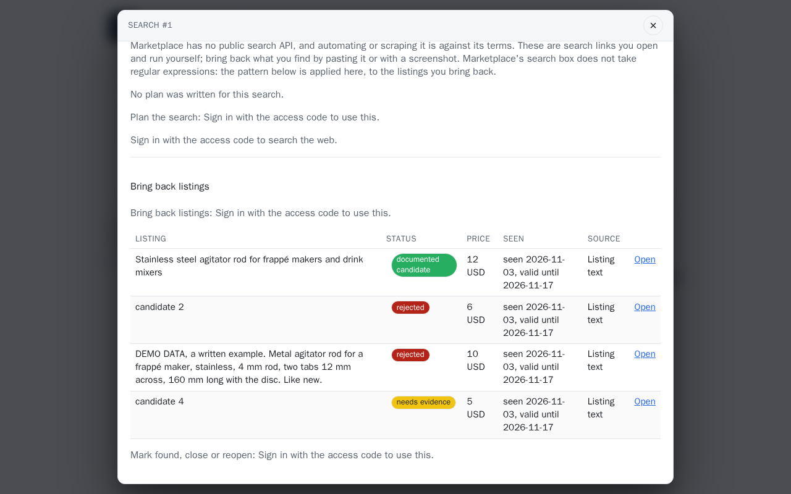

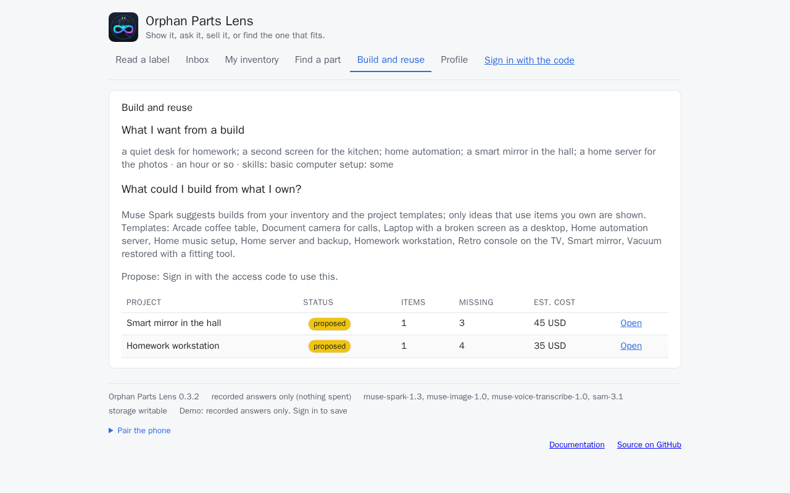

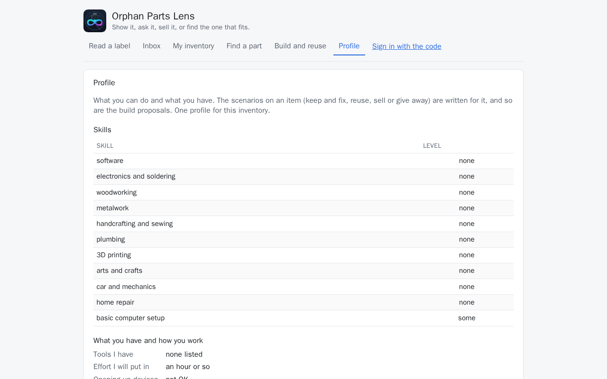

Signed in, everything below is open. The pictures in each step are on the guide it links to.

## 1. Read a label and save it

**Read a label** takes up to four photos (signed out on a gated host, a gallery of the set's
photos to click instead, one reading per item or photo). With *Find the label in the photo
first* on, SAM 3.1 looks for the item, the label and the connector: the overlay shows the
regions it found, with a note for each it did not, and when no label is found the photos are
read whole. Muse Spark reads the label crop, or the photos, into typed fields, each with its
confidence and its source. **Save privately** makes it an item in
[My inventory](../guides/inventory.md): every observed value waits for you to confirm or reject
it, and anything you add beside it carries your word as its provenance.

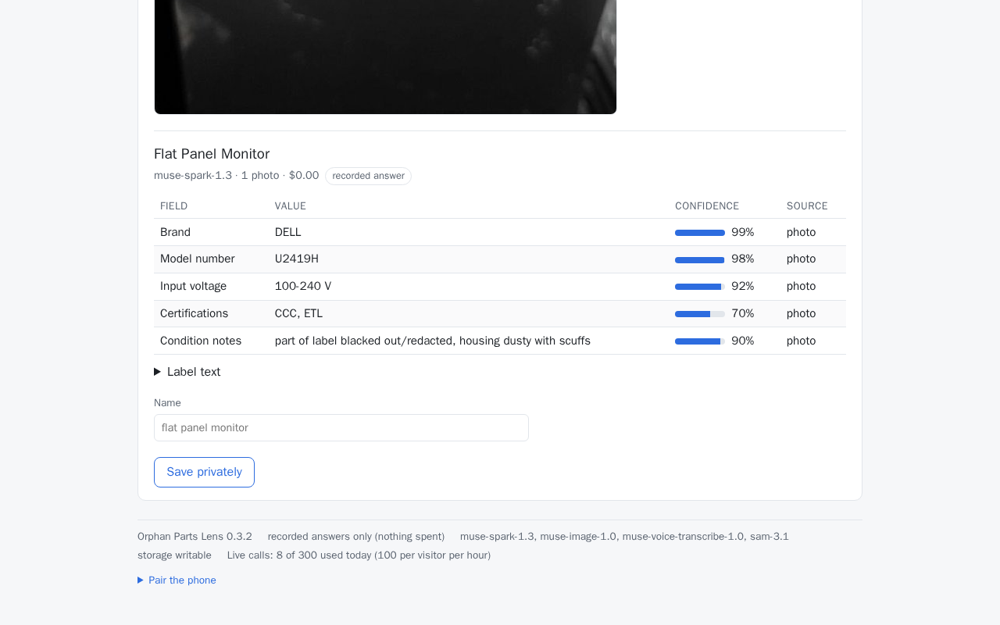

## 2. Measure the thing that decides fit

On the agitator's page, **Measure a feature**: the rod photographed from the side with a ruler
along it, two marks on the ruler and two on the rod, and the number comes from geometry, with
its uncertainty and the method. A blurred or oblique capture is refused with the reason.
[Measure a feature](../guides/measure.md).

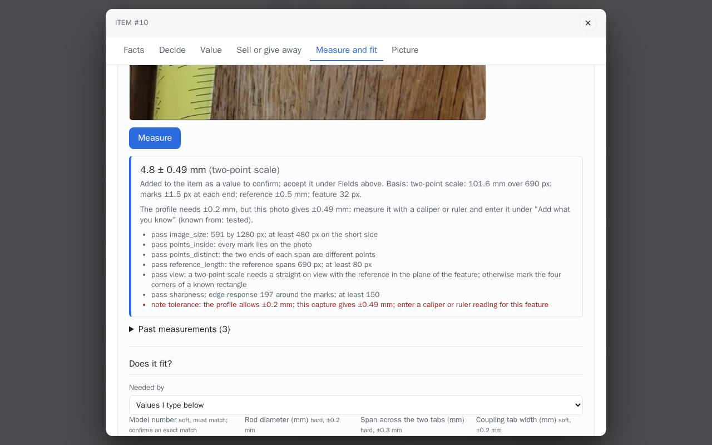

## 3. Does a listed rod fit?

**Does it fit?** checks a candidate against the agitator's profile rule by rule. In the demo
set the rod's diameter is that measurement, from the same photo and marks given in the set
(4.7 ± 0.49 mm; marked by hand through the page, as above, the marks land a pixel apart and
give 4.8); nothing else was measured. The two metal rods listed at 4 mm are rejected on
that diameter, the plastic one on its material and its diameter, and the listing with no
measurements stays at *needs evidence*; the tabs and the length, unknown on both sides, are
never counted as a pass. The verdict is one of five on the
[ladder](../concepts/verdicts.md), decided by the rules, never by the model.
[Does it fit?](../guides/match.md).

## 4. Find the missing piece

**Find a part** records what the agitator needs (all metal, the rod's measured diameter)
with a top price. **Plan the search** has Muse Spark write three to six Marketplace search links
you open yourself, a match pattern and the words that rule a listing out. Listings pasted back
are ranked by the pattern and the price with no model call; **Check fit** has Muse Spark read
one into fields, dated, assessed by the same rules and placed where it stands, and **Ask the
seller** turns the open questions into a message. [Find a part](../guides/search.md).

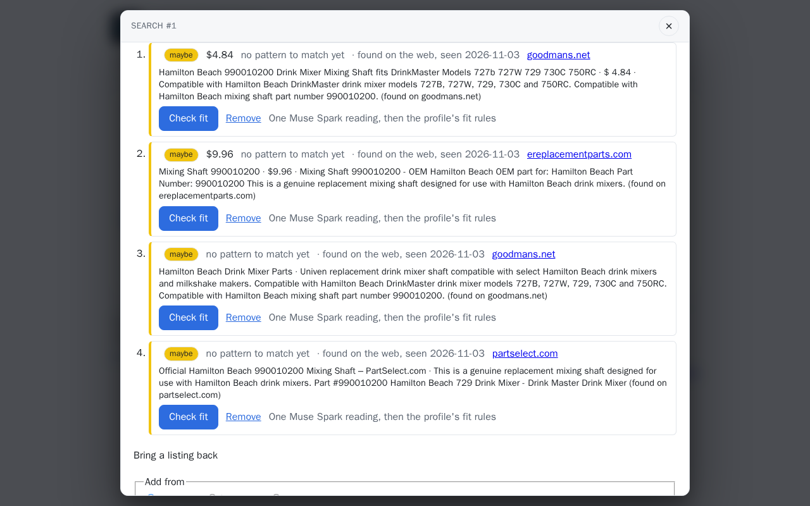

## 5. What should become of it?

On any item, **Decide**, **What should I do with it?**: Muse Spark writes three cards for the
item and for the owner's [profile](../guides/profile.md), its skills rated from *none* to *pro*:
keep and fix (the likely problem, the steps at that level, the parts, cost and time), reuse it
(two or three builds with what else the owner has) and sell or give away, with one
recommendation. **Choose this** keeps the choice as the item's plan and moves to the section it
leads to. [Decide what it becomes](../guides/decide.md).

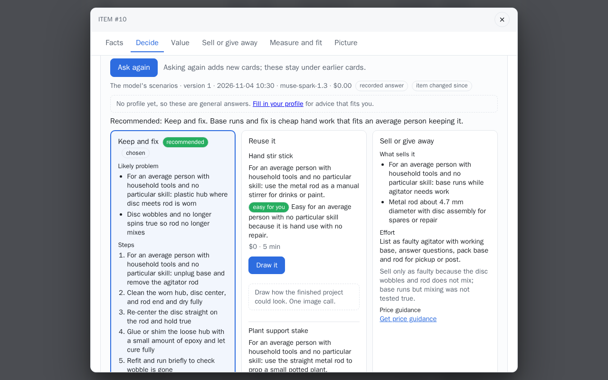

## 6. What could the monitors become?

**Build and reuse**: say what you want from a build, ask for proposals, and Muse Spark reads the
inventory through tools and proposes projects from templates kept as data; only what names
items you own is shown: a homework workstation on the 24 inch Dell and a smart mirror for the hall on the
18 inch one. Select the homework workstation: its items are committed, the budget line says what
is left, the missing cable becomes a search, and the build pack is one document from
what stands. **Draw it** has Muse Image draw how the finished desk could look, one image call,
captioned as drawn. Record the outcome once it works. [Build and reuse](../guides/reuse.md).

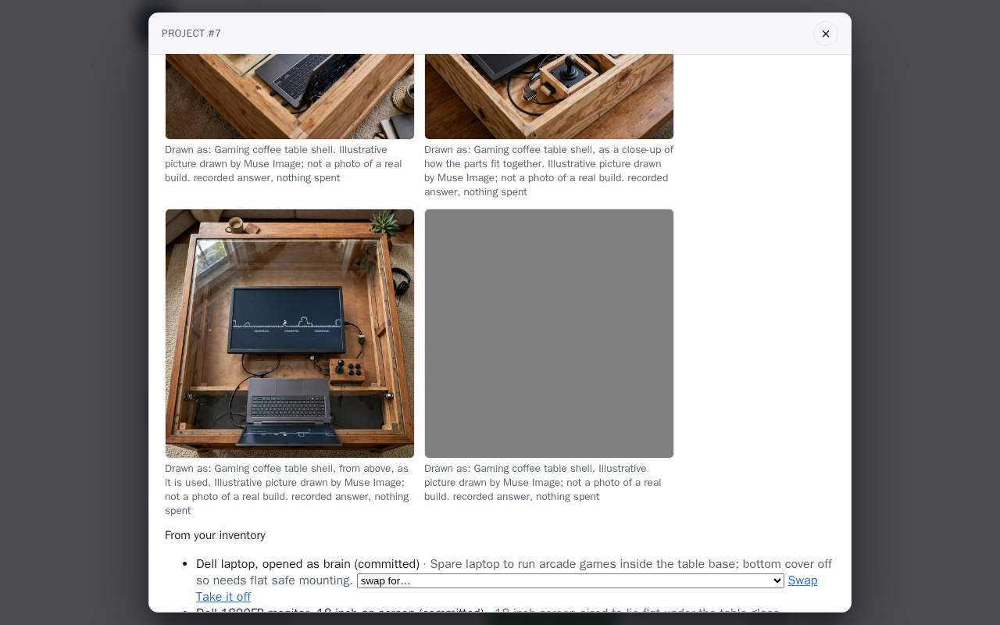

## 7. Sell the graphics card, give the processor away

On the graphics card, **What is it worth?** has Muse Spark search for listings and sales of the
same model and keeps only the comparables a page backs; asking, sold, reported and estimated
stay four numbers. Under **Prepare to sell or give away**, **Listing details** take the
condition, what is included, the faults, the handover and the area and the asking price;
**Write the draft** has Muse Spark write a Facebook Marketplace (US) draft from confirmed values,
with the disclosures the rules append; the slot 1 processor goes as a free-pickup draft, and
the older ThinkPad as one with the data-removal steps. Each field has **Copy**, **Download
photos** zips them in order, and **Open Marketplace** opens the create page; posting is yours.
[Value an item](../guides/value.md), [Seller flow](../guides/seller.md).

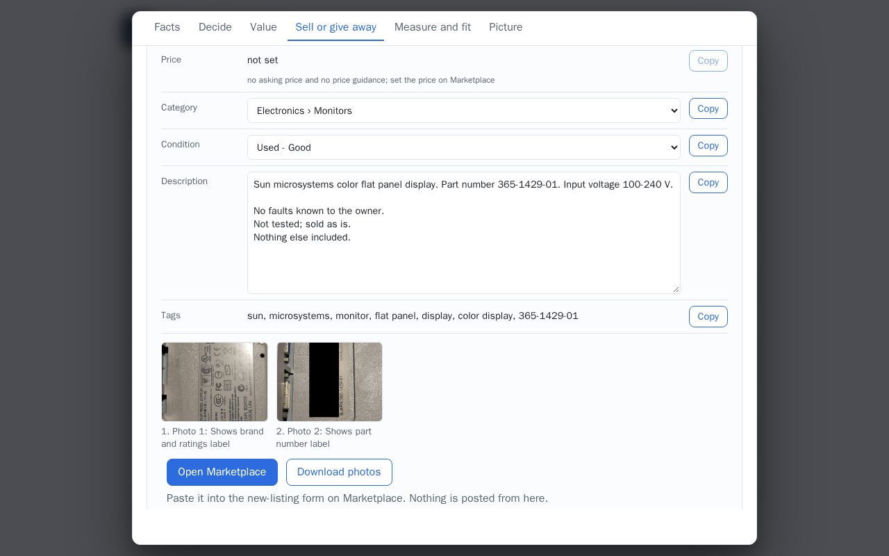

## 8. On the phone

The Android app points at the same backend: a photo of a label read and saved into the same
inventory, and a voice note held to the item, kept as your words and read back.
[Android app](../guides/android.md).

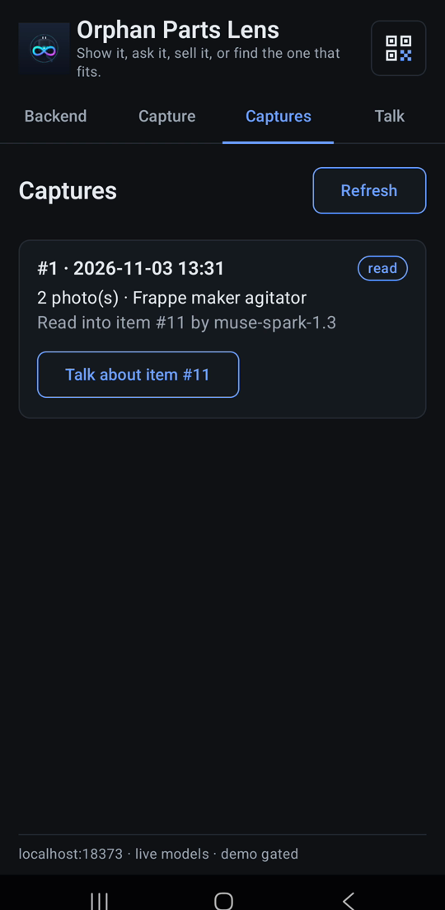{ width=300 }

## Running it in public

Behind an access code with allowances per visitor and per day, a spend cap and an operator's
switch: [Demo access](../operations/demo-access.md).
