# Run it on your own computer

Everything the hosted demo does runs on one computer: the web app, the backend, the demo set,
the access code and the phone. Nothing here depends on `orphan-parts.pages.dev` or on any
hosting account. Without a Model API key the stack answers from the recordings kept in the
repository and spends nothing; with a key it reads your own photos live.

## 1. What you need

- **Docker** with Compose v2: Docker Desktop on macOS and Windows, Docker Engine on Linux.
- **bash** and **git**. On Windows, run every command in WSL 2 (Ubuntu from the Microsoft
  Store), with Docker Desktop's WSL integration on.
- For the phone: an **Android 8.0 or newer** phone on the same Wi-Fi as the computer, and a USB
  cable that carries data if you install the app over USB.

Python, Node, a JDK and the Android SDK are not needed: the backend and the web app run in
containers, and the app comes as a ready APK.

## 2. Get the code

```bash
git clone https://github.com/nikolareljin/orphan-parts.git
cd orphan-parts
cp .env.example .env
```

`.env` is git-ignored: what you put in it stays on this computer.

## 3. Fill in `.env`

`.env.example` lists every setting with a line on what it does. A local run needs only a few.
Set these lines in `.env` (the copy starts with `OPL_FAKE_API=0` and `SPEND_CAP_USD=25`; the
values below are the ones to start with, and no real value goes on this page):

```bash
# The Meta Model API key (step 4). Empty: the stack runs on recorded answers.
MODEL_API_KEY=
# 1 = recorded answers only, never a call to the Model API, nothing spent.
OPL_FAKE_API=1
# Model API calls stop once this much (USD) has been spent through this stack.
SPEND_CAP_USD=5
# 1 = Draw it is on: one Muse Image call per click (about $0.01 an image).
PICTURE_ENABLED=0
# This computer's address on the Wi-Fi, for the phone; empty = the first address found.
LAN_ADDRESS=
# The access code. Leave it empty: ./dev gate on (step 6) writes one here.
DEMO_ACCESS_CODE=
```

| Setting | What it does |
|---|---|
| `MODEL_API_KEY` | The key from dev.meta.ai. Read by the backend only; it never reaches the browser or the phone. |
| `OPL_FAKE_API` | `1` answers every call from the recordings under `backend/tests/fixtures/api`: the demo set's photos get their real readings, anything else a recorded stand-in. `0` calls the Model API with the key. Left at `0` with no key, `./dev up` starts in recorded mode anyway and says so. |
| `SPEND_CAP_USD` | The app's own ceiling: once its spend ledger reaches it, every model call is refused. The footer of every page shows the spend against it. |
| `PICTURE_ENABLED` | Turns **Draw it** on. Off, the app says so where the button would be. |
| `LAN_ADDRESS` | The address the phone uses to reach this computer, such as `192.168.1.20`. Set it when the computer has several networks (Docker, a VPN, WSL) and the first one found is the wrong one. |
| `DEMO_ACCESS_CODE` | The gate. Empty: every page is open on this computer, no code needed. `./dev gate on` sets it. |

The rest of `.env.example` (the hosted demo's Modal and Cloudflare settings, a second model
route) is not read by a local run; leave it empty.

## 4. Get a Model API key (optional)

Skip this step to run on recorded answers. For live readings of your own photos:

1. Sign in at <https://dev.meta.ai>.
2. **Billing**: add a payment method. Set a spend limit there too, with a notification when
   it is near, so the account has a ceiling of its own beside `SPEND_CAP_USD`.
3. **API keys**: create a key and copy it (it is shown once).
4. Put it after `MODEL_API_KEY=` in `.env`, and set `OPL_FAKE_API=0`.

The Model API's own documentation is at <https://dev.meta.ai/docs/>. What each call costs here
is under [For judges](judges.md#costs-and-limits): a label read is under a cent.

**Not needed to run it locally:** tokens for hosting your own public copy. Those are a
[Modal](https://modal.com/settings/tokens) token (the backend) and a
[Cloudflare](https://dash.cloudflare.com/profile/api-tokens) API token with
*Cloudflare Pages: Edit* (the web app); [Deployment](../operations/deployment.md) says where they go.

## 5. Start it and load the demo set

```bash
./dev up      # the web app on http://localhost:5173, the API on http://localhost:8000
./dev demo    # the demo set: ten items, a search, two projects (recorded answers, nothing spent)
```

The first `./dev up` builds the backend image and installs the web app's packages; that takes
a few minutes once. Open <http://localhost:5173>. The footer says
`recorded answers only (nothing spent)` in recorded mode, or `live mode, spent $0.00 of $5.00`
with a key.

The foot of every page also links the **Documentation** (this site) and the **Source on
GitHub**, and opens **Pair the phone**.

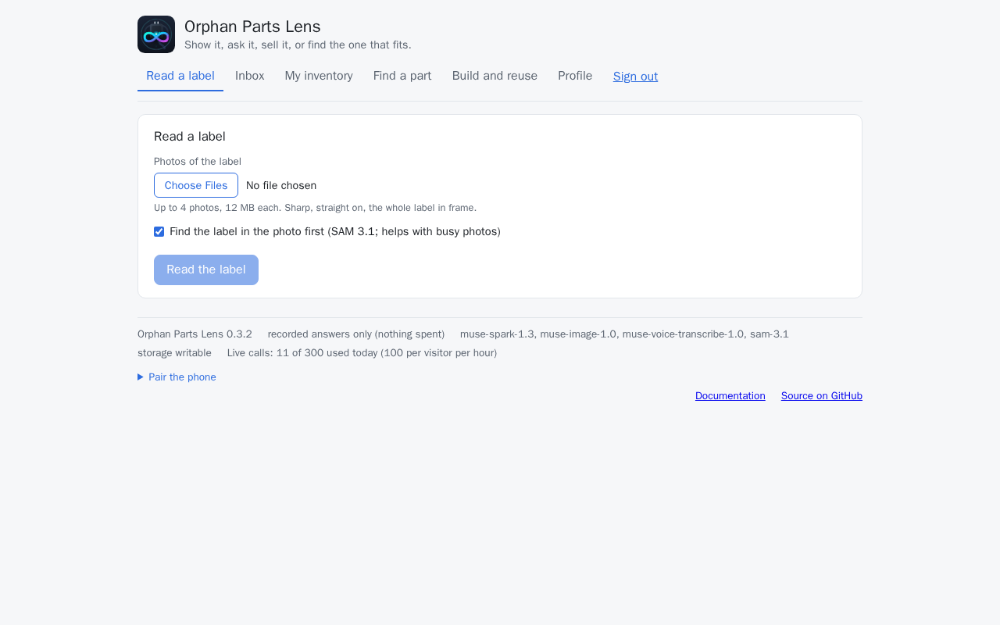

`./dev down` stops it; `./dev up` again keeps what you saved. `./dev demo` again resets the
inventory to the demo set, and drops the access codes issued with `./dev gate on` for the
phone (the master code in `.env` stays): run `./dev gate on` again afterwards.

## 6. Sign in (optional on your own computer)

With `DEMO_ACCESS_CODE` empty there is no door: the header says
*Open server (no code needed)* and every page is open. To see the app as a judge sees it, with
the demo for visitors and the code for you, turn the gate on:

```bash
./dev gate on
```

It writes a master code into `.env`, restarts the backend with the gate, issues a second code
for the phone, and prints both. Keep them off screen shares. Reload the page:
the header ends with **Sign in with the code**.

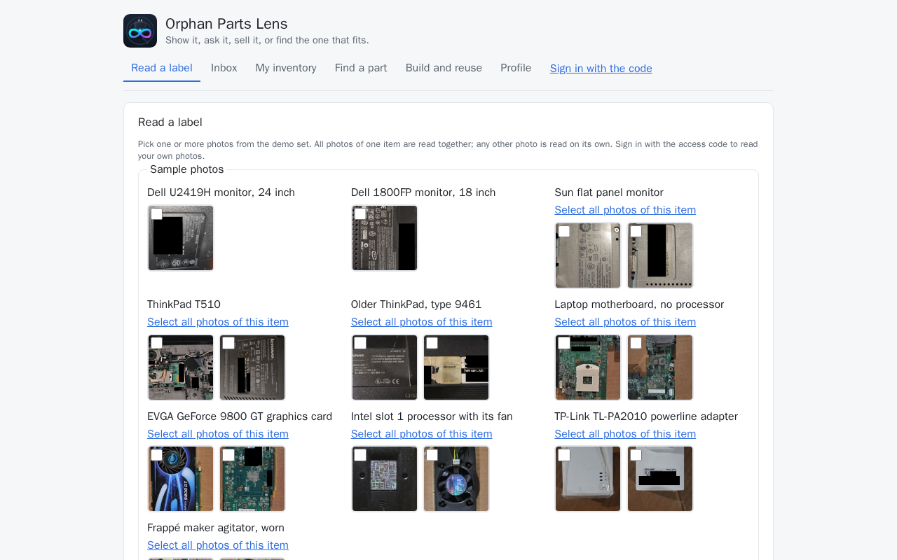

Click **Sign in with the code**, type the master code, **Enter**.

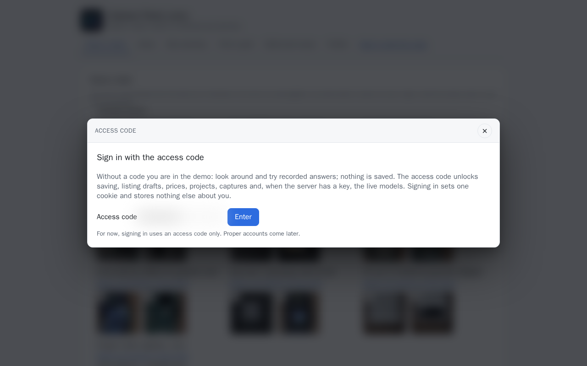

Signed in, the header shows **Sign out**, **Read a label** takes your own photos, and the
footer counts the day's live calls.

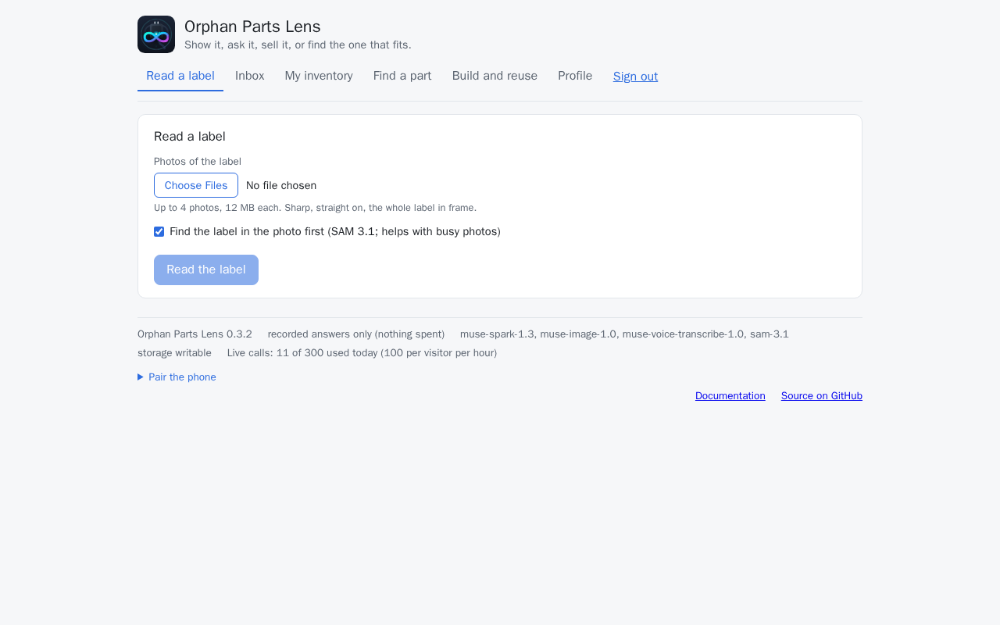

**Sign out**, in the same place, ends the session; the page is the demo again.

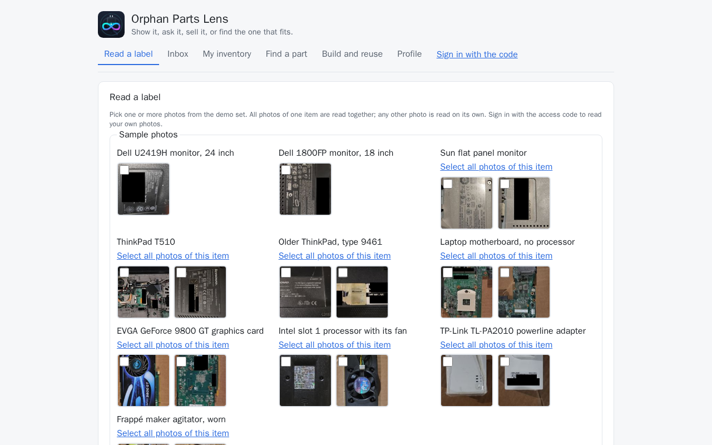

`./dev gate show` prints the master code again; `./dev gate off` removes the gate.

## 7. Put the app on the phone

### From the phone's browser

1. On the phone, open
   `https://github.com/nikolareljin/orphan-parts/releases/latest/download/orphan-parts.apk`,
   or scan this QR code with the camera:<br>
   
2. Open the download. Android asks before installing an app from outside Google Play: tap
   **Settings**, turn on **Allow from this source** for the browser, go back, tap **Install**.
   If Play Protect warns about an unknown developer: **More details**, **Install anyway**.
3. **Open**. The app starts on its **Backend** tab.

Every prompt on the way, and the Play Protect scan afterwards:
[For judges](judges.md#install-the-android-app).

### Over a USB cable

Use this when the phone's browser refuses the download, or to install a build of your own.

**Turn on Developer options and USB debugging** (once per phone; the names are Samsung's,
other makers differ a little):

1. **Settings**, **About phone**, **Software information** (on Pixel and most others, **About
   phone** directly).
2. Tap **Build number** seven times. The phone asks for its PIN, then says *Developer mode has
   been turned on*.
3. Back in **Settings**, open **Developer options** (at the bottom of the list; on Pixel under
   **System**) and turn on **USB debugging**.
4. On a Samsung phone with One UI 6 or newer: **Settings**, **Security and privacy**, **Auto
   Blocker** must be off. While it is on, it blocks commands over USB and the install fails.
5. Connect the cable. If the phone asks what the USB connection is for, choose **File
   transfer**.
6. The phone shows **Allow USB debugging?** with the computer's RSA key fingerprint: tick
   **Always allow from this computer** and tap **Allow**. Without that answer the computer
   sees the phone as *unauthorized*.

**Install from the computer**, from the repository's folder:

```bash
bash scripts/phone-install.sh            # macOS, Linux, WSL
```

```powershell
powershell -ExecutionPolicy Bypass -File scripts\phone-install.ps1   # Windows
```

The script finds `adb` (or downloads Google's platform-tools, about 10 MB), downloads the
latest release's APK, installs it and opens the app. `--apk file.apk` installs a file you
already have.

To build the app from this checkout instead, with the stack up:

```bash
./dev setup --android    # a JDK and the Android command-line tools, once
./dev phone              # builds the app, installs it over USB, opens it, prints the pairing code
```

## 8. Pair the phone

The phone reaches the computer over the Wi-Fi, never at `localhost` (on the phone,
`localhost` is the phone).

1. Put the phone on the **same Wi-Fi** as the computer.
2. Find the computer's address: `hostname -I` (Linux, WSL),
   `ipconfig getifaddr en0` (macOS), `ipconfig` (Windows, the Wi-Fi adapter's IPv4 address).
   If the wrong one is picked, set `LAN_ADDRESS` in `.env`.
3. On the computer, open the web app at that address, for example `http://192.168.1.20:5173`,
   and sign in there (the session is per address).
4. At the foot of the page, open **Pair the phone**. A QR code appears, and under it
   *Or type http://…:5173 into the app.*

    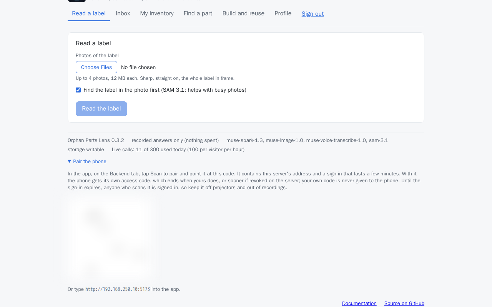

5. In the app, on the **Backend** tab, tap **Scan to pair** and point the camera at the code.
   Signed in, the phone gets an access code of its own from that scan.

    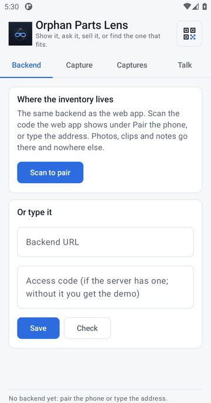{ width=300 }

    Without Google Play services, or without a second screen: type the address from under the QR
    code into **Backend URL**, the phone's code from `./dev gate on` into the field under it
    (leave it empty when the gate is off), then **Save**.

    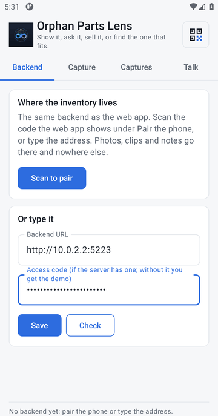{ width=300 }

6. Tap **Check**. It answers **Backend ok, Model API fixture, …** (`live` with a key) and ends
   with **The code opens it.** when the code is right.

    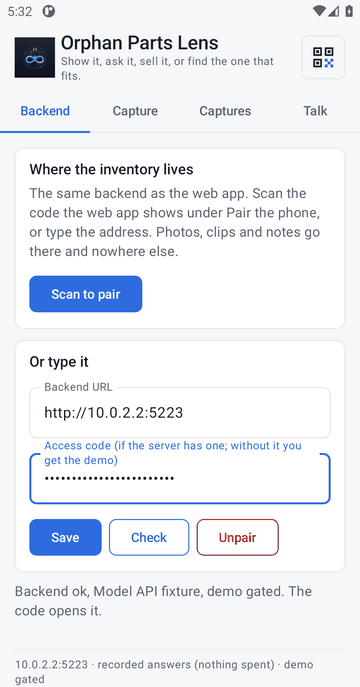{ width=300 }

7. On the **Capture** tab, **Take a photo**, then **Send**. The status line says
   **Sent as capture #1**.

    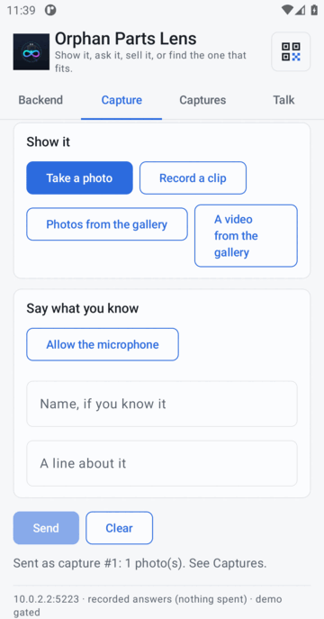{ width=300 }

8. On the web app, **Inbox** lists the capture. **Read it** turns it into an item.

    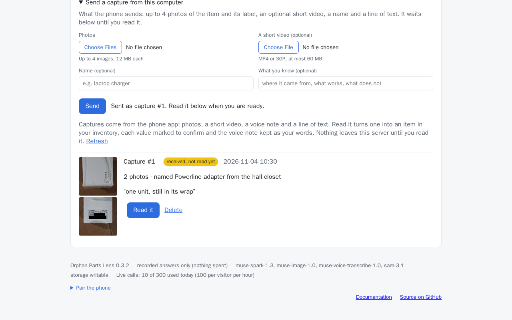

Each screen, and every message the app can answer with:
[Pair the phone with the web app](pairing.md).

## 9. Try every flow

The [Demo walkthrough](demo.md) and the [Guides](../guides/capture.md) go through each page
step by step, with a picture of each. All of them work on this local stack: the demo set's
items, search and projects are there after `./dev demo`, and every step that calls a model
answers from its recording when `OPL_FAKE_API=1`.

## When something does not work

| What you see | What to do |
|---|---|
| `docker is not running` | Start Docker Desktop (or `sudo systemctl start docker`), then `./dev up` again |
| `ports in use` / `free the ports above` | Something else listens on 5173 or 8000: stop it, or `FRONTEND_PORT=5174 BACKEND_PORT=8001 ./dev up` |
| The footer says *Cannot reach the server* | The backend is still starting or failed: `./dev logs backend` |
| The page opens on the computer, **Check** on the phone says **Not reachable** | The phone is on another network (a guest Wi-Fi, mobile data), the address is the wrong one (`LAN_ADDRESS`), or the computer's firewall blocks port 5173: allow it for the private network (Windows: when Windows Defender Firewall asks, tick **Private networks**; Linux with ufw: `sudo ufw allow 5173/tcp`) |
| The app: **that code points at localhost** | The page was opened at `localhost`: open it at the computer's address and scan again |
| Under WSL, the phone cannot reach the WSL address | The phone needs the Windows host's Wi-Fi address: set `LAN_ADDRESS` to it and forward port 5173 from Windows to WSL (`netsh interface portproxy add v4tov4 listenport=5173 connectport=5173 connectaddress=<WSL address>`) |
| `phone-install`: **no phone found** | A cable that carries data, **USB debugging** on, **File transfer** chosen; on Windows the maker's USB driver |
| `phone-install`: **the phone has not allowed this computer** (`adb devices` says *unauthorized*) | Unlock the phone and answer **Allow USB debugging?** with **Always allow**; if it never shows, **Developer options**, **Revoke USB debugging authorizations**, unplug and plug in again |
| The install over USB fails on a Samsung phone | **Auto Blocker** is on: **Settings**, **Security and privacy**, **Auto Blocker**, off; turn it back on afterwards |
| **App not installed** | An older release is on the phone under another key: uninstall it, install again |
| **Check**: **The code is refused** | A mistyped or ended code: `./dev gate on` issues a fresh one for the phone |
| A reading says *recorded answer* for a photo of your own | The stack is in recorded mode: set `MODEL_API_KEY`, `OPL_FAKE_API=0`, then `./dev up` |

More: [Troubleshooting](../operations/troubleshooting.md), and the app's own messages under
[For judges](judges.md#if-something-does-not-work).
