# Pair the phone with the web app

The Android app sends photos, clips and notes to the same backend the web app talks to. Pairing
tells the app where that backend is and, when the page is signed in, gives the phone an access
code of its own. The screens below come from a stack running on a computer with the gate on,
in fixture mode (recorded answers, nothing spent), and from the app on an Android emulator.
The hosted site looks the same; where these say `fixture`, its footer and **Check** on the
phone say `live for the code, recorded otherwise`.

The address in the pictures is the computer's network address with the port the stack was
started on. The hosted site's address is `https://orphan-parts.pages.dev`.

## 1. Open the web app and sign in

Open the hosted site, or a local stack at the computer's network address (for example
`http://192.168.1.20:5173`; not `localhost`, which on the phone is the phone). While the
server has a gate and the page is not signed in, the header ends with **Sign in with the
code**, and the foot of the page says `demo: recorded answers; the code unlocks saving`.

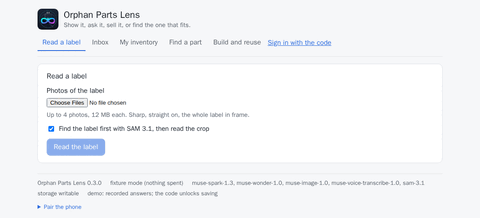{ width=480 }

Tap **Sign in with the code**, type the access code, **Enter**.

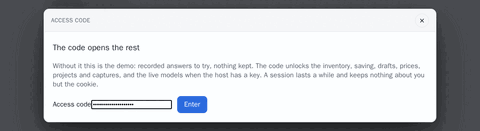{ width=480 }

Signed in, the link is gone from the header and the footer counts the day's calls instead:
`demo: 0 of 300 calls today, 20 per visitor and hour`. The inventory is the full one now, not
the public items only.

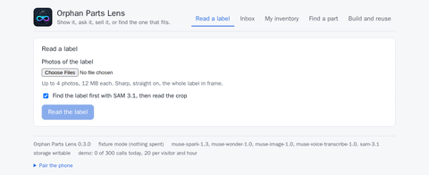{ width=480 }

## 2. Open Pair the phone

At the foot of the page, open **Pair the phone**. A QR code is drawn, with the address under it
(`Or type http://… into the app.`), and a line that says what the code carries.

**Signed in,** the code carries the address and a pairing good for a few minutes (fifteen on a
default server). With it the phone claims an access code of its own; that code stays on the
phone and ends with the code the page was signed in with, or sooner when revoked on the
server. For those minutes the code is a live credential: anyone who scans it is signed in, so
keep it off a projector and out of a recording. The page draws a fresh code each time the
section is opened, and again before the pairing in it ends.

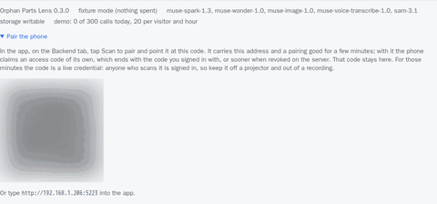{ width=480 }

*The QR code in this picture is blurred: it carried a live pairing when the screen was taken.*

**Signed out,** the code carries the address alone: the phone joins as the demo. The line under
the heading says so, and asks for a sign-in first when the phone should get a code of its own.

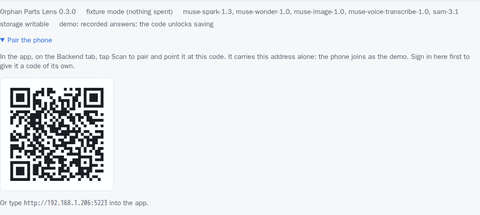{ width=480 }

On a phone's browser the same section stacks: the line, the code, the address. Scanning a code
shown on the phone's own screen takes a second device; the typed path in step 4 does not.

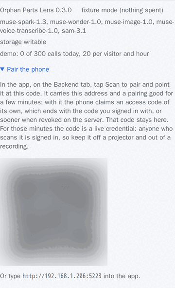{ width=300 }

A page opened at `localhost` shows no code. It says why: the code would carry an address the
phone cannot reach, and names the two ways out (the computer's network address, or
`./dev phone`, which prints a code with that address).

## 3. Scan to pair

In the app (installed as [On your phone in ten minutes](judges.md) says), open the **Backend**
tab. Its first card is **Where the inventory lives**, with **Scan to pair**; the icon at the
top right of every tab opens the same scanner.

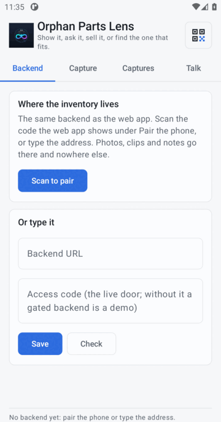{ width=300 }

Tap **Scan to pair** and point the camera at the code. The scanner is Google's, over the
phone's camera, so it needs Google Play services and a second screen to point at; the emulator
these screens come from has neither, which is why the scanner's own screen is not pictured and
the next screens show the typed path. What the app says after a scan:

- From a signed-in page: **Paired with http://…; this phone now has a code of its own (phone
  …, until …)**. The label and the end date are shown, never the code itself.
- From a page that is not signed in: **Paired with http://… as the demo visitor: nothing it
  sends is kept. Sign in on the web app and scan its code to give this phone a code of its
  own.**
- From a page open at `localhost`: **Could not pair: that code points at localhost, which on
  the phone is the phone itself.**

Then tap **Check**. With a code of its own the answer is **Backend ok, Model API live for the
code, recorded otherwise, demo gated. The phone's own code (phone …, until …) opens it.**
(`Model API fixture` on a stack in fixture mode.) The phone's code lasts thirty days, or until the code that paired it ends if
that is sooner; one access code pairs at most ten phones. The tab names the code the phone
holds, by label and end date, and how to end it on the server.

## 4. Type the address instead

Without Google Play services, or without a second screen to show the code on, type what the
code carries. On the **Backend** tab, under **Or type it**: the address from under the QR code
into **Backend URL**, the access code into the field under it, then **Save**. The code is shown
as dots while it is typed.

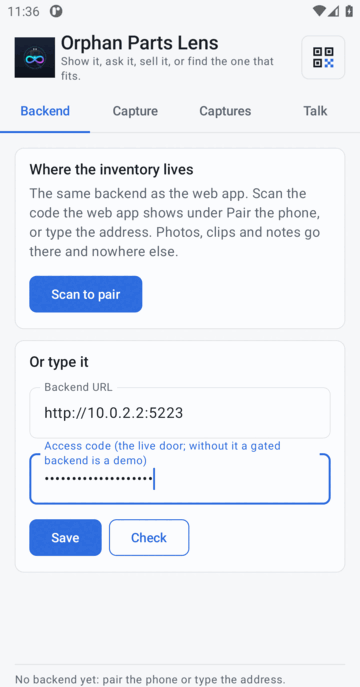{ width=300 }

Tap **Check**. The answer ends with **The code opens it.** A wrong or expired code answers
**The code is refused.**; an address the phone cannot reach answers **Not reachable**. The line
at the foot of every tab names the backend and its mode from then on.

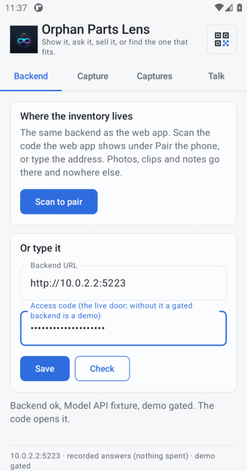{ width=300 }

Typed this way the phone keeps the access code itself; a later scan of a signed-in page
replaces it with a code of the phone's own.

## 5. Send a photo

On the **Capture** tab, **Take a photo** opens the camera; the photo comes back as a thumbnail
under the buttons, and the status line says it is ready.

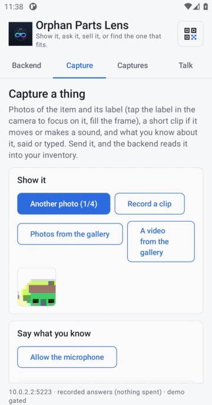{ width=300 }

Scroll down and tap **Send**. The status line says **Sent as capture #1: 1 photo(s). See
Captures.**

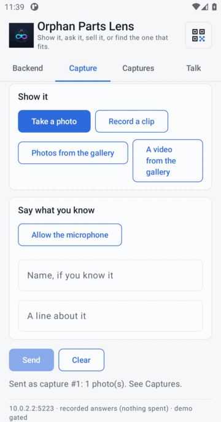{ width=300 }

On the web app, **Inbox** lists the capture, received and not read yet, with its photo.
**Read it** turns it into an item in the inventory.

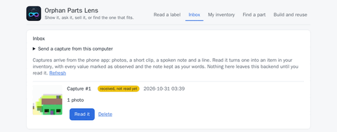{ width=480 }

## With the code and without it

The server has two doors. Which one a visitor is behind decides what the web app and the phone
show and keep.

**Without the code** the web app and the phone are the demo. The pages all open. **My
inventory** lists the items the owner marked public (the demo set loads as public), with their
values, photos and drawn pictures, and never a clip, a note, a location or a draft. A try
(**Read a label**, a crop, **Does it fit?** on values typed in, a measurement) is answered from
the recorded set, whatever the photo, and no live model is called. Nothing is kept: every save,
draft, price, project, picture and capture is refused with one line, `demo: the code unlocks
saving, drafts, prices, projects and captures`. A phone paired from a page that was not signed in is the same visitor: **Check** says
**Without the code this phone is the demo visitor: nothing it sends is kept.** Each visitor has
an hourly allowance of calls (`20 per visitor and hour` on a default server) and the server a
daily one.

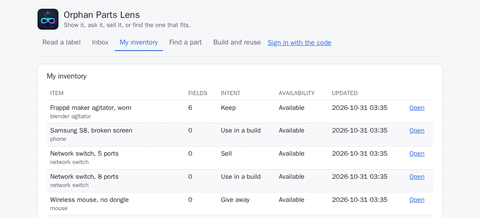{ width=480 }

**With the code** the session is signed in for twelve hours on a default server, and the
cookie is all it keeps about the visitor. Your own photos are read, by the live models when
the server has a key (the hosted one does), and the result is saved: the full inventory,
drafts, prices, projects, drawn pictures, and the captures the phone sends. The phone holds a
code of its own after a scan of a signed-in page, or the typed access code, and is through the
same door. What is kept and for how long is on [Privacy](../operations/privacy.md); the codes,
their lifetimes and how to revoke one are on [Demo access](../operations/demo-access.md).

| | Without the code | With the code |
|---|---|---|
| Inventory | The public demo items | Everything, yours included |
| A label read, a crop, a fit, a measurement | Recorded answers, whatever the photo | Your photos, read by the live models when the server has a key |
| Saving, drafts, prices, projects, pictures | Refused | Kept |
| Captures from the phone | Refused | In the Inbox |
| What the server keeps about you | Nothing | The session cookie |
